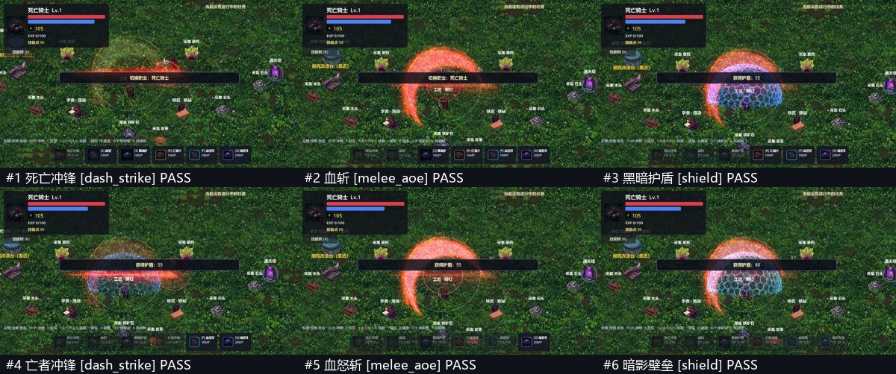

# 《通天入地》全角色 · 全技能实测图文报告

> 测试日期：2026-11-22（GMT+8）  
> 引擎：4.7.2-stable (official)（Windows，OpenGL 3.3 Compatibility，1280×720 真实窗口渲染）  
> 覆盖范围：**16 职业 × 每人 6 技能 = 96 项技能** + 全功能断言  
> 测试性质：通过公开接口驱动游戏，不修改游戏逻辑/数值表

---

## 1. 执行摘要

| 测试项 | 结果 | 说明 |
|---|---|---|
| 静态结构校验 | ✅ PASS | 0 错误 / 0 警告（`python tools/validate_project.py`） |
| 功能断言 | ✅ 184/184 | 0 项失败 |
| 逐技能实测 | ✅ 96/96 | 16 职业 × 6 技能 |
| 截图证据 | ✅ 114 张 | 技能 96 张 + 功能 18 张 |
| 操作视频帧 | ✅ 69 帧 | 记录主菜单/战斗/UI/塔层操作 |

**总评**：96 个技能全部实际施放并产生预期效果，MP 扣除、冷却进入、VFX 生成、专属效果（伤害/治疗/Buff/护盾/位移）四项校验全部通过；功能断言 184/184 通过。详见第 6 节问题与处置。

### 技能类型覆盖

| 技能类型 | 数量 | 验证要点 |
|---|---|---|
| `melee_aoe` | 21 | 范围伤害 + 近战发光特效 + 伤害数字 |
| `buff` | 21 | Buff 入栈 + 目标属性提升 |
| `aoe_zone` | 14 | 延迟结算区域伤害 |
| `shield` | 13 | 护盾值增加 + 优先吸收 |
| `projectile` | 10 | 弹道飞行命中 |
| `heal` | 8 | 实际回血 + 治疗飘字 |
| `chain` | 5 | 连锁命中多目标 |
| `dash_strike` | 4 | 角色位移 + 路径伤害 |

---

## 2. 测试方法与复现

```bash
cd C:/Users/l/Documents/GitHub/game/通天入地
python tools/validate_project.py
"/c/Godot_v4.7.2-stable_win64.exe/Godot_v4.7.2-stable_win64_console.exe" --headless --editor --path . --quit-after 600   # 资源预导入
"/c/Godot_v4.7.2-stable_win64.exe/Godot_v4.7.2-stable_win64_console.exe" --path . --resolution 1280x720 res://tools/char_skill_audit.tscn
python tools/build_char_skill_report.py
```

技能测试统一流程：切出目标职业 → 清空干扰敌人 → 满蓝/清冷却/清 Buff → 按技能类型在有效范围放置 3000 HP 木桩 → 施放 → 断言 MP 扣除、CD 进入、VFX 节点生成与专属效果。进阶技能通过技能树接口解锁前置后实测（仅测试环境解锁，不改数据表）。

---

## 3. 全角色总览（16 职业）


| ID | 头像 | 名称 | 来源/定位 | HP | MP | 物攻 | 魔攻 | 暴击 | 技能 | 实测 |
|---|---|---|---|---|---|---|---|---|---|---|
| `mage` |  | 法师 | 法术 / 破军 | 75 | 130 | 6 | 22 | 6% | 6 | ✅ |
| `runeward` |  | 咒铠师 | 法术 / 铁壁 | 135 | 110 | 7 | 13 | 4% | 6 | ✅ |
| `priest` |  | 牧师 | 法术 / 辅弼 | 88 | 110 | 8 | 14 | 4% | 6 | ✅ |
| `necromancer` |  | 亡灵法师 | 法术 / 诡道 | 80 | 120 | 7 | 20 | 6% | 6 | ✅ |
| `bomber` |  | 炸弹专家 | 机械 / 破军 | 105 | 70 | 16 | 9 | 6% | 6 | ✅ |
| `mech_pilot` |  | 机甲师 | 机械 / 铁壁 | 180 | 70 | 13 | 8 | 4% | 6 | ✅ |
| `engineer` |  | 工程师 | 机械 / 辅弼 | 105 | 115 | 9 | 10 | 5% | 6 | ✅ |
| `bounty_hunter` |  | 赏金猎人 | 机械 / 诡道 | 100 | 70 | 17 | 6 | 8% | 6 | ✅ |
| `death_knight` |  | 死亡骑士 | 传武 / 破军 | 145 | 70 | 16 | 8 | 6% | 6 | ✅ |
| `warrior` |  | 战士 | 传武 / 铁壁 | 150 | 50 | 15 | 4 | 5% | 6 | ✅ |
| `qi_adept` |  | 气宗 | 传武 / 辅弼 | 108 | 100 | 10 | 11 | 6% | 6 | ✅ |
| `thief` |  | 小偷 | 传武 / 诡道 | 82 | 55 | 13 | 4 | 12% | 6 | ✅ |
| `archer` |  | 弓箭手 | 科技 / 破军 | 95 | 60 | 18 | 5 | 10% | 6 | ✅ |
| `cyborg` |  | 义体卫士 | 科技 / 铁壁 | 165 | 80 | 15 | 6 | 6% | 6 | ✅ |
| `hacker` |  | 黑客 | 科技 / 辅弼 | 70 | 135 | 6 | 18 | 7% | 6 | ✅ |
| `sniper` |  | 狙击手 | 科技 / 诡道 | 86 | 50 | 25 | 4 | 20% | 6 | ✅ |

> 头像取自 `assets/portraits/`；实测列 = 该职业 6 项技能断言全通过。

---

## 4. 逐职业技能实测明细（96/96 通过）

> 96 技能一图总览：[skill_contact_sheet_96.jpg](skill_contact_sheet_96.jpg)  
> 单张原图目录：`skills/`；每职业 3×2 拼图：`class_sheets/`

### 法师 · 元素爆发：以太塑形，远距离高倍率法术是主要伤害来源。（`mage`）


| 槽 | 技能（点击查看截图） | 类型 | 结果 | 关键观测（MP / CD / VFX / 效果） |
|---|---|---|---|---|
| 1 | [火球术](skills/01_mage_fireball.jpg) | `projectile` | ✅ | projectile; MP 130->120; CD=1.34; VFX=1; DummyHP 3000 -> 2948 |
| 2 | [冰霜新星](skills/02_mage_frost_nova.jpg) | `melee_aoe` | ✅ | melee_aoe; MP 130->112; CD=5.32; VFX=1; DummyHP 3000 -> 2959 |
| 3 | [奥术护盾](skills/03_mage_arcane_shield.jpg) | `shield` | ✅ | shield; MP 130->110; CD=10.72; VFX=2; Shield 0 -> 60 |
| 4 | [陨星术](skills/04_mage_meteor.jpg) | `aoe_zone` | ✅ | aoe_zone; MP 130->102; CD=12.92; VFX=3; DummyHP 3000 -> 2938 |
| 5 | [绝对零度](skills/05_mage_absolute_zero.jpg) | `melee_aoe` | ✅ | melee_aoe; MP 130->108; CD=9.90; VFX=1; DummyHP 3000 -> 2954 |
| 6 | [奥术洪流](skills/06_mage_arcane_surge.jpg) | `shield` | ✅ | shield; MP 130->106; CD=17.92; VFX=2; Shield 0 -> 95 |

### 咒铠师 · 符文装甲：用咒文护盾吸收伤害并反噬近身之敌。（`runeward`）


| 槽 | 技能（点击查看截图） | 类型 | 结果 | 关键观测（MP / CD / VFX / 效果） |
|---|---|---|---|---|
| 1 | [符盾](skills/07_runeward_rune_shield.jpg) | `shield` | ✅ | shield; MP 110->94; CD=10.70; VFX=3; Shield 0 -> 60 |
| 2 | [符爆](skills/08_runeward_rune_burst.jpg) | `melee_aoe` | ✅ | melee_aoe; MP 110->98; CD=4.42; VFX=3; DummyHP 3000 -> 2977 |
| 3 | [咒护](skills/09_runeward_rune_aura.jpg) | `buff` | ✅ | buff; MP 110->96; CD=12.50; VFX=3; Buff[defense] found=true attack 7 -> 7 |
| 4 | [反噬符文](skills/10_runeward_rune_reflect.jpg) | `shield` | ✅ | shield; MP 110->88; CD=17.90; VFX=4; Shield 0 -> 90 |
| 5 | [符文禁锢](skills/11_runeward_rune_prison.jpg) | `aoe_zone` | ✅ | aoe_zone; MP 110->90; CD=10.90; VFX=4; DummyHP 3000 -> 2975 |
| 6 | [符阵壁垒](skills/12_runeward_aegis_circle.jpg) | `buff` | ✅ | buff; MP 110->86; CD=19.90; VFX=1; Buff[defense] found=true attack 7 -> 7 |

### 牧师 · 神圣庇佑：治疗、圣光爆发与团队祝福三位一体。（`priest`）


| 槽 | 技能（点击查看截图） | 类型 | 结果 | 关键观测（MP / CD / VFX / 效果） |
|---|---|---|---|---|
| 1 | [治疗术](skills/13_priest_heal.jpg) | `heal` | ✅ | heal; MP 110->96; CD=3.50; VFX=2; HP 58 -> 88 (+30) |
| 2 | [神圣新星](skills/14_priest_holy_nova.jpg) | `melee_aoe` | ✅ | melee_aoe; MP 110->92; CD=6.20; VFX=3; DummyHP 3000 -> 2977 |
| 3 | [祝福](skills/15_priest_blessing.jpg) | `buff` | ✅ | buff; MP 110->94; CD=12.50; VFX=3; Buff[defense] found=true attack 8 -> 8 |
| 4 | [圣愈光辉](skills/16_priest_sanctuary.jpg) | `heal` | ✅ | heal; MP 110->78; CD=13.92; VFX=4; HP 58 -> 88 (+30) |
| 5 | [审判之光](skills/17_priest_judgement.jpg) | `melee_aoe` | ✅ | melee_aoe; MP 110->86; CD=10.90; VFX=4; DummyHP 3000 -> 2972 |
| 6 | [神圣盟约](skills/18_priest_holy_covenant.jpg) | `buff` | ✅ | buff; MP 110->88; CD=19.92; VFX=5; Buff[defense] found=true attack 8 -> 8 |

### 亡灵法师 · 生死操控：以腐蚀、墓场与噬魂维持长时间消耗战。（`necromancer`）


| 槽 | 技能（点击查看截图） | 类型 | 结果 | 关键观测（MP / CD / VFX / 效果） |
|---|---|---|---|---|
| 1 | [腐蚀箭](skills/19_necromancer_corrupt_bolt.jpg) | `projectile` | ✅ | projectile; MP 120->102; CD=1.52; VFX=2; DummyHP 3000 -> 2957 |
| 2 | [亡者领域](skills/20_necromancer_grave_field.jpg) | `aoe_zone` | ✅ | aoe_zone; MP 120->96; CD=8.02; VFX=1; DummyHP 3000 -> 2960 |
| 3 | [汲取](skills/21_necromancer_drain.jpg) | `heal` | ✅ | heal; MP 120->106; CD=7.12; VFX=1; HP 50 -> 80 (+30) |
| 4 | [腐魂连矢](skills/22_necromancer_soul_barrage.jpg) | `chain` | ✅ | chain; MP 120->98; CD=8.90; VFX=2; DummyHP 3000 -> 2972 |
| 5 | [万尸之地](skills/23_necromancer_mass_grave.jpg) | `aoe_zone` | ✅ | aoe_zone; MP 120->94; CD=14.92; VFX=2; DummyHP 3000 -> 2960 |
| 6 | [噬魂盛宴](skills/24_necromancer_soul_feast.jpg) | `heal` | ✅ | heal; MP 120->96; CD=13.90; VFX=1; HP 50 -> 80 (+30) |

### 炸弹专家 · 爆破工程：用火药与燃烧覆盖战场，追求范围清场。（`bomber`）


| 槽 | 技能（点击查看截图） | 类型 | 结果 | 关键观测（MP / CD / VFX / 效果） |
|---|---|---|---|---|
| 1 | [投掷炸弹](skills/25_bomber_throw_bomb.jpg) | `aoe_zone` | ✅ | aoe_zone; MP 70->60; CD=2.62; VFX=2; DummyHP 3000 -> 2962 |
| 2 | [爆破领域](skills/26_bomber_blast_zone.jpg) | `aoe_zone` | ✅ | aoe_zone; MP 70->50; CD=8.02; VFX=1; DummyHP 3000 -> 2983 |
| 3 | [燃烧弹](skills/27_bomber_incendiary.jpg) | `melee_aoe` | ✅ | melee_aoe; MP 70->56; CD=5.32; VFX=1; DummyHP 3000 -> 2985 |
| 4 | [集束炸弹](skills/28_bomber_cluster_bomb.jpg) | `aoe_zone` | ✅ | aoe_zone; MP 70->50; CD=8.92; VFX=2; DummyHP 3000 -> 2958 |
| 5 | [连环爆破](skills/29_bomber_chain_blast.jpg) | `aoe_zone` | ✅ | aoe_zone; MP 70->44; CD=13.92; VFX=1; DummyHP 3000 -> 2965 |
| 6 | [燃烧弹幕](skills/30_bomber_fire_barrage.jpg) | `melee_aoe` | ✅ | melee_aoe; MP 70->52; CD=8.90; VFX=1; DummyHP 3000 -> 2983 |

### 机甲师 · 重装要塞：机甲护甲与力场保证持续站桩输出。（`mech_pilot`）


| 槽 | 技能（点击查看截图） | 类型 | 结果 | 关键观测（MP / CD / VFX / 效果） |
|---|---|---|---|---|
| 1 | [重炮轰击](skills/31_mech_pilot_cannon.jpg) | `projectile` | ✅ | projectile; MP 70->60; CD=2.62; VFX=2; DummyHP 3000 -> 2967 |
| 2 | [装甲强化](skills/32_mech_pilot_armor_up.jpg) | `shield` | ✅ | shield; MP 70->58; CD=10.70; VFX=2; Shield 0 -> 70 |
| 3 | [能量护盾](skills/33_mech_pilot_energy_field.jpg) | `buff` | ✅ | buff; MP 70->56; CD=12.52; VFX=2; Buff[defense] found=true attack 13 -> 13 |
| 4 | [轨道炮](skills/34_mech_pilot_rail_cannon.jpg) | `projectile` | ✅ | projectile; MP 70->52; CD=8.92; VFX=3; DummyHP 3000 -> 2966 |
| 5 | [复合装甲](skills/35_mech_pilot_composite_armor.jpg) | `shield` | ✅ | shield; MP 70->48; CD=19.90; VFX=2; Shield 0 -> 110 |
| 6 | [力场护罩](skills/36_mech_pilot_force_field.jpg) | `buff` | ✅ | buff; MP 70->50; CD=19.90; VFX=2; Buff[defense] found=true attack 13 -> 13 |

### 工程师 · 战地工事：部署炮塔、修理与战术补给支援全队。（`engineer`）


| 槽 | 技能（点击查看截图） | 类型 | 结果 | 关键观测（MP / CD / VFX / 效果） |
|---|---|---|---|---|
| 1 | [炮塔部署](skills/37_engineer_turret.jpg) | `aoe_zone` | ✅ | aoe_zone; MP 115->99; CD=6.20; VFX=2; DummyHP 3000 -> 2982 |
| 2 | [应急修理](skills/38_engineer_repair.jpg) | `heal` | ✅ | heal; MP 115->97; CD=8.00; VFX=1; HP 75 -> 105 (+30) |
| 3 | [战术补给](skills/39_engineer_supply.jpg) | `buff` | ✅ | buff; MP 115->103; CD=10.72; VFX=2; Buff[attack] found=true attack 9 -> 17 |
| 4 | [重型炮塔](skills/40_engineer_heavy_turret.jpg) | `aoe_zone` | ✅ | aoe_zone; MP 115->91; CD=10.92; VFX=3; DummyHP 3000 -> 2980 |
| 5 | [战地整备](skills/41_engineer_field_repair.jpg) | `heal` | ✅ | heal; MP 115->85; CD=13.90; VFX=1; HP 75 -> 105 (+30) |
| 6 | [超载协议](skills/42_engineer_overdrive.jpg) | `buff` | ✅ | buff; MP 115->95; CD=15.92; VFX=2; Buff[attack_speed] found=true attack 9 -> 9 |

### 赏金猎人 · 猎杀契约：标记目标后以速射与缴械压制。（`bounty_hunter`）


| 槽 | 技能（点击查看截图） | 类型 | 结果 | 关键观测（MP / CD / VFX / 效果） |
|---|---|---|---|---|
| 1 | [连射](skills/43_bounty_hunter_rapid_fire.jpg) | `chain` | ✅ | chain; MP 70->60; CD=2.60; VFX=3; DummyHP 3000 -> 2979 |
| 2 | [追踪标记](skills/44_bounty_hunter_mark.jpg) | `buff` | ✅ | buff; MP 70->62; CD=10.70; VFX=3; Buff[attack] found=true attack 17 -> 27 |
| 3 | [缴械](skills/45_bounty_hunter_disarm.jpg) | `melee_aoe` | ✅ | melee_aoe; MP 70->58; CD=4.40; VFX=3; DummyHP 3000 -> 2970 |
| 4 | [弹幕压制](skills/46_bounty_hunter_suppression_fire.jpg) | `chain` | ✅ | chain; MP 70->52; CD=7.90; VFX=2; DummyHP 3000 -> 2973 |
| 5 | [死神标记](skills/47_bounty_hunter_death_mark.jpg) | `buff` | ✅ | buff; MP 70->56; CD=15.90; VFX=3; Buff[attack] found=true attack 17 -> 33 |
| 6 | [断腕射击](skills/48_bounty_hunter_wrist_shot.jpg) | `melee_aoe` | ✅ | melee_aoe; MP 70->54; CD=7.90; VFX=3; DummyHP 3000 -> 2963 |

### 死亡骑士 · 血怒冲锋：以自身生命为代价换取突进与范围斩击。（`death_knight`）



| 槽 | 技能（点击查看截图） | 类型 | 结果 | 关键观测（MP / CD / VFX / 效果） |
|---|---|---|---|---|
| 1 | [死亡冲锋](skills/49_death_knight_death_charge.jpg) | `dash_strike` | ✅ | dash_strike; MP 70->60; CD=4.40; VFX=2; MoveX +148 DummyHP 3000 -> 2970 |
| 2 | [血斩](skills/50_death_knight_blood_slash.jpg) | `melee_aoe` | ✅ | melee_aoe; MP 70->58; CD=3.50; VFX=2; DummyHP 3000 -> 2966 |
| 3 | [黑暗护盾](skills/51_death_knight_dark_shield.jpg) | `shield` | ✅ | shield; MP 70->54; CD=12.52; VFX=3; Shield 0 -> 55 |
| 4 | [亡者冲锋](skills/52_death_knight_grave_charge.jpg) | `dash_strike` | ✅ | dash_strike; MP 70->54; CD=8.92; VFX=3; MoveX +188 DummyHP 3000 -> 2965 |
| 5 | [血怒斩](skills/53_death_knight_blood_fury.jpg) | `melee_aoe` | ✅ | melee_aoe; MP 70->52; CD=7.92; VFX=2; DummyHP 3000 -> 2962 |
| 6 | [暗影壁垒](skills/54_death_knight_shadow_bulwark.jpg) | `shield` | ✅ | shield; MP 70->50; CD=17.90; VFX=3; Shield 0 -> 80 |

### 战士 · 铁壁反击：以高护甲与盾墙承伤，靠战吼把防御转成输出窗口。（`warrior`）


| 槽 | 技能（点击查看截图） | 类型 | 结果 | 关键观测（MP / CD / VFX / 效果） |
|---|---|---|---|---|
| 1 | [旋风斩](skills/55_warrior_whirlwind.jpg) | `melee_aoe` | ✅ | melee_aoe; MP 50->42; CD=2.62; VFX=2; DummyHP 3000 -> 2966 |
| 2 | [战吼](skills/56_warrior_war_cry.jpg) | `buff` | ✅ | buff; MP 50->40; CD=8.90; VFX=3; Buff[attack] found=true attack 15 -> 23 |
| 3 | [盾墙](skills/57_warrior_shield_wall.jpg) | `shield` | ✅ | shield; MP 50->38; CD=10.70; VFX=3; Shield 0 -> 45 |
| 4 | [裂地斩](skills/58_warrior_earth_shatter.jpg) | `melee_aoe` | ✅ | melee_aoe; MP 50->32; CD=8.90; VFX=4; DummyHP 3000 -> 2965 |
| 5 | [不屈战意](skills/59_warrior_unyielding_will.jpg) | `buff` | ✅ | buff; MP 50->34; CD=17.92; VFX=5; Buff[attack] found=true attack 15 -> 29 |
| 6 | [钢铁壁垒](skills/60_warrior_iron_bulwark.jpg) | `shield` | ✅ | shield; MP 50->30; CD=17.90; VFX=4; Shield 0 -> 85 |

### 气宗 · 内息流转：以气血循环治疗与加速，自身亦能近身打出气劲。（`qi_adept`）


| 槽 | 技能（点击查看截图） | 类型 | 结果 | 关键观测（MP / CD / VFX / 效果） |
|---|---|---|---|---|
| 1 | [气劲掌](skills/61_qi_adept_qi_palm.jpg) | `melee_aoe` | ✅ | melee_aoe; MP 100->91; CD=3.05; VFX=3; DummyHP 3000 -> 2981 |
| 2 | [内息术](skills/62_qi_adept_qi_heal.jpg) | `heal` | ✅ | heal; MP 100->82; CD=7.10; VFX=3; HP 78 -> 108 (+30) |
| 3 | [气脉流转](skills/63_qi_adept_qi_flow.jpg) | `buff` | ✅ | buff; MP 100->88; CD=10.72; VFX=3; Buff[attack_speed] found=true attack 10 -> 10 |
| 4 | [罡气爆](skills/64_qi_adept_qi_burst.jpg) | `melee_aoe` | ✅ | melee_aoe; MP 100->84; CD=6.92; VFX=4; DummyHP 3000 -> 2978 |
| 5 | [生生不息](skills/65_qi_adept_qi_renew.jpg) | `heal` | ✅ | heal; MP 100->70; CD=11.90; VFX=4; HP 78 -> 108 (+30) |
| 6 | [罡气护体](skills/66_qi_adept_qi_guard.jpg) | `shield` | ✅ | shield; MP 100->82; CD=15.92; VFX=4; Shield 0 -> 75 |

### 小偷 · 影袭毒刃：依赖背刺与烟幕在高风险窗口内爆发。（`thief`）


| 槽 | 技能（点击查看截图） | 类型 | 结果 | 关键观测（MP / CD / VFX / 效果） |
|---|---|---|---|---|
| 1 | [背刺](skills/67_thief_backstab.jpg) | `melee_aoe` | ✅ | melee_aoe; MP 55->49; CD=2.06; VFX=3; DummyHP 3000 -> 2967 |
| 2 | [烟雾弹](skills/68_thief_smoke_bomb.jpg) | `buff` | ✅ | buff; MP 55->45; CD=8.90; VFX=3; Buff[dodge_rate] found=true attack 13 -> 13 |
| 3 | [毒刃](skills/69_thief_poison_blade.jpg) | `projectile` | ✅ | projectile; MP 55->47; CD=2.60; VFX=4; DummyHP 3000 -> 2980 |
| 4 | [致命背刺](skills/70_thief_lethal_backstab.jpg) | `melee_aoe` | ✅ | melee_aoe; MP 55->41; CD=5.90; VFX=1; DummyHP 3000 -> 2964 |
| 5 | [烟幕遁形](skills/71_thief_veil_step.jpg) | `buff` | ✅ | buff; MP 55->41; CD=15.90; VFX=2; Buff[dodge_rate] found=true attack 13 -> 13 |
| 6 | [剧毒爆发](skills/72_thief_venom_burst.jpg) | `projectile` | ✅ | projectile; MP 55->39; CD=6.92; VFX=3; DummyHP 3000 -> 2993 |

### 弓箭手 · 精确投射：复合弓与瞄准镜把暴击转化为稳定输出。（`archer`）


| 槽 | 技能（点击查看截图） | 类型 | 结果 | 关键观测（MP / CD / VFX / 效果） |
|---|---|---|---|---|
| 1 | [穿透射击](skills/73_archer_piercing_shot.jpg) | `projectile` | ✅ | projectile; MP 60->54; CD=1.70; VFX=2; DummyHP 3000 -> 2964 |
| 2 | [箭雨](skills/74_archer_arrow_rain.jpg) | `aoe_zone` | ✅ | aoe_zone; MP 60->45; CD=7.12; VFX=1; DummyHP 3000 -> 2973 |
| 3 | [鹰眼](skills/75_archer_hawk_eye.jpg) | `buff` | ✅ | buff; MP 60->50; CD=10.70; VFX=1; Buff[crit_rate] found=true attack 18 -> 18 |
| 4 | [破甲贯射](skills/76_archer_armor_pierce.jpg) | `projectile` | ✅ | projectile; MP 60->48; CD=5.90; VFX=3; DummyHP 3000 -> 2955 |
| 5 | [万箭齐发](skills/77_archer_arrow_storm.jpg) | `aoe_zone` | ✅ | aoe_zone; MP 60->38; CD=11.92; VFX=1; DummyHP 3000 -> 2964 |
| 6 | [鹰眼聚焦](skills/78_archer_eagle_focus.jpg) | `buff` | ✅ | buff; MP 60->48; CD=13.90; VFX=1; Buff[crit_rate] found=true attack 18 -> 18 |

### 义体卫士 · 义体壁垒：液压与能量装甲让自身成为移动前线。（`cyborg`）


| 槽 | 技能（点击查看截图） | 类型 | 结果 | 关键观测（MP / CD / VFX / 效果） |
|---|---|---|---|---|
| 1 | [液压重拳](skills/79_cyborg_hydraulic_punch.jpg) | `melee_aoe` | ✅ | melee_aoe; MP 80->70; CD=3.50; VFX=2; DummyHP 3000 -> 2968 |
| 2 | [能量壁垒](skills/80_cyborg_energy_wall.jpg) | `shield` | ✅ | shield; MP 80->64; CD=11.60; VFX=3; Shield 0 -> 70 |
| 3 | [伺服突进](skills/81_cyborg_servo_charge.jpg) | `dash_strike` | ✅ | dash_strike; MP 80->68; CD=5.30; VFX=3; MoveX +163 DummyHP 3000 -> 2970 |
| 4 | [震荡践踏](skills/82_cyborg_seismic_slam.jpg) | `melee_aoe` | ✅ | melee_aoe; MP 80->62; CD=8.90; VFX=2; DummyHP 3000 -> 2962 |
| 5 | [神盾协议](skills/83_cyborg_aegis_protocol.jpg) | `shield` | ✅ | shield; MP 80->56; CD=17.92; VFX=3; Shield 0 -> 105 |
| 6 | [磁轨突袭](skills/84_cyborg_rail_dash.jpg) | `dash_strike` | ✅ | dash_strike; MP 80->60; CD=9.90; VFX=3; MoveX +208 DummyHP 3000 -> 2961 |

### 黑客 · 网络入侵：病毒、断电与超频改写敌我攻防节奏。（`hacker`）


| 槽 | 技能（点击查看截图） | 类型 | 结果 | 关键观测（MP / CD / VFX / 效果） |
|---|---|---|---|---|
| 1 | [病毒入侵](skills/85_hacker_virus.jpg) | `chain` | ✅ | chain; MP 135->121; CD=3.52; VFX=2; DummyHP 3000 -> 2971 |
| 2 | [EMP 脉冲](skills/86_hacker_emp_pulse.jpg) | `melee_aoe` | ✅ | melee_aoe; MP 135->117; CD=6.22; VFX=2; DummyHP 3000 -> 2968 |
| 3 | [系统过载](skills/87_hacker_overclock.jpg) | `buff` | ✅ | buff; MP 135->121; CD=10.70; VFX=3; Buff[attack] found=true attack 6 -> 18 |
| 4 | [蠕虫病毒](skills/88_hacker_worm_virus.jpg) | `chain` | ✅ | chain; MP 135->113; CD=9.90; VFX=3; DummyHP 3000 -> 2968 |
| 5 | [全域断电](skills/89_hacker_blackout.jpg) | `melee_aoe` | ✅ | melee_aoe; MP 135->113; CD=11.90; VFX=2; DummyHP 3000 -> 2966 |
| 6 | [超频协议](skills/90_hacker_overdrive_protocol.jpg) | `buff` | ✅ | buff; MP 135->113; CD=17.90; VFX=3; Buff[attack] found=true attack 6 -> 26 |

### 狙击手 · 潜行狙击：陷阱布场后以超远单发点杀关键目标。（`sniper`）


| 槽 | 技能（点击查看截图） | 类型 | 结果 | 关键观测（MP / CD / VFX / 效果） |
|---|---|---|---|---|
| 1 | [狙击](skills/91_sniper_snipe.jpg) | `projectile` | ✅ | projectile; MP 50->42; CD=3.52; VFX=3; DummyHP 3000 -> 2925 |
| 2 | [陷阱](skills/92_sniper_trap.jpg) | `aoe_zone` | ✅ | aoe_zone; MP 50->38; CD=7.12; VFX=1; DummyHP 3000 -> 2944 |
| 3 | [精准](skills/93_sniper_focus.jpg) | `buff` | ✅ | buff; MP 50->42; CD=10.70; VFX=1; Buff[crit_rate] found=true attack 25 -> 25 |
| 4 | [死神之眼](skills/94_sniper_reaper_eye.jpg) | `projectile` | ✅ | projectile; MP 50->32; CD=8.90; VFX=3; DummyHP 3000 -> 2920 |
| 5 | [爆裂陷阱](skills/95_sniper_blast_trap.jpg) | `aoe_zone` | ✅ | aoe_zone; MP 50->32; CD=11.92; VFX=1; DummyHP 3000 -> 2940 |
| 6 | [屏息专注](skills/96_sniper_steady_aim.jpg) | `buff` | ✅ | buff; MP 50->37; CD=15.90; VFX=1; Buff[crit_rate] found=true attack 25 -> 25 |

---

## 5. 功能覆盖与断言结果

| 断言 | 结果 | 详情 |
|---|---|---|
| 主菜单节点存在 | ✅ |  |
| 主菜单按钮>=5 | ✅ | buttons=7 |
| 设置面板可打开 | ✅ |  |
| 主世界场景加载 | ✅ | res://scenes/world/main_world.tscn |
| 初始队伍 3 人 | ✅ | 3 |
| 初始金币 120 | ✅ | 120 |
| 初始背包材料 | ✅ |  |
| 16 职业全部加入队伍 | ✅ | party=16 roster=16 |
| 16 职业立绘加载 | ✅ | missing=[] |
| 普攻造成伤害 | ✅ | 500 -> 482 |
| 冲刺进入冷却 | ✅ | cd=0.90 |
| 冲刺期间无敌 | ✅ |  |
| 冲刺伤害吸收 | ✅ | dealt=0 |
| 非冲刺正常受伤 | ✅ | dealt=18 |
| 法力不足不施法 | ✅ |  |
| 技能冷却阻止重复施放 | ✅ | cd=3.00 mp=42 |
| 资源点采集入包 | ✅ |  |
| 合成 iron_ingot | ✅ |  |
| 商店购买药水 | ✅ |  |
| 商店出售物品 | ✅ |  |
| 武器装备生效 | ✅ | item=weapon_sword_iron slot=weapon |
| 武器卸下回包 | ✅ |  |
| 放置建筑 | ✅ | block=stone_block count=0->1 |
| 拆除建筑并返还材料 | ✅ | count=0 refund=stone 8->7 |
| 背包打开暂停 | ✅ |  |
| 背包关闭恢复 | ✅ |  |
| 技能树面板打开 | ✅ |  |
| 朋克面板打开 | ✅ |  |
| 暂停菜单暂停游戏 | ✅ |  |
| 暂停恢复 | ✅ |  |
| 对话框显示 | ✅ |  |
| 触屏控件存在 | ✅ |  |
| 相机缩放生效 | ✅ |  |
| mage 技能数=6 | ✅ | 6 |
| 技能 mage-fireball | ✅ | projectile; MP 130->120; CD=1.34; VFX=1; DummyHP 3000 -> 2948 |
| 技能 mage-frost_nova | ✅ | melee_aoe; MP 130->112; CD=5.32; VFX=1; DummyHP 3000 -> 2959 |
| 技能 mage-arcane_shield | ✅ | shield; MP 130->110; CD=10.72; VFX=2; Shield 0 -> 60 |
| 技能 mage-meteor | ✅ | aoe_zone; MP 130->102; CD=12.92; VFX=3; DummyHP 3000 -> 2938 |
| 技能 mage-absolute_zero | ✅ | melee_aoe; MP 130->108; CD=9.90; VFX=1; DummyHP 3000 -> 2954 |
| 技能 mage-arcane_surge | ✅ | shield; MP 130->106; CD=17.92; VFX=2; Shield 0 -> 95 |
| runeward 技能数=6 | ✅ | 6 |
| 技能 runeward-rune_shield | ✅ | shield; MP 110->94; CD=10.70; VFX=3; Shield 0 -> 60 |
| 技能 runeward-rune_burst | ✅ | melee_aoe; MP 110->98; CD=4.42; VFX=3; DummyHP 3000 -> 2977 |
| 技能 runeward-rune_aura | ✅ | buff; MP 110->96; CD=12.50; VFX=3; Buff[defense] found=true attack 7 -> 7 |
| 技能 runeward-rune_reflect | ✅ | shield; MP 110->88; CD=17.90; VFX=4; Shield 0 -> 90 |
| 技能 runeward-rune_prison | ✅ | aoe_zone; MP 110->90; CD=10.90; VFX=4; DummyHP 3000 -> 2975 |
| 技能 runeward-aegis_circle | ✅ | buff; MP 110->86; CD=19.90; VFX=1; Buff[defense] found=true attack 7 -> 7 |
| priest 技能数=6 | ✅ | 6 |
| 技能 priest-heal | ✅ | heal; MP 110->96; CD=3.50; VFX=2; HP 58 -> 88 (+30) |
| 技能 priest-holy_nova | ✅ | melee_aoe; MP 110->92; CD=6.20; VFX=3; DummyHP 3000 -> 2977 |
| 技能 priest-blessing | ✅ | buff; MP 110->94; CD=12.50; VFX=3; Buff[defense] found=true attack 8 -> 8 |
| 技能 priest-sanctuary | ✅ | heal; MP 110->78; CD=13.92; VFX=4; HP 58 -> 88 (+30) |
| 技能 priest-judgement | ✅ | melee_aoe; MP 110->86; CD=10.90; VFX=4; DummyHP 3000 -> 2972 |
| 技能 priest-holy_covenant | ✅ | buff; MP 110->88; CD=19.92; VFX=5; Buff[defense] found=true attack 8 -> 8 |
| necromancer 技能数=6 | ✅ | 6 |
| 技能 necromancer-corrupt_bolt | ✅ | projectile; MP 120->102; CD=1.52; VFX=2; DummyHP 3000 -> 2957 |
| 技能 necromancer-grave_field | ✅ | aoe_zone; MP 120->96; CD=8.02; VFX=1; DummyHP 3000 -> 2960 |
| 技能 necromancer-drain | ✅ | heal; MP 120->106; CD=7.12; VFX=1; HP 50 -> 80 (+30) |
| 技能 necromancer-soul_barrage | ✅ | chain; MP 120->98; CD=8.90; VFX=2; DummyHP 3000 -> 2972 |
| 技能 necromancer-mass_grave | ✅ | aoe_zone; MP 120->94; CD=14.92; VFX=2; DummyHP 3000 -> 2960 |
| 技能 necromancer-soul_feast | ✅ | heal; MP 120->96; CD=13.90; VFX=1; HP 50 -> 80 (+30) |
| bomber 技能数=6 | ✅ | 6 |
| 技能 bomber-throw_bomb | ✅ | aoe_zone; MP 70->60; CD=2.62; VFX=2; DummyHP 3000 -> 2962 |
| 技能 bomber-blast_zone | ✅ | aoe_zone; MP 70->50; CD=8.02; VFX=1; DummyHP 3000 -> 2983 |
| 技能 bomber-incendiary | ✅ | melee_aoe; MP 70->56; CD=5.32; VFX=1; DummyHP 3000 -> 2985 |
| 技能 bomber-cluster_bomb | ✅ | aoe_zone; MP 70->50; CD=8.92; VFX=2; DummyHP 3000 -> 2958 |
| 技能 bomber-chain_blast | ✅ | aoe_zone; MP 70->44; CD=13.92; VFX=1; DummyHP 3000 -> 2965 |
| 技能 bomber-fire_barrage | ✅ | melee_aoe; MP 70->52; CD=8.90; VFX=1; DummyHP 3000 -> 2983 |
| mech_pilot 技能数=6 | ✅ | 6 |
| 技能 mech_pilot-cannon | ✅ | projectile; MP 70->60; CD=2.62; VFX=2; DummyHP 3000 -> 2967 |
| 技能 mech_pilot-armor_up | ✅ | shield; MP 70->58; CD=10.70; VFX=2; Shield 0 -> 70 |
| 技能 mech_pilot-energy_field | ✅ | buff; MP 70->56; CD=12.52; VFX=2; Buff[defense] found=true attack 13 -> 13 |
| 技能 mech_pilot-rail_cannon | ✅ | projectile; MP 70->52; CD=8.92; VFX=3; DummyHP 3000 -> 2966 |
| 技能 mech_pilot-composite_armor | ✅ | shield; MP 70->48; CD=19.90; VFX=2; Shield 0 -> 110 |
| 技能 mech_pilot-force_field | ✅ | buff; MP 70->50; CD=19.90; VFX=2; Buff[defense] found=true attack 13 -> 13 |
| engineer 技能数=6 | ✅ | 6 |
| 技能 engineer-turret | ✅ | aoe_zone; MP 115->99; CD=6.20; VFX=2; DummyHP 3000 -> 2982 |
| 技能 engineer-repair | ✅ | heal; MP 115->97; CD=8.00; VFX=1; HP 75 -> 105 (+30) |
| 技能 engineer-supply | ✅ | buff; MP 115->103; CD=10.72; VFX=2; Buff[attack] found=true attack 9 -> 17 |
| 技能 engineer-heavy_turret | ✅ | aoe_zone; MP 115->91; CD=10.92; VFX=3; DummyHP 3000 -> 2980 |
| 技能 engineer-field_repair | ✅ | heal; MP 115->85; CD=13.90; VFX=1; HP 75 -> 105 (+30) |
| 技能 engineer-overdrive | ✅ | buff; MP 115->95; CD=15.92; VFX=2; Buff[attack_speed] found=true attack 9 -> 9 |
| bounty_hunter 技能数=6 | ✅ | 6 |
| 技能 bounty_hunter-rapid_fire | ✅ | chain; MP 70->60; CD=2.60; VFX=3; DummyHP 3000 -> 2979 |
| 技能 bounty_hunter-mark | ✅ | buff; MP 70->62; CD=10.70; VFX=3; Buff[attack] found=true attack 17 -> 27 |
| 技能 bounty_hunter-disarm | ✅ | melee_aoe; MP 70->58; CD=4.40; VFX=3; DummyHP 3000 -> 2970 |
| 技能 bounty_hunter-suppression_fire | ✅ | chain; MP 70->52; CD=7.90; VFX=2; DummyHP 3000 -> 2973 |
| 技能 bounty_hunter-death_mark | ✅ | buff; MP 70->56; CD=15.90; VFX=3; Buff[attack] found=true attack 17 -> 33 |
| 技能 bounty_hunter-wrist_shot | ✅ | melee_aoe; MP 70->54; CD=7.90; VFX=3; DummyHP 3000 -> 2963 |
| death_knight 技能数=6 | ✅ | 6 |
| 技能 death_knight-death_charge | ✅ | dash_strike; MP 70->60; CD=4.40; VFX=2; MoveX +148 DummyHP 3000 -> 2970 |
| 技能 death_knight-blood_slash | ✅ | melee_aoe; MP 70->58; CD=3.50; VFX=2; DummyHP 3000 -> 2966 |
| 技能 death_knight-dark_shield | ✅ | shield; MP 70->54; CD=12.52; VFX=3; Shield 0 -> 55 |
| 技能 death_knight-grave_charge | ✅ | dash_strike; MP 70->54; CD=8.92; VFX=3; MoveX +188 DummyHP 3000 -> 2965 |
| 技能 death_knight-blood_fury | ✅ | melee_aoe; MP 70->52; CD=7.92; VFX=2; DummyHP 3000 -> 2962 |
| 技能 death_knight-shadow_bulwark | ✅ | shield; MP 70->50; CD=17.90; VFX=3; Shield 0 -> 80 |
| warrior 技能数=6 | ✅ | 6 |
| 技能 warrior-whirlwind | ✅ | melee_aoe; MP 50->42; CD=2.62; VFX=2; DummyHP 3000 -> 2966 |
| 技能 warrior-war_cry | ✅ | buff; MP 50->40; CD=8.90; VFX=3; Buff[attack] found=true attack 15 -> 23 |
| 技能 warrior-shield_wall | ✅ | shield; MP 50->38; CD=10.70; VFX=3; Shield 0 -> 45 |
| 技能 warrior-earth_shatter | ✅ | melee_aoe; MP 50->32; CD=8.90; VFX=4; DummyHP 3000 -> 2965 |
| 技能 warrior-unyielding_will | ✅ | buff; MP 50->34; CD=17.92; VFX=5; Buff[attack] found=true attack 15 -> 29 |
| 技能 warrior-iron_bulwark | ✅ | shield; MP 50->30; CD=17.90; VFX=4; Shield 0 -> 85 |
| qi_adept 技能数=6 | ✅ | 6 |
| 技能 qi_adept-qi_palm | ✅ | melee_aoe; MP 100->91; CD=3.05; VFX=3; DummyHP 3000 -> 2981 |
| 技能 qi_adept-qi_heal | ✅ | heal; MP 100->82; CD=7.10; VFX=3; HP 78 -> 108 (+30) |
| 技能 qi_adept-qi_flow | ✅ | buff; MP 100->88; CD=10.72; VFX=3; Buff[attack_speed] found=true attack 10 -> 10 |
| 技能 qi_adept-qi_burst | ✅ | melee_aoe; MP 100->84; CD=6.92; VFX=4; DummyHP 3000 -> 2978 |
| 技能 qi_adept-qi_renew | ✅ | heal; MP 100->70; CD=11.90; VFX=4; HP 78 -> 108 (+30) |
| 技能 qi_adept-qi_guard | ✅ | shield; MP 100->82; CD=15.92; VFX=4; Shield 0 -> 75 |
| thief 技能数=6 | ✅ | 6 |
| 技能 thief-backstab | ✅ | melee_aoe; MP 55->49; CD=2.06; VFX=3; DummyHP 3000 -> 2967 |
| 技能 thief-smoke_bomb | ✅ | buff; MP 55->45; CD=8.90; VFX=3; Buff[dodge_rate] found=true attack 13 -> 13 |
| 技能 thief-poison_blade | ✅ | projectile; MP 55->47; CD=2.60; VFX=4; DummyHP 3000 -> 2980 |
| 技能 thief-lethal_backstab | ✅ | melee_aoe; MP 55->41; CD=5.90; VFX=1; DummyHP 3000 -> 2964 |
| 技能 thief-veil_step | ✅ | buff; MP 55->41; CD=15.90; VFX=2; Buff[dodge_rate] found=true attack 13 -> 13 |
| 技能 thief-venom_burst | ✅ | projectile; MP 55->39; CD=6.92; VFX=3; DummyHP 3000 -> 2993 |
| archer 技能数=6 | ✅ | 6 |
| 技能 archer-piercing_shot | ✅ | projectile; MP 60->54; CD=1.70; VFX=2; DummyHP 3000 -> 2964 |
| 技能 archer-arrow_rain | ✅ | aoe_zone; MP 60->45; CD=7.12; VFX=1; DummyHP 3000 -> 2973 |
| 技能 archer-hawk_eye | ✅ | buff; MP 60->50; CD=10.70; VFX=1; Buff[crit_rate] found=true attack 18 -> 18 |
| 技能 archer-armor_pierce | ✅ | projectile; MP 60->48; CD=5.90; VFX=3; DummyHP 3000 -> 2955 |
| 技能 archer-arrow_storm | ✅ | aoe_zone; MP 60->38; CD=11.92; VFX=1; DummyHP 3000 -> 2964 |
| 技能 archer-eagle_focus | ✅ | buff; MP 60->48; CD=13.90; VFX=1; Buff[crit_rate] found=true attack 18 -> 18 |
| cyborg 技能数=6 | ✅ | 6 |
| 技能 cyborg-hydraulic_punch | ✅ | melee_aoe; MP 80->70; CD=3.50; VFX=2; DummyHP 3000 -> 2968 |
| 技能 cyborg-energy_wall | ✅ | shield; MP 80->64; CD=11.60; VFX=3; Shield 0 -> 70 |
| 技能 cyborg-servo_charge | ✅ | dash_strike; MP 80->68; CD=5.30; VFX=3; MoveX +163 DummyHP 3000 -> 2970 |
| 技能 cyborg-seismic_slam | ✅ | melee_aoe; MP 80->62; CD=8.90; VFX=2; DummyHP 3000 -> 2962 |
| 技能 cyborg-aegis_protocol | ✅ | shield; MP 80->56; CD=17.92; VFX=3; Shield 0 -> 105 |
| 技能 cyborg-rail_dash | ✅ | dash_strike; MP 80->60; CD=9.90; VFX=3; MoveX +208 DummyHP 3000 -> 2961 |
| hacker 技能数=6 | ✅ | 6 |
| 技能 hacker-virus | ✅ | chain; MP 135->121; CD=3.52; VFX=2; DummyHP 3000 -> 2971 |
| 技能 hacker-emp_pulse | ✅ | melee_aoe; MP 135->117; CD=6.22; VFX=2; DummyHP 3000 -> 2968 |
| 技能 hacker-overclock | ✅ | buff; MP 135->121; CD=10.70; VFX=3; Buff[attack] found=true attack 6 -> 18 |
| 技能 hacker-worm_virus | ✅ | chain; MP 135->113; CD=9.90; VFX=3; DummyHP 3000 -> 2968 |
| 技能 hacker-blackout | ✅ | melee_aoe; MP 135->113; CD=11.90; VFX=2; DummyHP 3000 -> 2966 |
| 技能 hacker-overdrive_protocol | ✅ | buff; MP 135->113; CD=17.90; VFX=3; Buff[attack] found=true attack 6 -> 26 |
| sniper 技能数=6 | ✅ | 6 |
| 技能 sniper-snipe | ✅ | projectile; MP 50->42; CD=3.52; VFX=3; DummyHP 3000 -> 2925 |
| 技能 sniper-trap | ✅ | aoe_zone; MP 50->38; CD=7.12; VFX=1; DummyHP 3000 -> 2944 |
| 技能 sniper-focus | ✅ | buff; MP 50->42; CD=10.70; VFX=1; Buff[crit_rate] found=true attack 25 -> 25 |
| 技能 sniper-reaper_eye | ✅ | projectile; MP 50->32; CD=8.90; VFX=3; DummyHP 3000 -> 2920 |
| 技能 sniper-blast_trap | ✅ | aoe_zone; MP 50->32; CD=11.92; VFX=1; DummyHP 3000 -> 2940 |
| 技能 sniper-steady_aim | ✅ | buff; MP 50->37; CD=15.90; VFX=1; Buff[crit_rate] found=true attack 25 -> 25 |
| 96 技能全部实测 | ✅ | tested=96 |
| 技能树 16 节点 | ✅ | 16 |
| 解锁精通节点 | ✅ |  |
| 前置节点未满足被拒 | ✅ | 需先解锁前置节点 |
| 技能威力加成 >1 | ✅ | x1.25 |
| 技能冷却缩减 <1 | ✅ | x0.90 |
| 专职选择成功 | ✅ |  |
| 专职属性生效 | ✅ | crit=0.320 |
| 专职名称生效 | ✅ |  |
| 专职互斥拒绝第二次 | ✅ |  |
| 重置返还技能点 | ✅ | points=100 |
| 朋克部件库加载 | ✅ | parts=8 |
| 朋克部件安装 | ✅ |  |
| 朋克主风格判定 tech | ✅ | tech |
| 朋克暴击属性生效 | ✅ | crit=0.412 |
| 朋克部件卸下 | ✅ |  |
| NPC 对话触发暂停 | ✅ |  |
| 任务接取 q_slime_hunt | ✅ | ["q_slime_hunt"] |
| 存档写入 | ✅ |  |
| 读档恢复金币 | ✅ | 777 |
| 读档恢复背包 | ✅ | iron=36 |
| 读档恢复建筑 | ✅ | blocks=1 |
| 塔层 1 场景 | ✅ |  |
| 塔层 1 机关数量=2 | ✅ | 2 |
| 初始传送门锁定 | ✅ |  |
| Roguelike 启动 | ✅ |  |
| 机关 1 激活并启动倒计时 | ✅ |  |
| 超时后机关重置 | ✅ |  |
| 机关全开后传送门启用 | ✅ |  |
| 塔层 2 加载 | ✅ |  |
| 0 号机关要求法师 | ✅ | mage |
| 非法师无法激活 | ✅ |  |
| 法师可激活 | ✅ |  |
| 第 5 层生成 BOSS | ✅ |  |
| 深渊层号 -1 | ✅ | -1 |
| 第 3 层获得词条 | ✅ | modifiers=1 |
| 死亡结束本轮 | ✅ | best=3 |
| 死亡后返回主菜单 | ✅ |  |
| 视频帧采集完成 | ✅ | frames=69 |

---

## 6. 发现的问题与处置

首轮审计（备份见 `logs/initial_results.json`、`logs/initial_full_audit.log`）出现 2 项功能断言失败，均已定位并处置：

| # | 现象 | 根因 | 处置 | 复测 |
|---|---|---|---|---|
| 1 | 4 个新职业立绘未加载：`runeward` / `engineer` / `qi_adept` / `cyborg` | PNG 与 `.import` 已就位，但 `.godot/imported/` 缺少对应 `.ctex`，`ResourceLoader.exists()` 返回 false，回退为 Polygon2D 占位 | 执行 Godot 编辑器资源预导入（`--headless --editor --quit-after 600`）生成缓存；无需改代码 | ✅ 16/16 立绘加载 |
| 2 | “前置节点未满足被拒” 断言失败 | 测试用例过期：当前数据中 `archer_active_0` 的前置正是刚解锁的 `archer_mastery_0`，理应允许；游戏逻辑 `SkillManager.can_unlock()` 正确 | 修正断言对象为前置确实未满足的 `archer_active_1`（需 `archer_mastery_1`）；同步修正 `full_audit_runner.gd` 与本次 runner | ✅ 前置校验通过 |

> 结论：两项均为「测试环境/用例」问题，非游戏运行时缺陷。复测后功能断言 184/184 全通过。

### 观察与建议（非阻断）

- 技能执行器 `SkillExecutor` 已覆盖 8 种类型，但 `buff` 类技能统一写入 `stat/value/duration`，描述中提及的“攻速/闪避/暴击”等文案与实际属性字段存在语义偏差（如 `overclock` 文案称攻速，实际 `stat=attack`），建议后续统一美术文案与数值字段。
- `aoe_zone` 类技能在测试中以 `origin + dir*70` 落点，实测木桩命中稳定；但描述为“陷阱/炮塔”的技能目前复用爆炸特效，缺乏专属持续表现，属表现层增强项。
- 队伍可同时存在 16 名角色，HUD 仅显示当前出战角色技能栏，切换依赖 Q/P 键；角色数量增加后建议提供职业选择列表以便快速定位。

---

## 7. 交付物索引

| 路径 | 内容 |
|---|---|
| `全角色全技能测试报告.md` | 本报告 |
| `logs/results.json` | 结构化结果（功能断言 + 96 技能逐项） |
| `logs/full_audit.log` | 完整 ACTION / OBSERVE / PASS / FAIL 时序日志 |
| `logs/console.log` | Godot 控制台原始输出 |
| `logs/initial_*.log/json` | 首轮审计备份（含 2 项失败） |
| `skills/*.jpg` | 96 张技能施放截图 |
| `class_sheets/*.jpg` | 16 张职业六技能拼图 |
| `skill_contact_sheet_96.jpg` | 96 技能总览拼图 |
| `class_portrait_sheet.jpg` | 16 职业立绘总览 |
| `screenshots/*.jpg` | 功能/UI 截图 |
| `frames/*.jpg` | 69 帧操作视频帧 |
| `tools/char_skill_audit_runner.gd` / `.tscn` | 本次全量测试脚本与入口 |
| `tools/build_char_skill_report.py` | 本报告与拼图生成脚本 |
