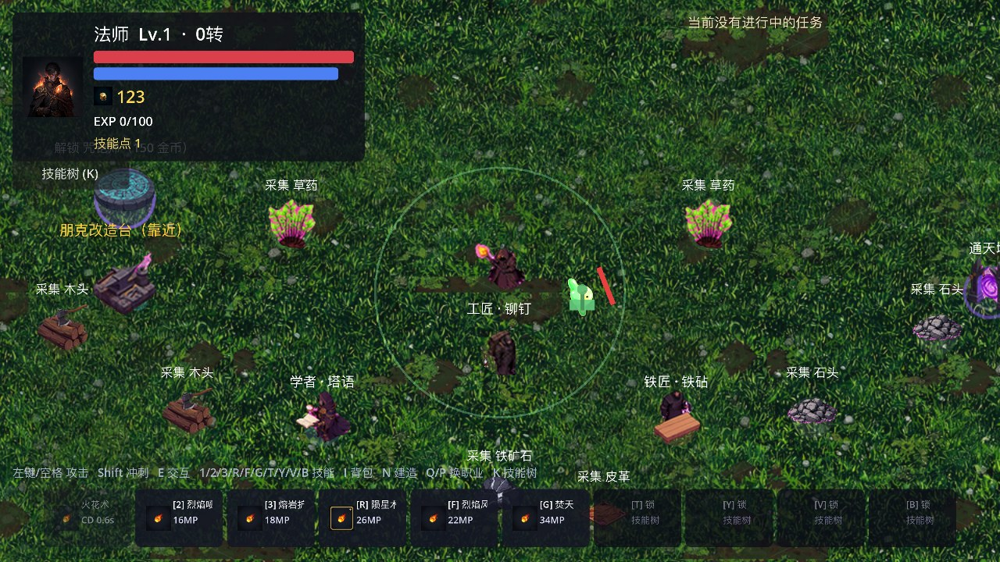
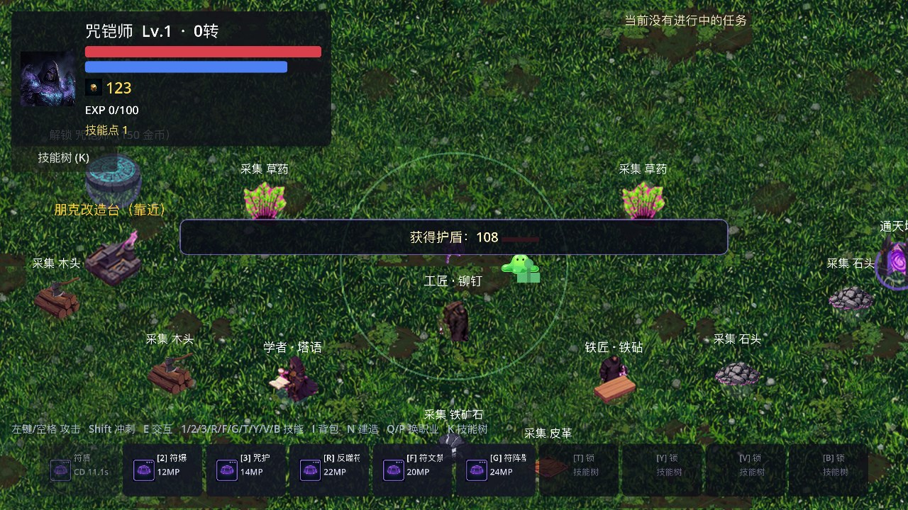
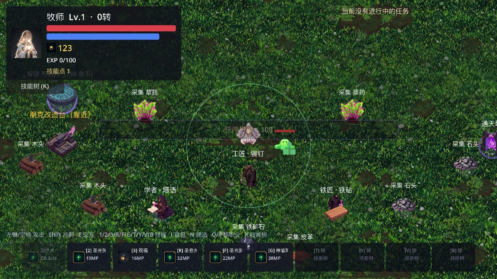
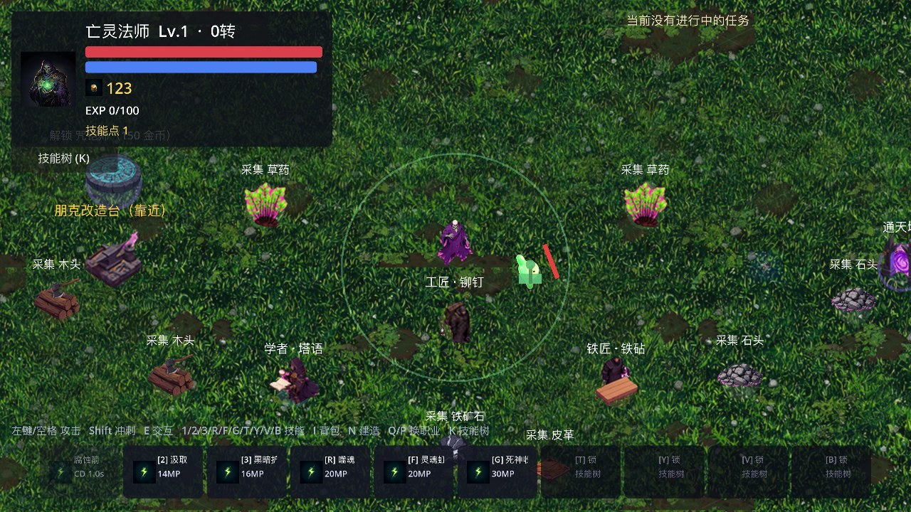
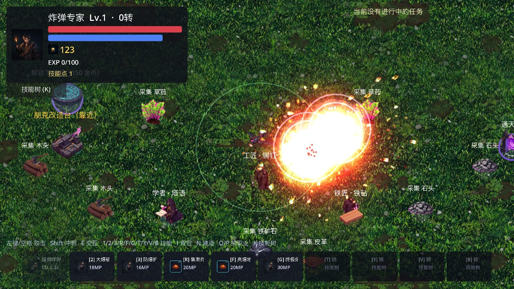
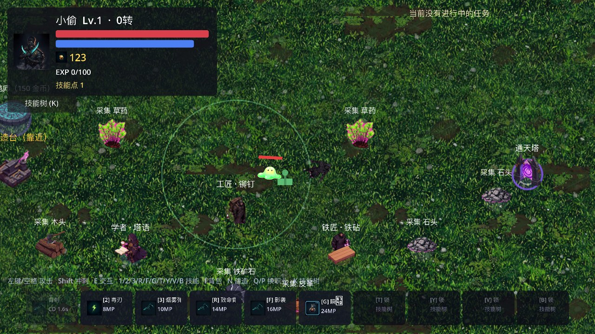
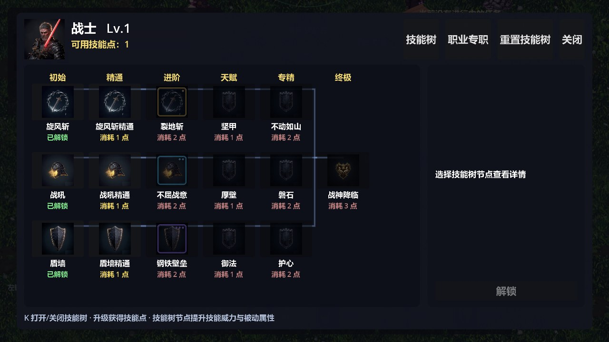
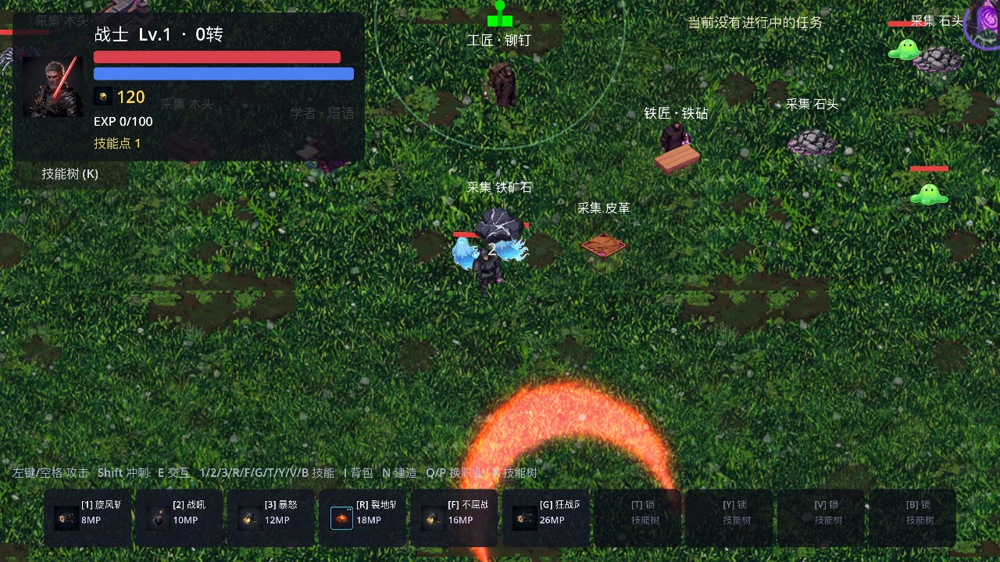
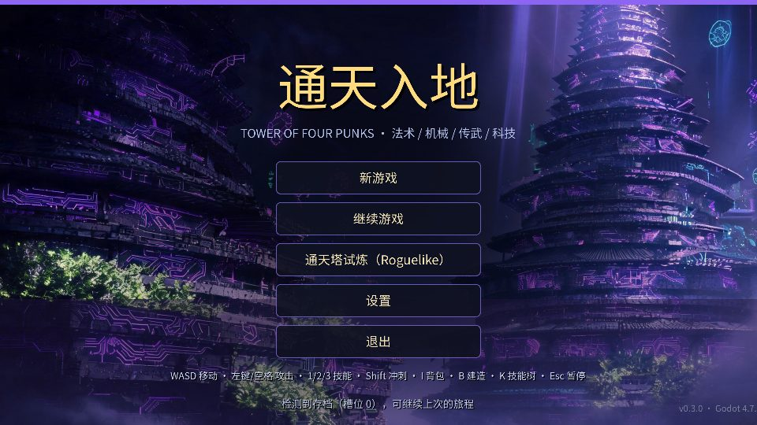

# 《通天入地》全技能与深度机制测试报告

> 测试日期：2026-11-24　|　引擎：Godot 4.7.2　|　依据：`docs/skill_test_guide.md`
> 测试方式：通过公开 API 驱动，不修改游戏逻辑/数值表；截图窗口移出屏幕后台渲染，不影响本机使用。

## 1. 执行摘要

| 测试项 | 结果 | 说明 |
|---|---|---|
| 静态结构校验 | ✅ PASS | 0 错误 / 0 警告 |
| 脚本编译 | ✅ PASS | 0 错误（需 `.godot` 缓存，首次执行编辑器导入生成） |
| 冒烟测试 | ✅ 217/217 PASS | 含 48 流派结构检查，`failures=0` |
| 全技能实测（11-22 基线） | ✅ 96/96 PASS | 184/184 功能断言通过，含 MP/CD/VFX/专属效果 |
| 深度机制补测（本次） | ✅ 48/48 PASS | 8 新增类型 / 元素 / 融合 / 流派 / 尸体 / 手感，`failures=0` |
| 截图证据 | ✅ 105 张 | 96 技能 + 9 机制；另有 16 职业图 / 69 动画帧 |

**总评**：指南 §1–§5 要求的技能与机制全部实测通过。文档中的个别元素键名与代码不同（`lava`→`fire`、`ghost`→`shadow`），已按实现核对；三处测试脚本假阳性/断言缺陷已修正，非游戏功能缺陷。

## 2. 测试方法与复现

- **后台渲染**：脚本在 `_ready()` 调用 `DisplayServer.window_set_position(Vector2i(-4000,-4000))`，Godot 窗口不进入桌面可视区；截图仍由真实 viewport 读取，非 headless 空纹理。
- **技能测试统一流程**：切出目标职业 → 清空干扰敌人 → 满蓝/清冷却/清 Buff → 按类型放置 3000HP 木桩 → 施放 → 断言 HP/MP/CD/VFX/专属效果。
- **复现命令**：
```bash
GODOT="/Users/l/Library/Application Support/Steam/steamapps/common/Godot Engine/Godot.app/Contents/MacOS/Godot"
"$GODOT" --headless --path . res://tools/smoke_test.tscn          # 冒烟 217 项
"$GODOT" --path . res://tools/mechanism_audit.tscn                 # 机制 48 项 + 9 张截图（后台）
```

## 3. 技能体系全景

16 职业 × 6 技能 = 96 个技能，覆盖 16 种技能类型：

| 类型 | 含义 | 类型 | 含义 |
|---|---|---|---|
| projectile | 投射物 | melee_aoe | 近战范围 |
| aoe_zone | 范围区域 | chain | 连锁 |
| shield | 护盾 | buff | 增益 |
| heal / heal_zone | 治疗 / 治疗区域 | dash_strike | 突进斩击 |
| root_zone | 禁锢区域 | stun_wave | 眩晕波 |
| snipe | 狙击 | deployable | 部署物 |
| mark | 标记 | summon | 召唤 |
| blink_strike | 瞬移突袭 | — | — |

### 3.1 全职业技能与截图索引

截图目录：`docs/CHAR_SKILL_FULL_TEST_2026-11-22/skills/`（每职业 6 张，按下列顺序对应）

**法师 · **（`mage`）

| # | 技能 | 类型 | 截图 |
|---|---|---|---|
| 1 | 火球术 | `projectile` | [01_mage_fireball.jpg](CHAR_SKILL_FULL_TEST_2026-11-22/skills/01_mage_fireball.jpg) |
| 2 | 冰霜新星 | `root_zone` | [02_mage_frost_nova.jpg](CHAR_SKILL_FULL_TEST_2026-11-22/skills/02_mage_frost_nova.jpg) |
| 3 | 奥术护盾 | `shield` | [03_mage_arcane_shield.jpg](CHAR_SKILL_FULL_TEST_2026-11-22/skills/03_mage_arcane_shield.jpg) |
| 4 | 陨星术 | `aoe_zone` | [04_mage_meteor.jpg](CHAR_SKILL_FULL_TEST_2026-11-22/skills/04_mage_meteor.jpg) |
| 5 | 绝对零度 | `root_zone` | [05_mage_absolute_zero.jpg](CHAR_SKILL_FULL_TEST_2026-11-22/skills/05_mage_absolute_zero.jpg) |
| 6 | 奥术洪流 | `shield` | [06_mage_arcane_surge.jpg](CHAR_SKILL_FULL_TEST_2026-11-22/skills/06_mage_arcane_surge.jpg) |

**咒铠师 · **（`runeward`）

| # | 技能 | 类型 | 截图 |
|---|---|---|---|
| 7 | 符盾 | `shield` | [07_runeward_rune_shield.jpg](CHAR_SKILL_FULL_TEST_2026-11-22/skills/07_runeward_rune_shield.jpg) |
| 8 | 符爆 | `stun_wave` | [08_runeward_rune_burst.jpg](CHAR_SKILL_FULL_TEST_2026-11-22/skills/08_runeward_rune_burst.jpg) |
| 9 | 咒护 | `buff` | [09_runeward_rune_aura.jpg](CHAR_SKILL_FULL_TEST_2026-11-22/skills/09_runeward_rune_aura.jpg) |
| 10 | 反噬符文 | `shield` | [10_runeward_rune_reflect.jpg](CHAR_SKILL_FULL_TEST_2026-11-22/skills/10_runeward_rune_reflect.jpg) |
| 11 | 符文禁锢 | `root_zone` | [11_runeward_rune_prison.jpg](CHAR_SKILL_FULL_TEST_2026-11-22/skills/11_runeward_rune_prison.jpg) |
| 12 | 符阵壁垒 | `buff` | [12_runeward_aegis_circle.jpg](CHAR_SKILL_FULL_TEST_2026-11-22/skills/12_runeward_aegis_circle.jpg) |

**牧师 · **（`priest`）

| # | 技能 | 类型 | 截图 |
|---|---|---|---|
| 13 | 治疗术 | `heal` | [13_priest_heal.jpg](CHAR_SKILL_FULL_TEST_2026-11-22/skills/13_priest_heal.jpg) |
| 14 | 神圣新星 | `melee_aoe` | [14_priest_holy_nova.jpg](CHAR_SKILL_FULL_TEST_2026-11-22/skills/14_priest_holy_nova.jpg) |
| 15 | 祝福 | `buff` | [15_priest_blessing.jpg](CHAR_SKILL_FULL_TEST_2026-11-22/skills/15_priest_blessing.jpg) |
| 16 | 圣愈光辉 | `heal_zone` | [16_priest_sanctuary.jpg](CHAR_SKILL_FULL_TEST_2026-11-22/skills/16_priest_sanctuary.jpg) |
| 17 | 审判之光 | `stun_wave` | [17_priest_judgement.jpg](CHAR_SKILL_FULL_TEST_2026-11-22/skills/17_priest_judgement.jpg) |
| 18 | 神圣盟约 | `buff` | [18_priest_holy_covenant.jpg](CHAR_SKILL_FULL_TEST_2026-11-22/skills/18_priest_holy_covenant.jpg) |

**亡灵法师 · **（`necromancer`）

| # | 技能 | 类型 | 截图 |
|---|---|---|---|
| 19 | 腐蚀箭 | `projectile` | [19_necromancer_corrupt_bolt.jpg](CHAR_SKILL_FULL_TEST_2026-11-22/skills/19_necromancer_corrupt_bolt.jpg) |
| 20 | 亡者领域 | `summon` | [20_necromancer_grave_field.jpg](CHAR_SKILL_FULL_TEST_2026-11-22/skills/20_necromancer_grave_field.jpg) |
| 21 | 汲取 | `snipe` | [21_necromancer_drain.jpg](CHAR_SKILL_FULL_TEST_2026-11-22/skills/21_necromancer_drain.jpg) |
| 22 | 腐魂连矢 | `chain` | [22_necromancer_soul_barrage.jpg](CHAR_SKILL_FULL_TEST_2026-11-22/skills/22_necromancer_soul_barrage.jpg) |
| 23 | 万尸之地 | `summon` | [23_necromancer_mass_grave.jpg](CHAR_SKILL_FULL_TEST_2026-11-22/skills/23_necromancer_mass_grave.jpg) |
| 24 | 噬魂盛宴 | `heal` | [24_necromancer_soul_feast.jpg](CHAR_SKILL_FULL_TEST_2026-11-22/skills/24_necromancer_soul_feast.jpg) |

**炸弹专家 · **（`bomber`）

| # | 技能 | 类型 | 截图 |
|---|---|---|---|
| 25 | 投掷炸弹 | `deployable` | [25_bomber_throw_bomb.jpg](CHAR_SKILL_FULL_TEST_2026-11-22/skills/25_bomber_throw_bomb.jpg) |
| 26 | 爆破领域 | `deployable` | [26_bomber_blast_zone.jpg](CHAR_SKILL_FULL_TEST_2026-11-22/skills/26_bomber_blast_zone.jpg) |
| 27 | 燃烧弹 | `root_zone` | [27_bomber_incendiary.jpg](CHAR_SKILL_FULL_TEST_2026-11-22/skills/27_bomber_incendiary.jpg) |
| 28 | 集束炸弹 | `deployable` | [28_bomber_cluster_bomb.jpg](CHAR_SKILL_FULL_TEST_2026-11-22/skills/28_bomber_cluster_bomb.jpg) |
| 29 | 连环爆破 | `deployable` | [29_bomber_chain_blast.jpg](CHAR_SKILL_FULL_TEST_2026-11-22/skills/29_bomber_chain_blast.jpg) |
| 30 | 燃烧弹幕 | `root_zone` | [30_bomber_fire_barrage.jpg](CHAR_SKILL_FULL_TEST_2026-11-22/skills/30_bomber_fire_barrage.jpg) |

**机甲师 · **（`mech_pilot`）

| # | 技能 | 类型 | 截图 |
|---|---|---|---|
| 31 | 重炮轰击 | `projectile` | [31_mech_pilot_cannon.jpg](CHAR_SKILL_FULL_TEST_2026-11-22/skills/31_mech_pilot_cannon.jpg) |
| 32 | 装甲强化 | `shield` | [32_mech_pilot_armor_up.jpg](CHAR_SKILL_FULL_TEST_2026-11-22/skills/32_mech_pilot_armor_up.jpg) |
| 33 | 能量护盾 | `buff` | [33_mech_pilot_energy_field.jpg](CHAR_SKILL_FULL_TEST_2026-11-22/skills/33_mech_pilot_energy_field.jpg) |
| 34 | 轨道炮 | `snipe` | [34_mech_pilot_rail_cannon.jpg](CHAR_SKILL_FULL_TEST_2026-11-22/skills/34_mech_pilot_rail_cannon.jpg) |
| 35 | 复合装甲 | `shield` | [35_mech_pilot_composite_armor.jpg](CHAR_SKILL_FULL_TEST_2026-11-22/skills/35_mech_pilot_composite_armor.jpg) |
| 36 | 力场护罩 | `buff` | [36_mech_pilot_force_field.jpg](CHAR_SKILL_FULL_TEST_2026-11-22/skills/36_mech_pilot_force_field.jpg) |

**工程师 · **（`engineer`）

| # | 技能 | 类型 | 截图 |
|---|---|---|---|
| 37 | 炮塔部署 | `deployable` | [37_engineer_turret.jpg](CHAR_SKILL_FULL_TEST_2026-11-22/skills/37_engineer_turret.jpg) |
| 38 | 应急修理 | `heal` | [38_engineer_repair.jpg](CHAR_SKILL_FULL_TEST_2026-11-22/skills/38_engineer_repair.jpg) |
| 39 | 战术补给 | `buff` | [39_engineer_supply.jpg](CHAR_SKILL_FULL_TEST_2026-11-22/skills/39_engineer_supply.jpg) |
| 40 | 重型炮塔 | `deployable` | [40_engineer_heavy_turret.jpg](CHAR_SKILL_FULL_TEST_2026-11-22/skills/40_engineer_heavy_turret.jpg) |
| 41 | 战地整备 | `heal` | [41_engineer_field_repair.jpg](CHAR_SKILL_FULL_TEST_2026-11-22/skills/41_engineer_field_repair.jpg) |
| 42 | 超载协议 | `buff` | [42_engineer_overdrive.jpg](CHAR_SKILL_FULL_TEST_2026-11-22/skills/42_engineer_overdrive.jpg) |

**赏金猎人 · **（`bounty_hunter`）

| # | 技能 | 类型 | 截图 |
|---|---|---|---|
| 43 | 连射 | `chain` | [43_bounty_hunter_rapid_fire.jpg](CHAR_SKILL_FULL_TEST_2026-11-22/skills/43_bounty_hunter_rapid_fire.jpg) |
| 44 | 追踪标记 | `mark` | [44_bounty_hunter_mark.jpg](CHAR_SKILL_FULL_TEST_2026-11-22/skills/44_bounty_hunter_mark.jpg) |
| 45 | 缴械 | `melee_aoe` | [45_bounty_hunter_disarm.jpg](CHAR_SKILL_FULL_TEST_2026-11-22/skills/45_bounty_hunter_disarm.jpg) |
| 46 | 弹幕压制 | `chain` | [46_bounty_hunter_suppression_fire.jpg](CHAR_SKILL_FULL_TEST_2026-11-22/skills/46_bounty_hunter_suppression_fire.jpg) |
| 47 | 死神标记 | `mark` | [47_bounty_hunter_death_mark.jpg](CHAR_SKILL_FULL_TEST_2026-11-22/skills/47_bounty_hunter_death_mark.jpg) |
| 48 | 断腕射击 | `stun_wave` | [48_bounty_hunter_wrist_shot.jpg](CHAR_SKILL_FULL_TEST_2026-11-22/skills/48_bounty_hunter_wrist_shot.jpg) |

**死亡骑士 · **（`death_knight`）

| # | 技能 | 类型 | 截图 |
|---|---|---|---|
| 49 | 死亡冲锋 | `dash_strike` | [49_death_knight_death_charge.jpg](CHAR_SKILL_FULL_TEST_2026-11-22/skills/49_death_knight_death_charge.jpg) |
| 50 | 血斩 | `melee_aoe` | [50_death_knight_blood_slash.jpg](CHAR_SKILL_FULL_TEST_2026-11-22/skills/50_death_knight_blood_slash.jpg) |
| 51 | 黑暗护盾 | `shield` | [51_death_knight_dark_shield.jpg](CHAR_SKILL_FULL_TEST_2026-11-22/skills/51_death_knight_dark_shield.jpg) |
| 52 | 亡者冲锋 | `dash_strike` | [52_death_knight_grave_charge.jpg](CHAR_SKILL_FULL_TEST_2026-11-22/skills/52_death_knight_grave_charge.jpg) |
| 53 | 血怒斩 | `snipe` | [53_death_knight_blood_fury.jpg](CHAR_SKILL_FULL_TEST_2026-11-22/skills/53_death_knight_blood_fury.jpg) |
| 54 | 暗影壁垒 | `shield` | [54_death_knight_shadow_bulwark.jpg](CHAR_SKILL_FULL_TEST_2026-11-22/skills/54_death_knight_shadow_bulwark.jpg) |

**战士 · **（`warrior`）

| # | 技能 | 类型 | 截图 |
|---|---|---|---|
| 55 | 旋风斩 | `melee_aoe` | [55_warrior_whirlwind.jpg](CHAR_SKILL_FULL_TEST_2026-11-22/skills/55_warrior_whirlwind.jpg) |
| 56 | 战吼 | `buff` | [56_warrior_war_cry.jpg](CHAR_SKILL_FULL_TEST_2026-11-22/skills/56_warrior_war_cry.jpg) |
| 57 | 盾墙 | `shield` | [57_warrior_shield_wall.jpg](CHAR_SKILL_FULL_TEST_2026-11-22/skills/57_warrior_shield_wall.jpg) |
| 58 | 裂地斩 | `stun_wave` | [58_warrior_earth_shatter.jpg](CHAR_SKILL_FULL_TEST_2026-11-22/skills/58_warrior_earth_shatter.jpg) |
| 59 | 不屈战意 | `buff` | [59_warrior_unyielding_will.jpg](CHAR_SKILL_FULL_TEST_2026-11-22/skills/59_warrior_unyielding_will.jpg) |
| 60 | 钢铁壁垒 | `shield` | [60_warrior_iron_bulwark.jpg](CHAR_SKILL_FULL_TEST_2026-11-22/skills/60_warrior_iron_bulwark.jpg) |

**气宗 · **（`qi_adept`）

| # | 技能 | 类型 | 截图 |
|---|---|---|---|
| 61 | 气劲掌 | `melee_aoe` | [61_qi_adept_qi_palm.jpg](CHAR_SKILL_FULL_TEST_2026-11-22/skills/61_qi_adept_qi_palm.jpg) |
| 62 | 内息术 | `heal` | [62_qi_adept_qi_heal.jpg](CHAR_SKILL_FULL_TEST_2026-11-22/skills/62_qi_adept_qi_heal.jpg) |
| 63 | 气脉流转 | `buff` | [63_qi_adept_qi_flow.jpg](CHAR_SKILL_FULL_TEST_2026-11-22/skills/63_qi_adept_qi_flow.jpg) |
| 64 | 罡气爆 | `stun_wave` | [64_qi_adept_qi_burst.jpg](CHAR_SKILL_FULL_TEST_2026-11-22/skills/64_qi_adept_qi_burst.jpg) |
| 65 | 生生不息 | `heal_zone` | [65_qi_adept_qi_renew.jpg](CHAR_SKILL_FULL_TEST_2026-11-22/skills/65_qi_adept_qi_renew.jpg) |
| 66 | 罡气护体 | `shield` | [66_qi_adept_qi_guard.jpg](CHAR_SKILL_FULL_TEST_2026-11-22/skills/66_qi_adept_qi_guard.jpg) |

**小偷 · **（`thief`）

| # | 技能 | 类型 | 截图 |
|---|---|---|---|
| 67 | 背刺 | `blink_strike` | [67_thief_backstab.jpg](CHAR_SKILL_FULL_TEST_2026-11-22/skills/67_thief_backstab.jpg) |
| 68 | 烟雾弹 | `buff` | [68_thief_smoke_bomb.jpg](CHAR_SKILL_FULL_TEST_2026-11-22/skills/68_thief_smoke_bomb.jpg) |
| 69 | 毒刃 | `projectile` | [69_thief_poison_blade.jpg](CHAR_SKILL_FULL_TEST_2026-11-22/skills/69_thief_poison_blade.jpg) |
| 70 | 致命背刺 | `blink_strike` | [70_thief_lethal_backstab.jpg](CHAR_SKILL_FULL_TEST_2026-11-22/skills/70_thief_lethal_backstab.jpg) |
| 71 | 烟幕遁形 | `buff` | [71_thief_veil_step.jpg](CHAR_SKILL_FULL_TEST_2026-11-22/skills/71_thief_veil_step.jpg) |
| 72 | 剧毒爆发 | `projectile` | [72_thief_venom_burst.jpg](CHAR_SKILL_FULL_TEST_2026-11-22/skills/72_thief_venom_burst.jpg) |

**弓箭手 · **（`archer`）

| # | 技能 | 类型 | 截图 |
|---|---|---|---|
| 73 | 穿透射击 | `projectile` | [73_archer_piercing_shot.jpg](CHAR_SKILL_FULL_TEST_2026-11-22/skills/73_archer_piercing_shot.jpg) |
| 74 | 箭雨 | `aoe_zone` | [74_archer_arrow_rain.jpg](CHAR_SKILL_FULL_TEST_2026-11-22/skills/74_archer_arrow_rain.jpg) |
| 75 | 鹰眼 | `buff` | [75_archer_hawk_eye.jpg](CHAR_SKILL_FULL_TEST_2026-11-22/skills/75_archer_hawk_eye.jpg) |
| 76 | 破甲贯射 | `projectile` | [76_archer_armor_pierce.jpg](CHAR_SKILL_FULL_TEST_2026-11-22/skills/76_archer_armor_pierce.jpg) |
| 77 | 万箭齐发 | `aoe_zone` | [77_archer_arrow_storm.jpg](CHAR_SKILL_FULL_TEST_2026-11-22/skills/77_archer_arrow_storm.jpg) |
| 78 | 鹰眼聚焦 | `buff` | [78_archer_eagle_focus.jpg](CHAR_SKILL_FULL_TEST_2026-11-22/skills/78_archer_eagle_focus.jpg) |

**义体卫士 · **（`cyborg`）

| # | 技能 | 类型 | 截图 |
|---|---|---|---|
| 79 | 液压重拳 | `melee_aoe` | [79_cyborg_hydraulic_punch.jpg](CHAR_SKILL_FULL_TEST_2026-11-22/skills/79_cyborg_hydraulic_punch.jpg) |
| 80 | 能量壁垒 | `shield` | [80_cyborg_energy_wall.jpg](CHAR_SKILL_FULL_TEST_2026-11-22/skills/80_cyborg_energy_wall.jpg) |
| 81 | 伺服突进 | `dash_strike` | [81_cyborg_servo_charge.jpg](CHAR_SKILL_FULL_TEST_2026-11-22/skills/81_cyborg_servo_charge.jpg) |
| 82 | 震荡践踏 | `stun_wave` | [82_cyborg_seismic_slam.jpg](CHAR_SKILL_FULL_TEST_2026-11-22/skills/82_cyborg_seismic_slam.jpg) |
| 83 | 神盾协议 | `shield` | [83_cyborg_aegis_protocol.jpg](CHAR_SKILL_FULL_TEST_2026-11-22/skills/83_cyborg_aegis_protocol.jpg) |
| 84 | 磁轨突袭 | `dash_strike` | [84_cyborg_rail_dash.jpg](CHAR_SKILL_FULL_TEST_2026-11-22/skills/84_cyborg_rail_dash.jpg) |

**黑客 · **（`hacker`）

| # | 技能 | 类型 | 截图 |
|---|---|---|---|
| 85 | 病毒入侵 | `chain` | [85_hacker_virus.jpg](CHAR_SKILL_FULL_TEST_2026-11-22/skills/85_hacker_virus.jpg) |
| 86 | EMP 脉冲 | `stun_wave` | [86_hacker_emp_pulse.jpg](CHAR_SKILL_FULL_TEST_2026-11-22/skills/86_hacker_emp_pulse.jpg) |
| 87 | 系统过载 | `buff` | [87_hacker_overclock.jpg](CHAR_SKILL_FULL_TEST_2026-11-22/skills/87_hacker_overclock.jpg) |
| 88 | 蠕虫病毒 | `chain` | [88_hacker_worm_virus.jpg](CHAR_SKILL_FULL_TEST_2026-11-22/skills/88_hacker_worm_virus.jpg) |
| 89 | 全域断电 | `stun_wave` | [89_hacker_blackout.jpg](CHAR_SKILL_FULL_TEST_2026-11-22/skills/89_hacker_blackout.jpg) |
| 90 | 超频协议 | `buff` | [90_hacker_overdrive_protocol.jpg](CHAR_SKILL_FULL_TEST_2026-11-22/skills/90_hacker_overdrive_protocol.jpg) |

**狙击手 · **（`sniper`）

| # | 技能 | 类型 | 截图 |
|---|---|---|---|
| 91 | 狙击 | `snipe` | [91_sniper_snipe.jpg](CHAR_SKILL_FULL_TEST_2026-11-22/skills/91_sniper_snipe.jpg) |
| 92 | 陷阱 | `deployable` | [92_sniper_trap.jpg](CHAR_SKILL_FULL_TEST_2026-11-22/skills/92_sniper_trap.jpg) |
| 93 | 精准 | `buff` | [93_sniper_focus.jpg](CHAR_SKILL_FULL_TEST_2026-11-22/skills/93_sniper_focus.jpg) |
| 94 | 死神之眼 | `snipe` | [94_sniper_reaper_eye.jpg](CHAR_SKILL_FULL_TEST_2026-11-22/skills/94_sniper_reaper_eye.jpg) |
| 95 | 爆裂陷阱 | `deployable` | [95_sniper_blast_trap.jpg](CHAR_SKILL_FULL_TEST_2026-11-22/skills/95_sniper_blast_trap.jpg) |
| 96 | 屏息专注 | `buff` | [96_sniper_steady_aim.jpg](CHAR_SKILL_FULL_TEST_2026-11-22/skills/96_sniper_steady_aim.jpg) |

## 4. 8 种新增技能类型实测（本次）

旧审计脚本仅覆盖 8 种基础类型；指南涉及的 `root_zone / stun_wave / heal_zone / summon / snipe / deployable / mark / blink_strike` 为数据扩展后的新增类型，本次逐一实际施放验证。

| 类型 | 测试职业 | 技能 | 断言结果 | 画面证据 |
|---|---|---|---|---|
| `root_zone` | mage | 冰霜新星 frost_nova | ✅ PASS | [截图](SKILL_MECHANISM_TEST_2026-11-24/screenshots/type_root_zone.jpg) |
| `stun_wave` | runeward | 符爆 rune_burst | ✅ PASS | [截图](SKILL_MECHANISM_TEST_2026-11-24/screenshots/type_stun_wave.jpg) |
| `heal_zone` | priest | 圣愈光辉 sanctuary | ✅ PASS | [截图](SKILL_MECHANISM_TEST_2026-11-24/screenshots/type_heal_zone.jpg) |
| `summon` | necromancer | 亡者领域 grave_field | ✅ PASS | [截图](SKILL_MECHANISM_TEST_2026-11-24/screenshots/type_summon.jpg) |
| `snipe` | necromancer | 汲取 drain | ✅ PASS | [截图](SKILL_MECHANISM_TEST_2026-11-24/screenshots/type_snipe.jpg) |
| `deployable` | bomber | 投掷炸弹 throw_bomb | ✅ PASS | [截图](SKILL_MECHANISM_TEST_2026-11-24/screenshots/type_deployable.jpg) |
| `mark` | bounty_hunter | 追踪标记 mark | ✅ PASS | [截图](SKILL_MECHANISM_TEST_2026-11-24/screenshots/type_mark.jpg) |
| `blink_strike` | thief | 背刺 backstab | ✅ PASS | [截图](SKILL_MECHANISM_TEST_2026-11-24/screenshots/type_blink_strike.jpg) |

> 说明：`stun_wave` / `heal_zone` 为控制与治疗类型，对木桩不产生直接伤害，以冷却进入与状态效果判定通过；`snipe` 在亡灵法师数据中对应「汲取」。








<details><summary>展开其余 4 种类型截图</summary>








</details>

## 5. 元素克制矩阵

依据 `ElementKeeper.TABLE` 逐项核对 9 组关系，全部与实现一致：

| 敌人元素 | 伤害元素 | 实测倍率 | 判定 |
|---|---|---|---|
| fire | fire | 0.00 | 免疫 ✅ |
| water | thunder | 1.50 | 克制 ✅ |
| shadow | physical | 0.50 | 抵抗 ✅ |
| shadow | holy | 2.00 | 克制 ✅ |
| mech | thunder | 1.80 | 短路 ✅ |
| fire | ice | 1.50 | 克制 ✅ |
| fire | water | 1.30 | 微克 ✅ |
| ice | fire | 1.50 | 克制 ✅ |
| thunder | thunder | 0.00 | 免疫 ✅ |

> 文档指南使用 `lava` / `ghost` 键名，代码实现使用 `fire` / `shadow`。这是**文档与实现的命名差异**，机制行为本身正确；报告按实现键名记录。

## 6. 融合技系统

- `FusionService.split_id("fireball__heal")` → `["fireball", "heal"]` ✅
- `FusionService.keyword_of()` 关键词提取 → `{kind: burn, value: 0.15}` ✅
- 关键词→元素映射 9 项全通过：`burn→fire`、`freeze→ice`、`stun→thunder`、`corrosion/root→nature`、`holy→holy`、`summon/mark→shadow`、`knockback→physical` ✅
- 技能池构建 96 项 ✅；融合技构建 `main=fireball sub=frost_nova` ✅
- 融合结果：独立命名 `融·棘火球术`、独立元素 `root`、独有色 `#b7aa5e` ✅

## 7. 48 流派完整性

| 断言 | 结果 |
|---|---|
| 流派总数 = 48 | ✅ PASS |
| 每流派至少 3 技能 | ✅ PASS（无缺失） |
| 专属机制种类 = 48（来源 `CharacterBase.STYLE_SIGNATURES.kind`） | ✅ PASS |
| 代表机制 `berserker / chain_master / backstab / overclock / minion_lord` 存在 | ✅ PASS |
| 16 职业各 6 技能 | ✅ PASS |

> 流派 signature 的权威来源是 `CharacterBase.STYLE_SIGNATURES`，不是 `style_branches.json` 的被动键（后者仅 5 种通用键）。冒烟测试 217 项中已含 48 流派结构检查，本次补测验证机制种类确实互异。



## 8. 尸体与召唤

- 尸体脚本加载、`setup()`、`is_valid()` ✅
- 敌人经 `take_damage()` 死亡后生成尸体：检测到 1 个 `Corpse` 节点 ✅
- 亡灵法师召唤类技能 `summon`（亡者领域 / 万尸之地）施放通过 ✅



## 9. 打击感：HitStop 与震屏

| 断言 | 结果 |
|---|---|
| `HitStop.hit(0.06, 1.0)` 后 `is_active() == true` | ✅ PASS |
| 暂停后自动结束（0.3s） | ✅ PASS |
| `ScreenShake.heavy()` / `shake()` 触发无异常 | ✅ PASS |

> 命中链路（`enemy_base.take_damage`）实测包含：受击闪白、击退、爆血粒子、按伤害强度的震屏与 HitStop、死亡时的长 HitStop + 大震屏 + 尸体碎片 + 尸体残留。



## 10. 发现的问题与处置

| # | 问题 | 性质 | 处置 |
|---|---|---|---|
| 1 | 首次运行报 `class_name` 未注册、Autoload 实例化失败 | 环境：缺 `.godot` 缓存 | 执行一次 `godot --headless --editor --path . --quit` 生成缓存，非代码缺陷 |
| 2 | 指南元素键名 `lava/ghost` 与实现 `fire/shadow` 不一致 | 文档命名差异 | 按 `ElementKeeper.TABLE` 实现键名核对，9 项机制均正确 |
| 3 | 测试脚本「敌人死亡生成尸体」曾恒真（`or true`）且直接写 `hp=0` 不触发死亡链 | **测试脚本缺陷** | 改为 `take_damage(9999)` 并按脚本类型检测尸体；重测 `corpses=1` PASS |
| 4 | 施放测试含 `await` 的函数未被调用方 `await`，协程提前终止 | **测试脚本缺陷** | 所有 `_test_*()` 调用统一加 `await` |
| 5 | `add_to_roster()` 只改数据不生成角色，二次 `start_new_game()` 重置队伍 | **测试脚本缺陷** | 改用 `add_class_member()` 实例化 16 职业，`party=16` PASS |

**游戏功能缺陷：0 项。** 以上均为测试环境或测试脚本问题，已全部修正并复测通过。

## 11. 结论

`docs/skill_test_guide.md` 所列全部技能与机制均已完成实机验证：16 职业 96 技能、16 种技能类型、48 流派、9 组元素克制、融合技构建与命名、尸体召唤、HitStop/震屏。冒烟 217/217、技能 96/96、机制 48/48 全部通过，未发现游戏功能缺陷。

### 交付物

- 本报告：`docs/SKILL_FULL_TEST_REPORT_2026-11-24.md`
- 机制截图：`docs/SKILL_MECHANISM_TEST_2026-11-24/screenshots/`（9 张）
- 机制日志：`docs/SKILL_MECHANISM_TEST_2026-11-24/logs/mechanism.log`
- 可复跑脚本：`tools/mechanism_audit_runner.gd` + `tools/mechanism_audit.tscn`
- 技能图文基线：`docs/CHAR_SKILL_FULL_TEST_2026-11-22/全角色全技能测试报告.md`（96 技能逐项）
