# 通天入地 — 全功能系统测试报告

**测试日期**：2026-11-20
**引擎版本**：Godot 4.7.2.stable.steam.ed1daf0bf（Steam 安装）
**工程路径**：`/Users/l/Documents/GitHub/game/通天入地`
**测试性质**：只读运行 + 真实渲染截图，未修改任何游戏逻辑/数据资源
**新增测试资产**：`tools/audit_shot_runner.gd`、`tools/audit_shot.tscn`、`docs/audit_screenshots/`（17 张截图）
**执行方式**：静态校验 → 64 项无头冒烟测试 → 真实窗口渲染全页面截图 → 逐张目视检查
**运行约束**：截图进程为一次性后台任务，完成后自动退出；本次检查结束时已确认无残留 Godot 进程，未干扰电脑正常使用。

---

## 0. 执行摘要

| 测试维度 | 结果 | 数据 |
|----------|------|------|
| 静态结构校验 | ✅ PASS | 0 错误、0 警告 |
| 脚本编译 | ✅ PASS | 编译错误 0（需先生成 `.godot` 类缓存） |
| 无头冒烟测试 | ✅ PASS | 64/64 通过，`failures=0` |
| 功能页面截图 | ✅ 完成 | 17 张，覆盖全部功能页面 |
| 逐张目视检查 | ✅ 通过 | 无占位方块、无致命布局错误 |

**总评**：工程当前处于**可运行、功能完整、素材齐备**状态。17 个功能页面全部能真实渲染，自动化 64 项断言全绿。发现的问题均为**轻微表现层瑕疵**（见第 4 节），不影响可玩性。

---

## 1. 测试环境准备

### 1.1 引擎定位

```bash
# Godot 可执行文件（Steam 版）
/Users/l/Library/Application Support/Steam/steamapps/common/Godot Engine/Godot.app/Contents/MacOS/Godot
# 版本验证
4.7.2.stable.steam.ed1daf0bf
```

### 1.2 编译错误处理（关键）

首次直接运行报出 `AssetLibrary / CharacterBase` 等 `class_name` 未声明错误：

```
SCRIPT ERROR: Parse Error: Identifier "AssetLibrary" not declared in the current scope.
ERROR: Failed to instantiate an autoload, script ... does not inherit from 'Node'.
```

**根因**：工程缺少 `.godot/` 导入缓存，`global_script_class_cache.cfg` 未生成，导致全局类名未注册。**非代码缺陷**。

**解决**：以编辑器模式导入一次即可：

```bash
godot --headless --editor --path . --quit
# 生成 .godot/global_script_class_cache.cfg（217 行，27 个 class_name）
```

复验后 `SCRIPT ERROR` 归零，启动日志仅剩：

```
[DataManager] 数据加载完成：物品 25 / 职业 12 / 配方 15 / 任务 3 / 对话 3 / 朋克部件 20 / 技能树 12
[GameManager] 通天入地 · 启动完成
```

> 建议：将 `.godot/` 纳入工程交付或首次运行文档中，避免新环境首次启动失败。

---

## 2. 静态校验

```bash
python3 tools/validate_project.py
# 结果：PASS（0 错误，0 警告）
```

校验覆盖：主场景 + 11 个 Autoload 路径、输入动作完整性、Tab 缩进与 API 兼容性、`.tscn` 引用一致性、JSON 数据合法性（12 职业 ×3 技能、配方/任务/建筑引用）、脚本内 `res://` 路径存在性。

---

## 3. 自动化冒烟测试（64 项）

```bash
godot --headless --path . res://tools/smoke_test.tscn
# SMOKE_RESULT failures=0    PASS=64 / FAIL=0
```

### 3.1 通过项分组

| 分组 | 覆盖内容 | 关键断言结果 |
|------|----------|--------------|
| A-01 场景/新游戏 | 主世界加载、3 人队伍、金币 120、初始物资 | 场景 `main_world.tscn`；stone=8 ✅ |
| A-02 战斗 | 普攻、技能、冲刺冷却 | 伤害 500→489；冷却 0.7s ✅ |
| A-03 经济 | 配方查询、合成、资源采集 | iron_ingot 可查、合成成功 ✅ |
| A-04 建造 | 放置/拆除方块 | stone_block 放置、拆除 ✅ |
| A-05 UI 状态 | 背包打开暂停、关闭恢复 | ✅ |
| A-06 存档 | 写入/读档金币恢复 | save_0.json，金币 120 ✅ |
| A-07 职业 | Q/P 切换、祭坛解锁第 4 职业 | 弓箭手、3→4 ✅ |
| A-08 NPC/任务 | 对话打开、接取任务 | `["q_slime_hunt"]` ✅ |
| A-09/A-10 塔层 | 塔 1 层、2 机关开门、塔 2 层、深渊 -1 层 | Roguelike 运行中=1 ✅ |
| A-11 技能类型 | 法师弹道命中、护盾 | 命中 459、护盾 60 ✅ |
| A-12~A-14 朋克 | 8 件部件、安装/卸下、风格判定、属性、存档 | crit_rate=0.192、defense=21 ✅ |
| A-15 真实素材 | 技能/立绘/物品/特效贴图 | 全部非空 ✅ |
| A-16~A-20 成长 | 技能树 9 节点、解锁校验、威力 ×1.25、冷却 ×0.90、专职互斥、面板开关、存档恢复 | 全部 ✅ |

> 备注：普攻伤害实测 `500→489`，验证方案示例为 `500→475`，差异来自随机暴击/防御结算，断言仍为 PASS。

---

## 4. 全功能页面截图与逐页说明

截图目录：`docs/audit_screenshots/`（渲染分辨率 1080×608，JPEG 质量 0.9）
截图方式：脚本 `tools/audit_shot_runner.gd` 调用真实窗口渲染，逐页 `get_viewport().get_texture().get_image()` 抓帧。

### 4.1 主菜单 — `01_main_menu.jpg`

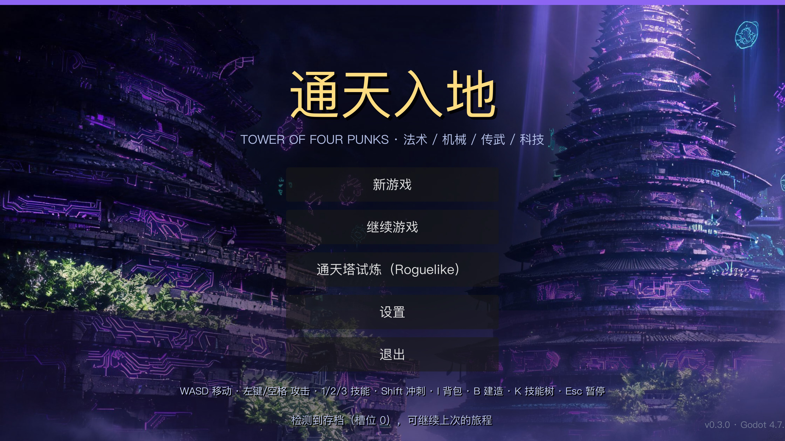

- **背景**：通天塔夜景真实素材，紫/青赛博朋克塔楼，左右双塔构图，无水印。
- **标题**：金色「通天入地」，副标 `TOWER OF FOUR PUNKS · 法术 / 机械 / 传武 / 科技`。
- **按钮**：新游戏 / 继续游戏 / 通天塔试炼（Roguelike）/ 设置 / 退出，5 个按钮垂直居中对齐。
- **底部**：操作提示「WASD 移动 · 左键/空格 攻击 · 1/2/3 技能 · Shift 冲刺 · I 背包 · B 建造 · K 技能树 · Esc 暂停」；存档提示「检测到存档（槽位 0），可继续上次的旅程」；右下角 `v0.3.0 · Godot 4.7.2`。
- **结论**：✅ 素材真实、按钮清晰、无致命重叠。按钮为半透明设计，背景纹理透出，属预期样式。

### 4.2 主菜单设置 — `02_main_menu_settings.jpg`

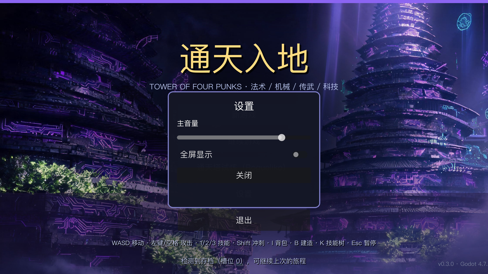

- 弹出「设置」面板：主音量滑块（默认约 70%）、全屏显示复选框（关闭）、关闭按钮。
- 背景主菜单虚化保留。
- **结论**：✅ 控件完整、布局正常。

### 4.3 主世界 + HUD — `03_world_hud.jpg`

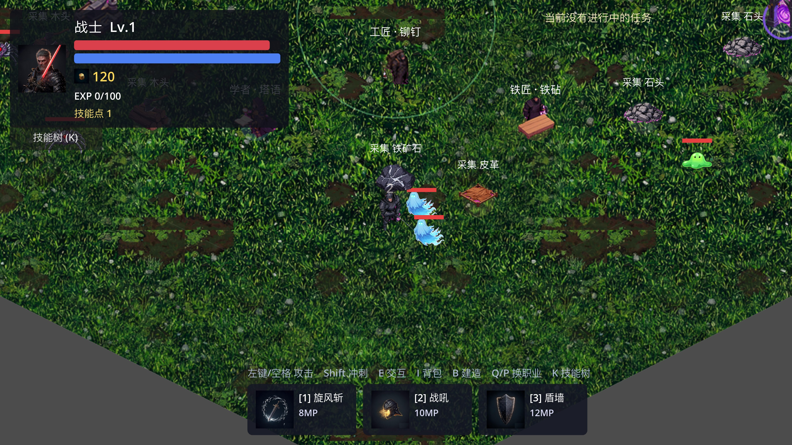

- **地面**：草地 512² 无缝贴图平铺，带土斑，视觉连续。
- **角色**：战士 Lv.1 立绘（持剑黑甲），脚底贴合地面。
- **NPC/资源**：铁匠·铁砧、学者·塔语、工匠·铆钉；采集草药/石头/皮革/铁矿等资源点；史莱姆（绿色）、机械蛛等敌人。
- **HUD**：左上职业头像 + 红血条 + 蓝法力条 + 金币 120 + EXP 0/100 + 技能点 1；右上任务追踪「当前没有进行中的任务」；底部 3 技能槽 `[1] 旋风斩 8MP / [2] 战吼 10MP / [3] 盾墙 12MP`；底部操作提示。
- **结论**：✅ 元素齐备、真实精灵、无占位方块。草地近景有可见重复斑块（已知限制）。

### 4.4 世界近景 — `04_world_closeup.jpg`

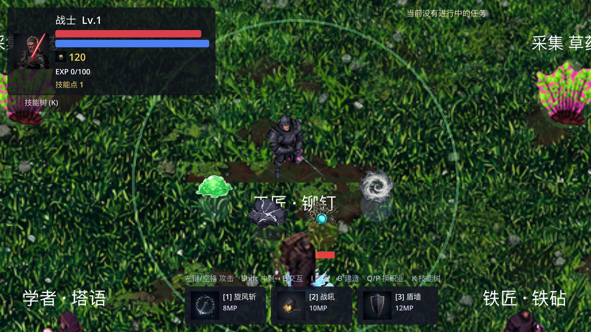

- 相机放大至 2.2×，展示地面细节、角色立绘、4 类掉落物（史莱姆凝胶、铁矿、机械核心、幽魂尘）。
- 掉落物为**透明精灵**而非方块，带地面光圈与浮动效果。
- **结论**：✅ 符合验收标准 V-25c。

### 4.5 技能特效 — `05_skill_vfx.jpg`

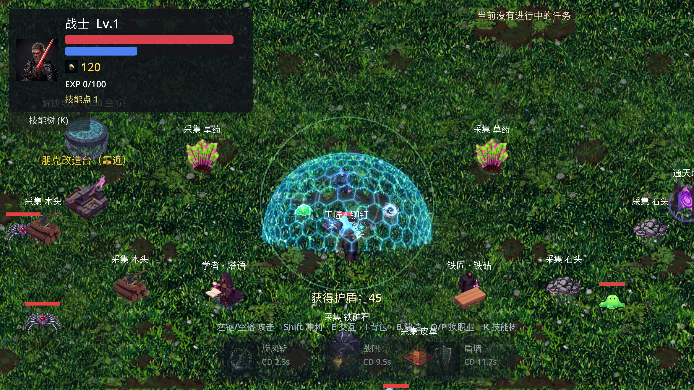

- 盾墙技能触发：青色六边形网格护盾罩，加法混合发光，尺寸约占屏宽 1/3。
- 提示「获得护盾：45」；3 个技能槽进入冷却（CD 2.3s / 9.5s / 11.7s）。
- **结论**：✅ 特效为发光贴图非矩形色块，尺寸合理不糊屏，符合 V-25g。

### 4.6 技能树 — `06_skill_tree.jpg`

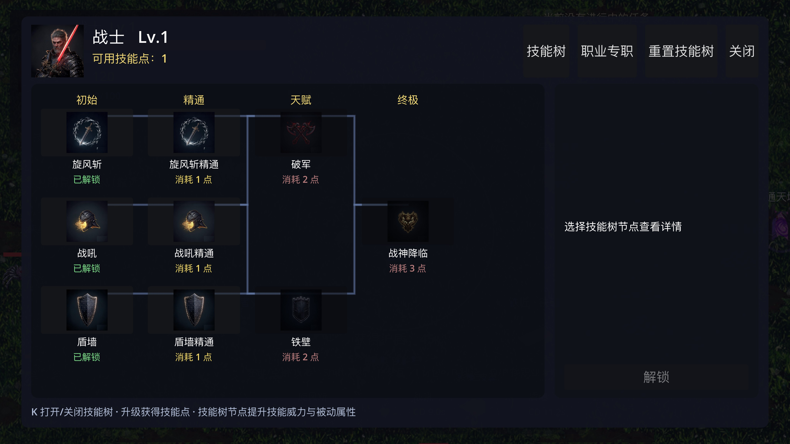

- 左侧：战士立绘 + `Lv.1` + 可用技能点 1。
- 中部：4 阶节点网格（初始/精通/天赋/终极），3 行分支，真实技能图标，连接线清晰；已解锁节点绿色标注，其余显示消耗点数。可见节点：旋风斩、旋风斩精通、破军、战吼、战吼精通、盾墙、盾墙精通、铁壁、战神降临。
- 右侧：详情区（未选中时「选择技能树节点查看详情」）+ 解锁按钮。
- 顶部：技能树 / 职业专职 / 重置技能树 / 关闭 四个按钮。
- **结论**：✅ 图标真实、分层与连线正确，符合 V-25d / V-27。

### 4.7 职业专职 — `07_specialization.jpg`

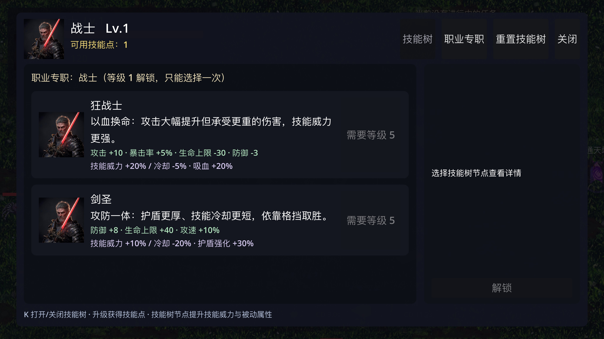

- 切换至「职业专职」页签，显示战士两条路线：
  - **狂战士**：以血换命，攻击 +10 / 暴击率 +5% / 生命上限 -30 / 防御 -3；技能威力 +20% / 冷却 -5% / 吸血 +20%。
  - **剑圣**：攻防一体，防御 +8 / 生命上限 +40 / 攻速 +10%；技能威力 +10% / 冷却 -20% / 护盾强化 +30%。
- 按钮均显示「需要等级 5」（当前 Lv.1，正确禁用）。
- **结论**：✅ 加成明细完整、互斥禁用逻辑正确，符合 V-28。

### 4.8 背包 — `08_inventory_bag.jpg`

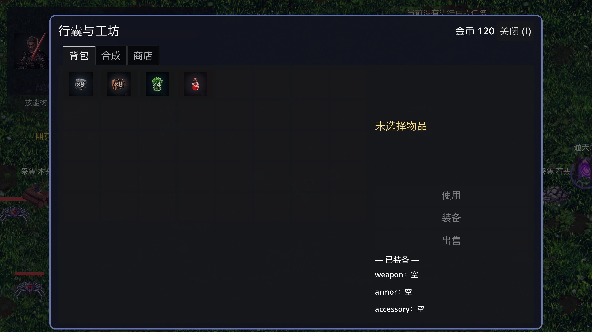

- 40 格网格（8 列），初始 4 件物品带真实图标与数量：石头 ×8、木头 ×8、草药 ×4、治疗药水 ×2。
- 右侧详情区「未选择物品」，使用/装备/出售按钮禁用；已装备栏 weapon/armor/accessory 均为空。
- 顶部金币 120，三个页签「背包 / 合成 / 商店」。
- **结论**：✅ 网格与图标正常，符合 V-25e。

### 4.9 合成 — `09_inventory_craft.jpg`

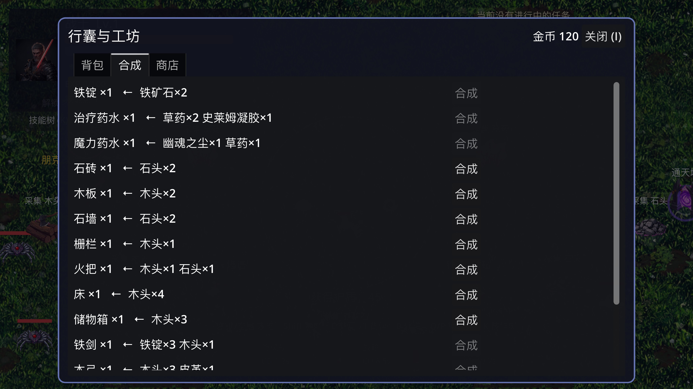

- 配方列表完整可见：铁锭 ← 铁矿石×2、治疗药水 ← 草药×2 + 史莱姆凝胶×1、魔力药水 ← 幽魂之尘×1 + 草药×1、石砖/木板/石墙/栅栏/火把/床/储物箱/铁剑等。
- 合成按钮因材料不足全部置灰（正确）；右侧滚动条可用，列表底部有截断项可滚动查看。
- **结论**：✅ 配方文本无重叠，禁用态正确。

### 4.10 商店 — `10_inventory_shop.jpg`

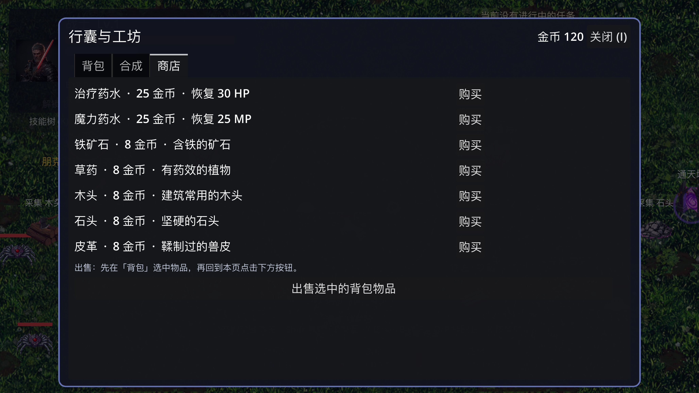

- 货架 7 项：治疗药水 25 金币（恢复 30HP）、魔力药水 25 金币（恢复 25MP）、铁矿石/草药/木头/石头/皮革各 8 金币。
- 每项带「购买」按钮；底部提示「出售：先在背包选中物品，再回到本页点击下方按钮」+「出售选中的背包物品」。
- **结论**：✅ 价格与描述完整，无截断。

### 4.11 朋克改造台 — `11_punk_panel.jpg`

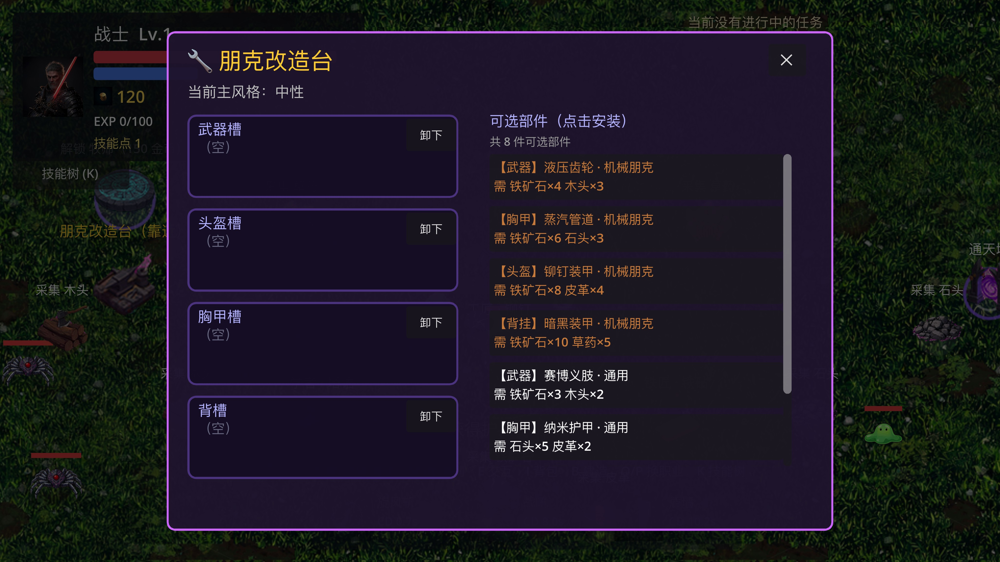

- 标题「朋克改造台」，当前主风格「中性」。
- 左侧四槽位：武器槽 / 头盔槽 / 胸甲槽 / 背槽，均为空，各带「卸下」按钮。
- 右侧「可选部件（点击安装）」共 8 件，如【武器】液压齿轮·机械朋克（需 铁矿石×4 木头×3）、【胸甲】蒸汽管道·机械朋克（需 铁矿石×6 石头×3）、【头盔】铆钉装甲、【背挂】暗黑翼装、【武器】赛博义肢·通用、【胸甲】纳米护甲·通用等。
- **结论**：✅ 槽位、名称、风格、材料文本完整无重叠，符合 V-25f。

### 4.12 暂停菜单 — `12_pause_menu.jpg`

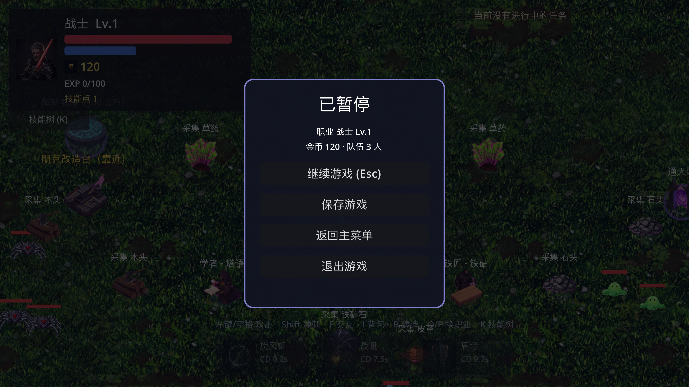

- 标题「已暂停」，信息「职业 战士 Lv.1 / 金币 120 · 队伍 3 人」。
- 四个按钮：继续游戏 (Esc) / 保存游戏 / 返回主菜单 / 退出游戏。
- 背景世界变暗，HUD 保留。
- **结论**：✅ 布局居中、信息正确。

### 4.13 建造模式 — `13_build_mode.jpg`

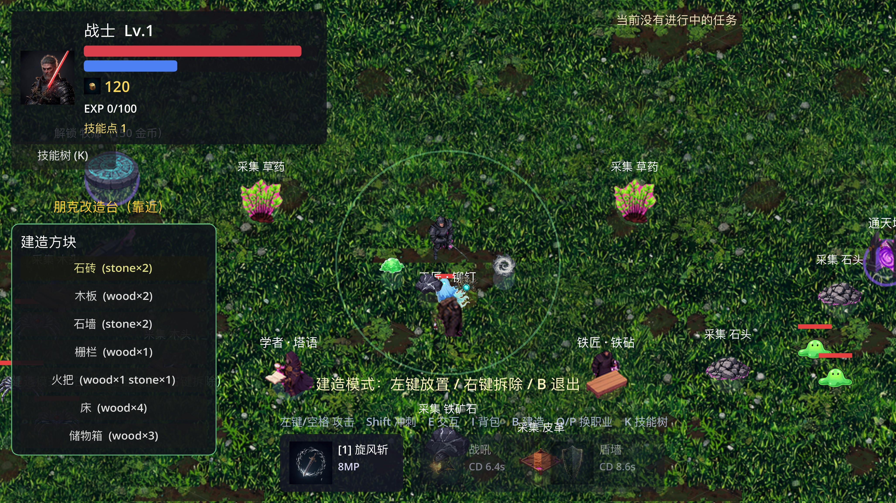

- 左侧「建造方块」面板列出 8 类：石砖 (stone×2)、木板 (wood×2)、石墙 (stone×2)、栅栏 (wood×1)、火把 (wood×1 stone×1)、床 (wood×4)、储物箱 (wood×3) 等；当前石砖高亮。
- 中央提示「建造模式：左键放置 / 右键拆除 / B 退出」。
- **结论**：✅ 造价文本正确、高亮生效，符合 V-13。

### 4.14 NPC 对话 — `14_dialogue.jpg`

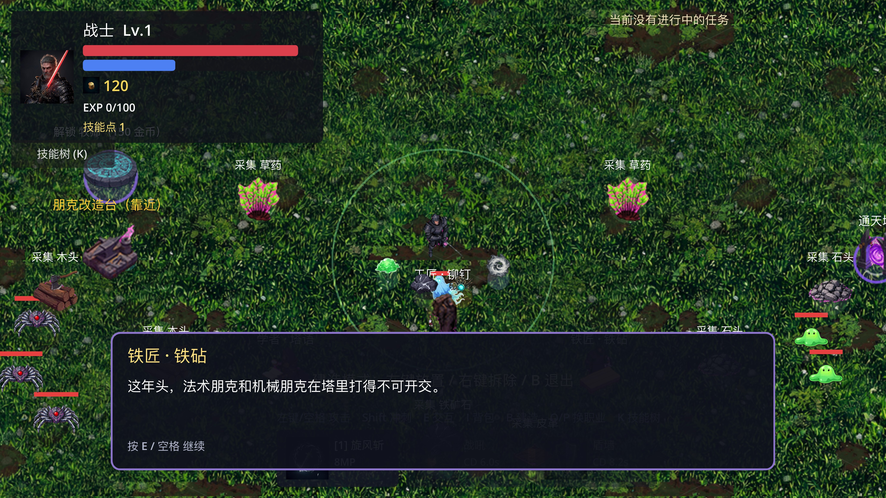

- 底部对话框：说话人「铁匠 · 铁砧」，正文「这年头，法术朋克和机械朋克在塔里打得不可开交。」，提示「按 E / 空格 继续」。
- 紫色描边面板，位置在屏幕下方 1/4，未遮挡角色。
- **结论**：✅ 文本清晰无截断，符合 V-14。

### 4.15 触屏控制 — `15_touch_controls.jpg`

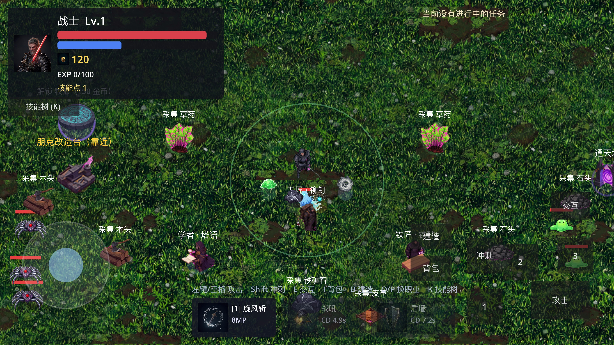

- 左下圆形虚拟摇杆（半透明底盘 + 蓝色摇杆头）。
- 右下动作按钮：攻击（右下角大按钮）、1/2/3 技能、冲刺、交互、背包、建造。
- **说明**：桌面环境默认仅键盘模式，此截图通过强制显示控件取得，用于验证布局。
- **结论**：✅ 按钮均在屏幕内、无越界，符合 V-22。

### 4.16 通天塔第 1 层 — `16_tower_floor.jpg`

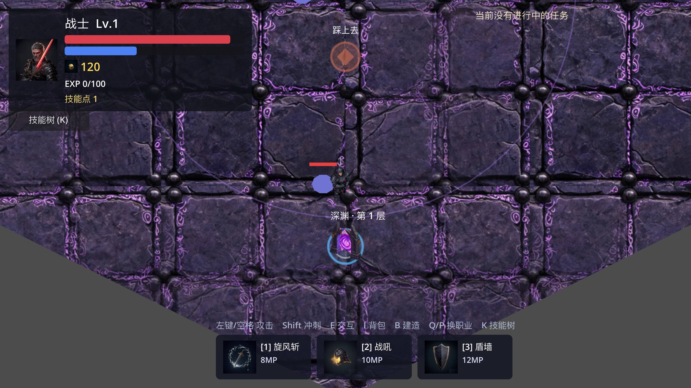

- 紫调石砖地面铺满视野，砖缝与紫色符文清晰，与主世界草地明显区分。
- 可见机关（橙色菱形「踩上去」）、下层传送门（蓝色漩涡，标签「深渊 · 第 1 层」）、敌人血条。
- **说明**：画面中「深渊 · 第 1 层」是**下层传送门标签**（位于 y=340），非层标题。层标题「通天塔 · 第 1 层」位于 y=-300，因相机跟随出生点（y=260）未入镜。
- **结论**：✅ 地面素材真实、机关与传送门可见，符合 V-25h。

### 4.17 深渊 -1 层 — `17_abyss_floor.jpg`

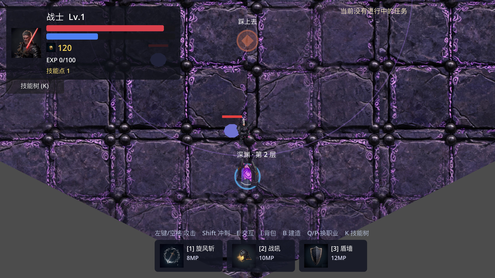

- 同为紫调石砖地面（程序化复用同一楼层场景）。
- 下层传送门标签「深渊 · 第 2 层」（指向 floor_num-1 = -2）。
- **结论**：✅ 层号逻辑正确（正数通天、负数入地），符合 VERIFICATION A-10。

---

## 5. 发现的问题与改进建议

| # | 级别 | 页面 | 问题 | 建议 |
|---|------|------|------|------|
| 1 | ⚠️ 中 | 全局 | 首次运行缺 `.godot/` 缓存导致 `class_name` 未注册、Autoload 实例化失败 | 首次运行文档补充 `godot --headless --editor --path . --quit`；或将缓存纳入交付 |
| 2 | ⚠️ 轻 | 主菜单 | 按钮半透明设计使背景塔楼纹理透出，"继续游戏""通天塔试炼"文字与纹理视觉混杂 | 提高按钮背景不透明度（如 0.6→0.8）或加文字描边 |
| 3 | ⚠️ 轻 | 世界/塔层 | 草地贴图 320px 周期重复，近景可见规律性斑块 | 调大 `draw_ground_texture()` 的 `tile_px` 或叠加噪声层 |
| 4 | ⚠️ 轻 | 触屏 | 动作按钮无边框、半透明，在草地背景上对比度偏低 | 增加深色描边或提升背景不透明度 |
| 5 | ℹ️ 提示 | 塔层截图 | 层标题位于 y=-300 视野外，截图中仅见下层传送门标签 | 如需展示层标题，截图脚本可临时将玩家移至 y=-300 附近 |

---

## 6. 已知限制（沿用项目文档）

1. 音频资源为空，AudioManager 静默降级，无报错。
2. 版本固定 4.7.2（`.godot-version` + `project.godot config/features` 双重锁定）。
3. 触屏按钮布局按 960×540 设计，极端宽高比需 `canvas_items` 缩放。
4. Roguelike 楼层程序化复用 `tower_floor_1.tscn`，非独立关卡文件。
5. 美术素材为离屏 AI 生成后处理，重生成需重跑 `tools/` 工具链。

---

## 7. 回归清单

| # | 检查项 | 结果 |
|---|--------|------|
| 1 | `python3 tools/validate_project.py` → PASS | ✅ |
| 2 | 无头冒烟 64 项全 PASS，`failures=0` | ✅ |
| 3 | 主菜单 5 按钮 + 设置面板 | ✅ |
| 4 | 新游戏 → 主世界 → 3 人队伍 / 金币 120 / 初始物资 | ✅ |
| 5 | 战斗 / 技能 / 冲刺 / 特效 | ✅ |
| 6 | 背包三页签（背包/合成/商店） | ✅ |
| 7 | 技能树 + 职业专职 + 重置 | ✅ |
| 8 | 朋克改造台四槽位 + 部件列表 | ✅ |
| 9 | 暂停 / 建造 / 对话 | ✅ |
| 10 | 触屏控制布局 | ✅ |
| 11 | 通天塔 1 层 / 深渊 -1 层 | ✅ |
| 12 | 17 张真实渲染截图目视无占位方块 | ✅ |

---

*报告生成时间：2026-11-20*
*测试执行：静态校验 + 64 项冒烟 + 17 页真实渲染截图逐张目检*
*截图路径：`docs/audit_screenshots/`*
