# 《通天入地》训练场 · 全角色 / 全技能 / 全动作 实测图文报告

> 测试日期：2026-11-24（GMT+8）  
> 场地：`scenes/world/training_ground.tscn`（训练场 · 全职业试炼）  
> 引擎：4.7.2-stable (official)（Windows，OpenGL 3.3 Compatibility，1280×720 真实窗口渲染）  
> 覆盖范围：**16 职业完整进阶后全部技能 = 160 项** + **40 个动作形变状态** + 玩家真实动作链 + 训练场机制  
> 测试性质：通过训练场公开接口驱动，不修改游戏逻辑/数值表

---

## 1. 执行摘要

| 测试项 | 结果 | 说明 |
|---|---|---|
| 训练场结构 | ✅ PASS | 16 职业石 / 8 元素木桩 / 3 功能台 / 出口门 / 信息面板 |
| 全角色切换 | ✅ 16/16 | 职业石接口 + 完整进阶形态 + 立绘 |
| 全技能实测 | ✅ 160/160 | 16 职业完整进阶后全部技能槽（含专属/进阶/融合），按 16 种技能类型断言效果 |
| 全动作形变 | ✅ 40/40 | SpriteAnim 40 个 AnimState 逐状态播放 |
| 玩家真实动作 | ✅ PASS | 普攻命中 / 冲刺无敌 / 受击 / 死亡 / 复活 |
| 功能断言 | ✅ 269/269 | 0 项失败 |
| 截图证据 | ✅ 218 张 | 角色 16 + 技能 160 + 动作 41 + 场景/机制 |
| 操作视频帧 | ✅ 36 帧 | 训练场普攻 / 技能操作 |
| VFX 生成观测 | 146/160 技能 | 施放瞬间特效节点计数 > 0 |

**总评**：训练场内 16 名职业全部可切换并达到完整进阶形态；160 项技能全部实际施放，按类型分别验证了伤害/治疗/增益/护盾/召唤/部署/标记/位移等效果；40 个动作形变状态逐一切换并截图。发现 3 项问题（木桩碰撞形状缺失、统一动作层编译失败、魔法元素归类单一），详见第 6 节。

### 技能类型覆盖（16 种）

| 技能类型 | 数量 | 验证要点 |
|---|---|---|
| `melee_aoe` | 10 | 范围伤害 + 木桩承伤 |
| `projectile` | 8 | 弹道飞行命中 |
| `chain` | 11 | 连锁命中 |
| `aoe_zone` | 11 | 延迟区域结算 |
| `dash_strike` | 11 | 位移 + 路径伤害 |
| `blink_strike` | 7 | 瞬步 + 路径伤害 |
| `snipe` | 23 | 直线光束命中 |
| `stun_wave` | 7 | 环形冲击波 |
| `root_zone` | 1 | 地刺范围 + 减速 |
| `mark` | 5 | 目标标记 |
| `buff` | 22 | Buff 入栈 |
| `shield` | 9 | 护盾值增加 |
| `heal` | 5 | 实际回血 |
| `heal_zone` | 10 | 持续治疗区域 |
| `summon` | 3 | 召唤物生成 |
| `deployable` | 17 | 陷阱/部署物生成 |

---

## 2. 测试方法与复现

```bash
cd C:/Users/l/Documents/GitHub/game/通天入地
"/c/Godot_v4.7.2-stable_win64.exe/Godot_v4.7.2-stable_win64_console.exe" --headless --editor --path . --quit-after 600
"/c/Godot_v4.7.2-stable_win64.exe/Godot_v4.7.2-stable_win64_console.exe" --path . --resolution 1280x720 res://tools/training_ground_audit.tscn
python tools/build_training_ground_report.py
```

统一流程：进入训练场 → 经职业石接口切职业 → 触发进阶台解锁 10 技能槽与四层技能树 → 逐技能清冷却/满状态、把中性木桩置于正前方 → 施放 → 按技能类型断言效果 + MP/冷却/VFX/动作状态。

---

## 3. 训练场全景与全角色

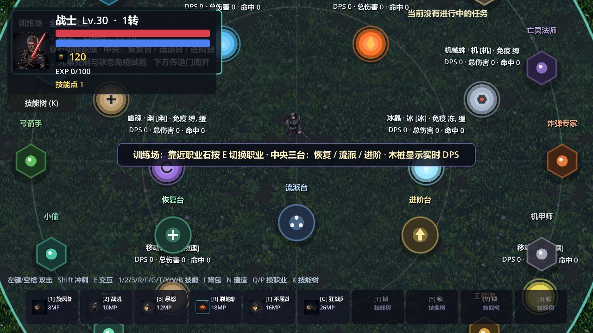


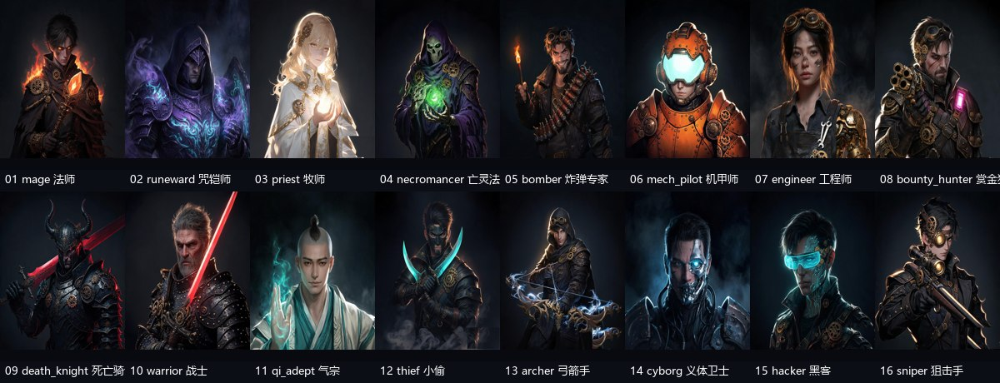

| # | 职业 | 名称 | 定位 | 技能 | 阶段 | 技能槽 | 立绘 | 实测 |
|---|---|---|---|---|---|---|---|---|
| 1 | `mage` | 法师 | 破军 | 10 | 4 | 10 | ✅ | ✅ |
| 2 | `runeward` | 咒铠师 | 铁壁 | 10 | 4 | 10 | ✅ | ✅ |
| 3 | `priest` | 牧师 | 辅弼 | 10 | 4 | 10 | ✅ | ✅ |
| 4 | `necromancer` | 亡灵法师 | 诡道 | 10 | 4 | 10 | ✅ | ✅ |
| 5 | `bomber` | 炸弹专家 | 破军 | 10 | 4 | 10 | ✅ | ✅ |
| 6 | `mech_pilot` | 机甲师 | 铁壁 | 10 | 4 | 10 | ✅ | ✅ |
| 7 | `engineer` | 工程师 | 辅弼 | 10 | 4 | 10 | ✅ | ✅ |
| 8 | `bounty_hunter` | 赏金猎人 | 诡道 | 10 | 4 | 10 | ✅ | ✅ |
| 9 | `death_knight` | 死亡骑士 | 破军 | 10 | 4 | 10 | ✅ | ✅ |
| 10 | `warrior` | 战士 | 铁壁 | 10 | 4 | 10 | ✅ | ✅ |
| 11 | `qi_adept` | 气宗 | 辅弼 | 10 | 4 | 10 | ✅ | ✅ |
| 12 | `thief` | 小偷 | 诡道 | 10 | 4 | 10 | ✅ | ✅ |
| 13 | `archer` | 弓箭手 | 破军 | 10 | 4 | 10 | ✅ | ✅ |
| 14 | `cyborg` | 义体卫士 | 铁壁 | 10 | 4 | 10 | ✅ | ✅ |
| 15 | `hacker` | 黑客 | 辅弼 | 10 | 4 | 10 | ✅ | ✅ |
| 16 | `sniper` | 狙击手 | 诡道 | 10 | 4 | 10 | ✅ | ✅ |

---

## 4. 逐职业技能实测明细（160/160 通过）

> 160 技能一图总览：[skill_contact_sheet.jpg](skill_contact_sheet.jpg)  
> 单张原图：`skills/`；每职业 3×2 拼图：`class_sheets/`

### 法师 · 元素爆发：以太塑形，远距离高倍率法术是主要伤害来源。（`mage`）

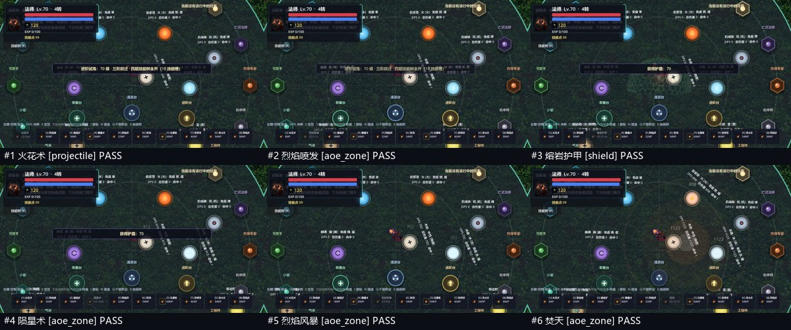

| 槽 | 技能（点击看截图） | 类型 | 结果 | 关键观测 |
|---|---|---|---|---|
| 1 | [火花术](skills/001_mage_mage_a_1.jpg) | `projectile` | ✅ | projectile; Dmg 0->606, Hits 0->1; MP 783->775; CD=0.80; VFX=1; Anim=n/a |
| 2 | [烈焰喷发](skills/002_mage_mage_a_2.jpg) | `aoe_zone` | ✅ | aoe_zone; Dmg 0->491, Hits 0->1; MP 783->767; CD=5.05; VFX=0; Anim=n/a |
| 3 | [熔岩护甲](skills/003_mage_mage_a_3.jpg) | `shield` | ✅ | shield; Shield 0->70; MP 783->765; CD=11.58; VFX=1; Anim=n/a |
| 4 | [陨星术](skills/004_mage_mage_a_4.jpg) | `aoe_zone` | ✅ | aoe_zone; Dmg 0->1826, Hits 0->2; MP 783->757; CD=10.83; VFX=0; Anim=n/a |
| 5 | [烈焰风暴](skills/005_mage_mage_a_5.jpg) | `aoe_zone` | ✅ | aoe_zone; Dmg 0->1404, Hits 0->2; MP 783->761; CD=9.00; VFX=0; Anim=n/a |
| 6 | [焚天](skills/006_mage_mage_a_6.jpg) | `aoe_zone` | ✅ | aoe_zone; Dmg 0->3144, Hits 0->3; MP 783->749; CD=16.72; VFX=0; Anim=n/a |
| 7 | [元素轮舞](skills/007_mage_mage_fusion.jpg) | `aoe_zone` | ✅ | aoe_zone; Dmg 0->6318, Hits 0->4; MP 783->723; CD=28.98; VFX=0; Anim=n/a |
| 8 | [灰烬领域](skills/008_mage_mage_a_spec_a.jpg) | `aoe_zone` | ✅ | aoe_zone; Dmg 0->3833, Hits 0->3; MP 783->737; CD=24.90; VFX=0; Anim=n/a |
| 9 | [天火焚城](skills/009_mage_mage_a_apex.jpg) | `aoe_zone` | ✅ | aoe_zone; Dmg 0->6570, Hits 0->4; MP 783->729; CD=30.57; VFX=0; Anim=n/a |
| 10 | [烈焰突进](skills/010_mage_mage_a_spec_b.jpg) | `dash_strike` | ✅ | dash_strike; Move 232, Dmg 0->2581; MP 783->753; CD=14.68; VFX=1; Anim=n/a |

### 咒铠师 · 符文装甲：用咒文护盾吸收伤害并反噬近身之敌。（`runeward`）

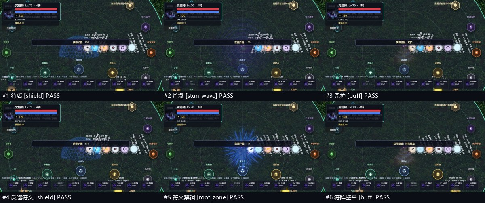

| 槽 | 技能（点击看截图） | 类型 | 结果 | 关键观测 |
|---|---|---|---|---|
| 1 | [符盾](skills/011_runeward_runeward_a_1.jpg) | `shield` | ✅ | shield; Shield 0->108; MP 648->632; CD=11.62; VFX=1; Anim=n/a |
| 2 | [符爆](skills/012_runeward_runeward_a_2.jpg) | `stun_wave` | ✅ | stun_wave; Dmg 0->361, Hits 0->1; MP 648->636; CD=4.55; VFX=2; Anim=n/a |
| 3 | [咒护](skills/013_runeward_runeward_a_3.jpg) | `buff` | ✅ | buff; BuffCount 0->1; MP 648->634; CD=13.58; VFX=1; Anim=n/a |
| 4 | [反噬符文](skills/014_runeward_runeward_a_4.jpg) | `shield` | ✅ | shield; Shield 0->171; MP 648->626; CD=17.60; VFX=1; Anim=n/a |
| 5 | [符文禁锢](skills/015_runeward_runeward_a_5.jpg) | `root_zone` | ✅ | root_zone; Dmg 0->1784, Hits 0->4; MP 648->628; CD=10.68; VFX=1; Anim=n/a |
| 6 | [符阵壁垒](skills/016_runeward_runeward_a_6.jpg) | `buff` | ✅ | buff; BuffCount 0->1; MP 648->624; CD=19.62; VFX=1; Anim=n/a |
| 7 | [符阵归一](skills/017_runeward_runeward_fusion.jpg) | `buff` | ✅ | buff; BuffCount 0->2; MP 648->596; CD=33.62; VFX=1; Anim=n/a |
| 8 | [九宫符阵](skills/018_runeward_runeward_a_spec_a.jpg) | `heal_zone` | ✅ | heal_zone; HP 1670->1715 (+45); MP 648->612; CD=24.65; VFX=1; Anim=n/a |
| 9 | [万符天罗](skills/019_runeward_runeward_a_apex.jpg) | `buff` | ✅ | buff; BuffCount 0->1; MP 648->600; CD=31.60; VFX=1; Anim=n/a |
| 10 | [符能反噬](skills/020_runeward_runeward_a_spec_b.jpg) | `stun_wave` | ✅ | stun_wave; Dmg 0->2688, Hits 0->3; MP 648->616; CD=17.70; VFX=2; Anim=n/a |

### 牧师 · 神圣庇佑：治疗、圣光爆发与团队祝福三位一体。（`priest`）

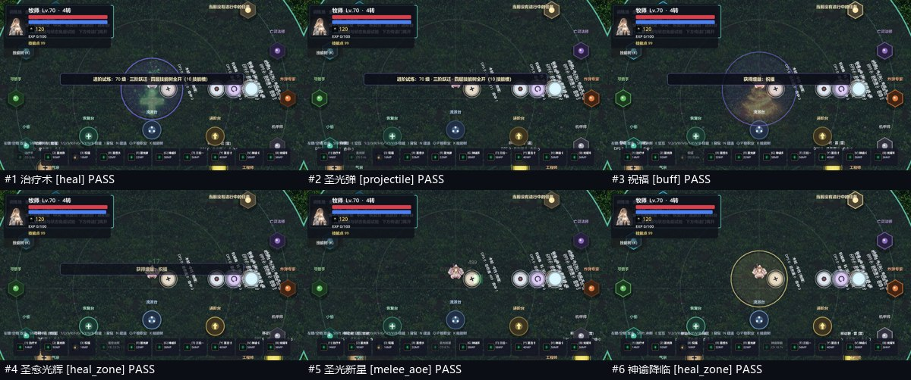

| 槽 | 技能（点击看截图） | 类型 | 结果 | 关键观测 |
|---|---|---|---|---|
| 1 | [治疗术](skills/021_priest_priest_a_1.jpg) | `heal` | ✅ | heal; HP 1544->1589 (+45); MP 701->687; CD=3.60; VFX=1; Anim=n/a |
| 2 | [圣光弹](skills/022_priest_priest_a_2.jpg) | `projectile` | ✅ | projectile; Dmg 0->311, Hits 0->1; MP 701->691; CD=2.40; VFX=1; Anim=n/a |
| 3 | [祝福](skills/023_priest_priest_a_3.jpg) | `buff` | ✅ | buff; BuffCount 0->1; MP 701->685; CD=13.60; VFX=1; Anim=n/a |
| 4 | [圣愈光辉](skills/024_priest_priest_a_4.jpg) | `heal_zone` | ✅ | heal_zone; HP 1544->1589 (+45); MP 701->669; CD=12.67; VFX=1; Anim=n/a |
| 5 | [圣光新星](skills/025_priest_priest_a_5.jpg) | `melee_aoe` | ✅ | melee_aoe; Dmg 0->489, Hits 0->1; MP 701->679; CD=8.70; VFX=1; Anim=n/a |
| 6 | [神谕降临](skills/026_priest_priest_a_6.jpg) | `heal_zone` | ✅ | heal_zone; HP 1544->1589 (+45); MP 701->663; CD=18.65; VFX=1; Anim=n/a |
| 7 | [三位一体](skills/027_priest_priest_fusion.jpg) | `heal_zone` | ✅ | heal_zone; HP 1544->1589 (+45); MP 701->645; CD=30.67; VFX=1; Anim=n/a |
| 8 | [圣言·愈](skills/028_priest_priest_a_spec_a.jpg) | `heal` | ✅ | heal; HP 1544->1589 (+45); MP 701->661; CD=17.60; VFX=1; Anim=n/a |
| 9 | [神谕·创世](skills/029_priest_priest_a_apex.jpg) | `heal_zone` | ✅ | heal_zone; HP 1544->1589 (+45); MP 701->645; CD=32.67; VFX=1; Anim=n/a |
| 10 | [光耀审判](skills/030_priest_priest_a_spec_b.jpg) | `snipe` | ✅ | snipe; Dmg 0->4646, Hits 0->6; MP 701->665; CD=19.83; VFX=1; Anim=n/a |

### 亡灵法师 · 生死操控：以腐蚀、墓场与噬魂维持长时间消耗战。（`necromancer`）

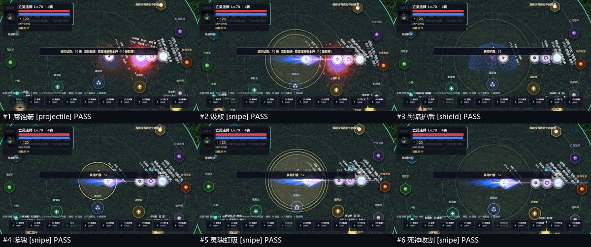

| 槽 | 技能（点击看截图） | 类型 | 结果 | 关键观测 |
|---|---|---|---|---|
| 1 | [腐蚀箭](skills/031_necromancer_necromancer_a_1.jpg) | `projectile` | ✅ | projectile; Dmg 0->854, Hits 0->2; MP 769->748; CD=1.32; VFX=-1; Anim=n/a |
| 2 | [汲取](skills/032_necromancer_necromancer_a_2.jpg) | `snipe` | ✅ | snipe; Dmg 0->1376, Hits 0->4; MP 769->755; CD=7.85; VFX=1; Anim=n/a |
| 3 | [黑暗护盾](skills/033_necromancer_necromancer_a_3.jpg) | `shield` | ✅ | shield; Shield 0->52; MP 769->753; CD=11.60; VFX=1; Anim=n/a |
| 4 | [噬魂](skills/034_necromancer_necromancer_a_4.jpg) | `snipe` | ✅ | snipe; Dmg 0->3101, Hits 0->6; MP 769->749; CD=8.83; VFX=1; Anim=n/a |
| 5 | [灵魂虹吸](skills/035_necromancer_necromancer_a_5.jpg) | `snipe` | ✅ | snipe; Dmg 0->2534, Hits 0->6; MP 769->749; CD=8.83; VFX=1; Anim=n/a |
| 6 | [死神收割](skills/036_necromancer_necromancer_a_6.jpg) | `snipe` | ✅ | snipe; Dmg 0->4224, Hits 0->6; MP 769->739; CD=15.83; VFX=1; Anim=n/a |
| 7 | [生死轮回](skills/037_necromancer_necromancer_fusion.jpg) | `summon` | ✅ | summon; Summons 0->2(peak); MP 769->711; CD=35.70; VFX=1; Anim=n/a |
| 8 | [灵魂收割](skills/038_necromancer_necromancer_a_spec_a.jpg) | `snipe` | ✅ | snipe; Dmg 0->5635, Hits 0->6; MP 769->731; CD=21.85; VFX=1; Anim=n/a |
| 9 | [死亡宣告](skills/039_necromancer_necromancer_a_apex.jpg) | `snipe` | ✅ | snipe; Dmg 0->8454, Hits 0->6; MP 769->713; CD=33.85; VFX=1; Anim=n/a |
| 10 | [噬魂领域](skills/040_necromancer_necromancer_a_spec_b.jpg) | `heal_zone` | ✅ | heal_zone; HP 1473->1518 (+45); MP 769->729; CD=22.65; VFX=1; Anim=n/a |

### 炸弹专家 · 爆破工程：用火药与燃烧覆盖战场，追求范围清场。（`bomber`）

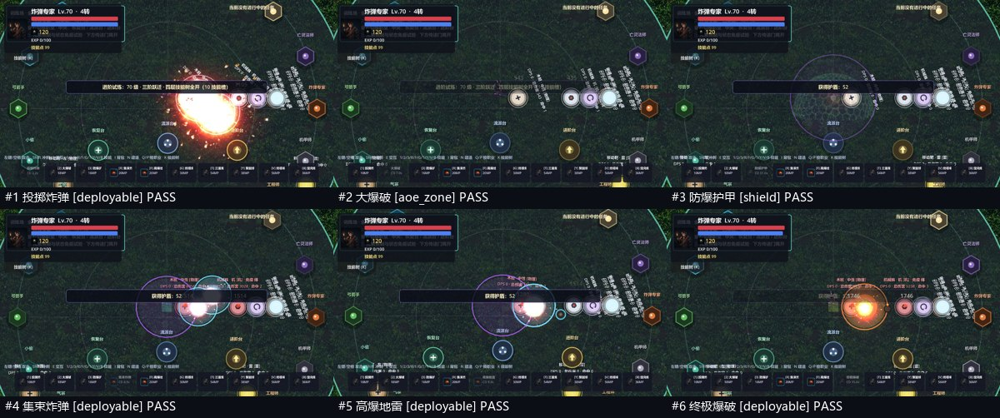

| 槽 | 技能（点击看截图） | 类型 | 结果 | 关键观测 |
|---|---|---|---|---|
| 1 | [投掷炸弹](skills/041_bomber_bomber_a_1.jpg) | `deployable` | ✅ | deployable; Deployables 0->2(peak); MP 623->613; CD=2.23; VFX=2; Anim=n/a |
| 2 | [大爆破](skills/042_bomber_bomber_a_2.jpg) | `aoe_zone` | ✅ | aoe_zone; Dmg 0->978, Hits 0->2; MP 623->605; CD=7.02; VFX=0; Anim=n/a |
| 3 | [防爆护甲](skills/043_bomber_bomber_a_3.jpg) | `shield` | ✅ | shield; Shield 0->52; MP 623->607; CD=11.60; VFX=1; Anim=n/a |
| 4 | [集束炸弹](skills/044_bomber_bomber_a_4.jpg) | `deployable` | ✅ | deployable; Deployables 0->4(peak); MP 623->603; CD=8.48; VFX=4; Anim=n/a |
| 5 | [高爆地雷](skills/045_bomber_bomber_a_5.jpg) | `deployable` | ✅ | deployable; Deployables 0->4(peak); MP 623->603; CD=9.42; VFX=4; Anim=n/a |
| 6 | [终极爆破](skills/046_bomber_bomber_a_6.jpg) | `deployable` | ✅ | deployable; Deployables 0->6(peak); MP 623->593; CD=15.58; VFX=6; Anim=n/a |
| 7 | [三重爆破](skills/047_bomber_bomber_fusion.jpg) | `deployable` | ✅ | deployable; Deployables 0->6(peak); MP 623->569; CD=33.42; VFX=6; Anim=n/a |
| 8 | [聚能核爆](skills/048_bomber_bomber_a_spec_a.jpg) | `deployable` | ✅ | deployable; Deployables 0->4(peak); MP 623->585; CD=21.27; VFX=4; Anim=n/a |
| 9 | [终极审判](skills/049_bomber_bomber_a_apex.jpg) | `deployable` | ✅ | deployable; Deployables 0->8(peak); MP 623->567; CD=33.48; VFX=8; Anim=n/a |
| 10 | [定向爆破](skills/050_bomber_bomber_a_spec_b.jpg) | `aoe_zone` | ✅ | aoe_zone; Dmg 0->4895, Hits 0->4; MP 623->587; CD=19.13; VFX=0; Anim=n/a |

### 机甲师 · 重装要塞：机甲护甲与力场保证持续站桩输出。（`mech_pilot`）

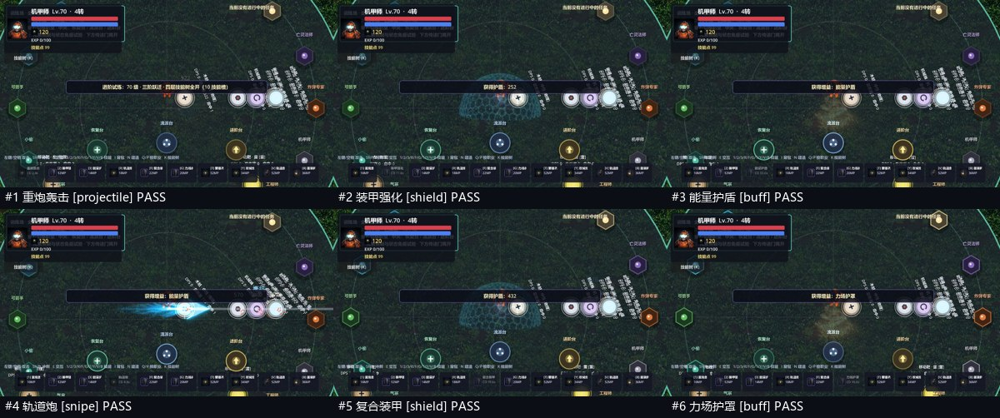

| 槽 | 技能（点击看截图） | 类型 | 结果 | 关键观测 |
|---|---|---|---|---|
| 1 | [重炮轰击](skills/051_mech_pilot_mech_pilot_a_1.jpg) | `projectile` | ✅ | projectile; Dmg 0->522, Hits 0->1; MP 574->564; CD=2.42; VFX=0; Anim=n/a |
| 2 | [装甲强化](skills/052_mech_pilot_mech_pilot_a_2.jpg) | `shield` | ✅ | shield; Shield 0->252; MP 574->562; CD=11.58; VFX=1; Anim=n/a |
| 3 | [能量护盾](skills/053_mech_pilot_mech_pilot_a_3.jpg) | `buff` | ✅ | buff; BuffCount 0->1; MP 574->560; CD=13.58; VFX=1; Anim=n/a |
| 4 | [轨道炮](skills/054_mech_pilot_mech_pilot_a_4.jpg) | `snipe` | ✅ | snipe; Dmg 0->3585, Hits 0->6; MP 574->556; CD=8.83; VFX=1; Anim=n/a |
| 5 | [复合装甲](skills/055_mech_pilot_mech_pilot_a_5.jpg) | `shield` | ✅ | shield; Shield 0->432; MP 574->552; CD=19.58; VFX=1; Anim=n/a |
| 6 | [力场护罩](skills/056_mech_pilot_mech_pilot_a_6.jpg) | `buff` | ✅ | buff; BuffCount 0->1; MP 574->554; CD=19.60; VFX=1; Anim=n/a |
| 7 | [要塞齐射](skills/057_mech_pilot_mech_pilot_fusion.jpg) | `aoe_zone` | ✅ | aoe_zone; Dmg 0->5809, Hits 0->5; MP 574->522; CD=31.12; VFX=0; Anim=n/a |
| 8 | [攻城炮](skills/058_mech_pilot_mech_pilot_a_spec_a.jpg) | `snipe` | ✅ | snipe; Dmg 0->6066, Hits 0->6; MP 574->540; CD=21.85; VFX=1; Anim=n/a |
| 9 | [轨道轰炸](skills/059_mech_pilot_mech_pilot_a_apex.jpg) | `snipe` | ✅ | snipe; Dmg 0->8549, Hits 0->6; MP 574->522; CD=33.87; VFX=1; Anim=n/a |
| 10 | [重装阵线](skills/060_mech_pilot_mech_pilot_a_spec_b.jpg) | `buff` | ✅ | buff; BuffCount 0->1; MP 574->538; CD=29.60; VFX=1; Anim=n/a |

### 工程师 · 战地工事：部署炮塔、修理与战术补给支援全队。（`engineer`）

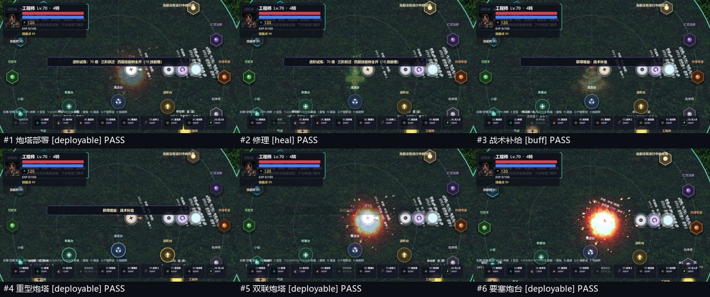

| 槽 | 技能（点击看截图） | 类型 | 结果 | 关键观测 |
|---|---|---|---|---|
| 1 | [炮塔部署](skills/061_engineer_engineer_a_1.jpg) | `deployable` | ✅ | deployable; Deployables 0->1(peak); MP 680->664; CD=6.15; VFX=1; Anim=n/a |
| 2 | [修理](skills/062_engineer_engineer_a_2.jpg) | `heal` | ✅ | heal; HP 1567->1612 (+45); MP 680->662; CD=8.62; VFX=1; Anim=n/a |
| 3 | [战术补给](skills/063_engineer_engineer_a_3.jpg) | `buff` | ✅ | buff; BuffCount 0->1; MP 680->668; CD=11.60; VFX=1; Anim=n/a |
| 4 | [重型炮塔](skills/064_engineer_engineer_a_4.jpg) | `deployable` | ✅ | deployable; Deployables 0->1(peak); MP 680->656; CD=10.13; VFX=1; Anim=n/a |
| 5 | [双联炮塔](skills/065_engineer_engineer_a_5.jpg) | `deployable` | ✅ | deployable; Deployables 0->2(peak); MP 680->652; CD=13.25; VFX=2; Anim=n/a |
| 6 | [要塞炮台](skills/066_engineer_engineer_a_6.jpg) | `deployable` | ✅ | deployable; Deployables 0->1(peak); MP 680->646; CD=17.23; VFX=1; Anim=n/a |
| 7 | [战争工事](skills/067_engineer_engineer_fusion.jpg) | `deployable` | ✅ | deployable; Deployables 0->2(peak); MP 680->624; CD=35.45; VFX=2; Anim=n/a |
| 8 | [重型要塞炮台](skills/068_engineer_engineer_a_spec_a.jpg) | `deployable` | ✅ | deployable; Deployables 0->1(peak); MP 680->638; CD=23.33; VFX=1; Anim=n/a |
| 9 | [炮塔矩阵](skills/069_engineer_engineer_a_apex.jpg) | `deployable` | ✅ | deployable; Deployables 0->3(peak); MP 680->624; CD=31.45; VFX=3; Anim=n/a |
| 10 | [无人机编队](skills/070_engineer_engineer_a_spec_b.jpg) | `summon` | ✅ | summon; Summons 0->1(peak); MP 680->642; CD=21.75; VFX=0; Anim=n/a |

### 赏金猎人 · 猎杀契约：标记目标后以速射与缴械压制。（`bounty_hunter`）

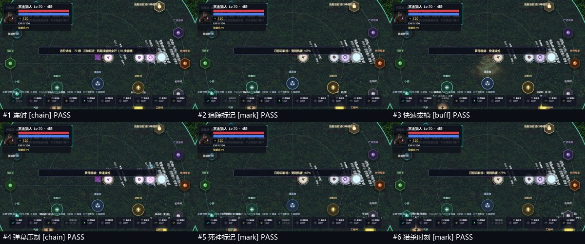

| 槽 | 技能（点击看截图） | 类型 | 结果 | 关键观测 |
|---|---|---|---|---|
| 1 | [连射](skills/071_bounty_hunter_bounty_hunter_a_1.jpg) | `chain` | ✅ | chain; Dmg 0->1496, Hits 0->3; MP 599->589; CD=2.70; VFX=4; Anim=n/a |
| 2 | [追踪标记](skills/072_bounty_hunter_bounty_hunter_a_2.jpg) | `mark` | ✅ | mark; MarkedDummies 0->1; MP 599->591; CD=11.45; VFX=1; Anim=n/a |
| 3 | [快速拔枪](skills/073_bounty_hunter_bounty_hunter_a_3.jpg) | `buff` | ✅ | buff; BuffCount 0->1; MP 599->587; CD=9.60; VFX=1; Anim=n/a |
| 4 | [弹幕压制](skills/074_bounty_hunter_bounty_hunter_a_4.jpg) | `chain` | ✅ | chain; Dmg 0->2606, Hits 0->4; MP 599->581; CD=7.70; VFX=5; Anim=n/a |
| 5 | [死神标记](skills/075_bounty_hunter_bounty_hunter_a_5.jpg) | `mark` | ✅ | mark; MarkedDummies 0->1; MP 599->585; CD=15.43; VFX=1; Anim=n/a |
| 6 | [猎杀时刻](skills/076_bounty_hunter_bounty_hunter_a_6.jpg) | `mark` | ✅ | mark; MarkedDummies 0->1; MP 599->579; CD=19.45; VFX=1; Anim=n/a |
| 7 | [猎杀交响](skills/077_bounty_hunter_bounty_hunter_fusion.jpg) | `mark` | ✅ | mark; MarkedDummies 0->1; MP 599->559; CD=29.43; VFX=1; Anim=n/a |
| 8 | [猎杀清单](skills/078_bounty_hunter_bounty_hunter_a_spec_a.jpg) | `mark` | ✅ | mark; MarkedDummies 0->1; MP 599->565; CD=27.45; VFX=1; Anim=n/a |
| 9 | [悬赏处决](skills/079_bounty_hunter_bounty_hunter_a_apex.jpg) | `snipe` | ✅ | snipe; Dmg 0->13930, Hits 0->6; MP 599->547; CD=31.85; VFX=1; Anim=n/a |
| 10 | [双枪连舞](skills/080_bounty_hunter_bounty_hunter_a_spec_b.jpg) | `projectile` | ✅ | projectile; Dmg 0->7256, Hits 0->8; MP 599->569; CD=17.47; VFX=8; Anim=n/a |

### 死亡骑士 · 血怒冲锋：以自身生命为代价换取突进与范围斩击。（`death_knight`）

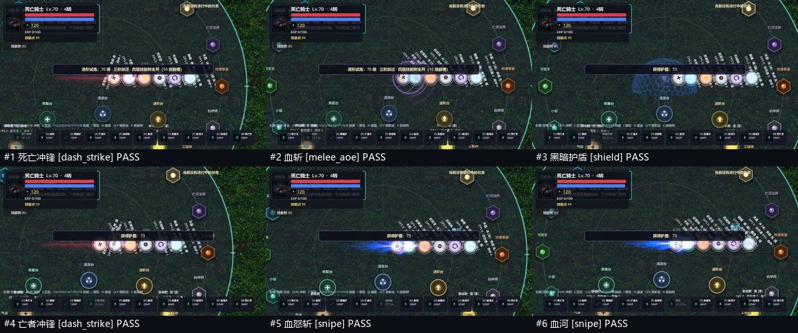

| 槽 | 技能（点击看截图） | 类型 | 结果 | 关键观测 |
|---|---|---|---|---|
| 1 | [死亡冲锋](skills/081_death_knight_death_knight_a_1.jpg) | `dash_strike` | ✅ | dash_strike; Move 123, Dmg 0->752; MP 599->589; CD=4.65; VFX=1; Anim=n/a |
| 2 | [血斩](skills/082_death_knight_death_knight_a_2.jpg) | `melee_aoe` | ✅ | melee_aoe; Dmg 0->1330, Hits 0->3; MP 599->587; CD=3.83; VFX=1; Anim=n/a |
| 3 | [黑暗护盾](skills/083_death_knight_death_knight_a_3.jpg) | `shield` | ✅ | shield; Shield 0->73; MP 599->583; CD=13.60; VFX=1; Anim=n/a |
| 4 | [亡者冲锋](skills/084_death_knight_death_knight_a_4.jpg) | `dash_strike` | ✅ | dash_strike; Move 178, Dmg 0->980; MP 599->583; CD=8.63; VFX=1; Anim=n/a |
| 5 | [血怒斩](skills/085_death_knight_death_knight_a_5.jpg) | `snipe` | ✅ | snipe; Dmg 0->2731, Hits 0->5; MP 599->581; CD=7.83; VFX=1; Anim=n/a |
| 6 | [血河](skills/086_death_knight_death_knight_a_6.jpg) | `snipe` | ✅ | snipe; Dmg 0->4489, Hits 0->6; MP 599->571; CD=15.85; VFX=1; Anim=n/a |
| 7 | [血墓冲锋](skills/087_death_knight_death_knight_fusion.jpg) | `dash_strike` | ✅ | dash_strike; Move 287, Dmg 0->6228; MP 599->553; CD=27.68; VFX=1; Anim=n/a |
| 8 | [血河冲锋](skills/088_death_knight_death_knight_a_spec_a.jpg) | `dash_strike` | ✅ | dash_strike; Move 233, Dmg 0->3208; MP 599->567; CD=19.68; VFX=1; Anim=n/a |
| 9 | [血海无涯](skills/089_death_knight_death_knight_a_apex.jpg) | `snipe` | ✅ | snipe; Dmg 0->7856, Hits 0->6; MP 599->547; CD=31.85; VFX=1; Anim=n/a |
| 10 | [死亡践踏](skills/090_death_knight_death_knight_a_spec_b.jpg) | `stun_wave` | ✅ | stun_wave; Dmg 0->2965, Hits 0->3; MP 599->569; CD=17.70; VFX=2; Anim=n/a |

### 战士 · 铁壁反击：以高护甲与盾墙承伤，靠战吼把防御转成输出窗口。（`warrior`）

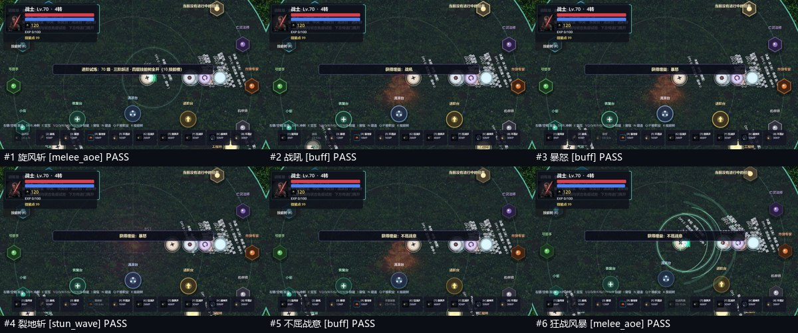

| 槽 | 技能（点击看截图） | 类型 | 结果 | 关键观测 |
|---|---|---|---|---|
| 1 | [旋风斩](skills/091_warrior_warrior_a_1.jpg) | `melee_aoe` | ✅ | melee_aoe; Dmg 0->666, Hits 0->1; MP 551->543; CD=2.70; VFX=1; Anim=n/a |
| 2 | [战吼](skills/092_warrior_warrior_a_2.jpg) | `buff` | ✅ | buff; BuffCount 0->1; MP 551->541; CD=9.60; VFX=1; Anim=n/a |
| 3 | [暴怒](skills/093_warrior_warrior_a_3.jpg) | `buff` | ✅ | buff; BuffCount 0->1; MP 551->539; CD=9.62; VFX=1; Anim=n/a |
| 4 | [裂地斩](skills/094_warrior_warrior_a_4.jpg) | `stun_wave` | ✅ | stun_wave; Dmg 0->851, Hits 0->1; MP 551->533; CD=8.57; VFX=2; Anim=n/a |
| 5 | [不屈战意](skills/095_warrior_warrior_a_5.jpg) | `buff` | ✅ | buff; BuffCount 0->1; MP 551->535; CD=17.60; VFX=1; Anim=n/a |
| 6 | [狂战风暴](skills/096_warrior_warrior_a_6.jpg) | `melee_aoe` | ✅ | melee_aoe; Dmg 0->3316, Hits 0->3; MP 551->525; CD=13.85; VFX=1; Anim=n/a |
| 7 | [剑阵风暴](skills/097_warrior_warrior_fusion.jpg) | `melee_aoe` | ✅ | melee_aoe; Dmg 0->8205, Hits 0->5; MP 551->505; CD=27.85; VFX=1; Anim=n/a |
| 8 | [狂战风暴](skills/098_warrior_warrior_a_spec_a.jpg) | `melee_aoe` | ✅ | melee_aoe; Dmg 0->4355, Hits 0->3; MP 551->521; CD=17.85; VFX=1; Anim=n/a |
| 9 | [战神降临](skills/099_warrior_warrior_a_apex.jpg) | `melee_aoe` | ✅ | melee_aoe; Dmg 0->9414, Hits 0->5; MP 551->501; CD=29.85; VFX=1; Anim=n/a |
| 10 | [不屈战吼](skills/100_warrior_warrior_a_spec_b.jpg) | `buff` | ✅ | buff; BuffCount 0->2; MP 551->521; CD=25.62; VFX=1; Anim=n/a |

### 气宗 · 内息流转：以气血循环治疗与加速，自身亦能近身打出气劲。（`qi_adept`）

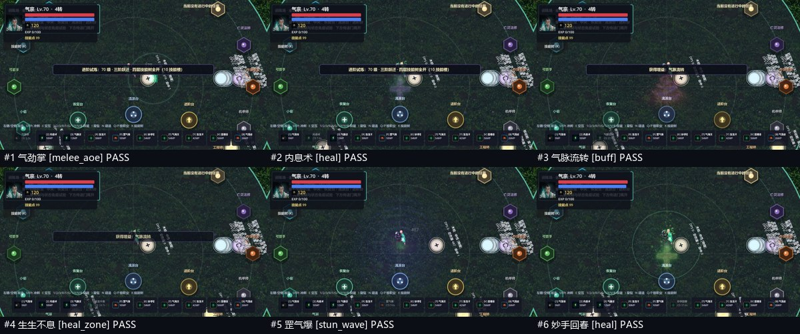

| 槽 | 技能（点击看截图） | 类型 | 结果 | 关键观测 |
|---|---|---|---|---|
| 1 | [气劲掌](skills/101_qi_adept_qi_adept_a_1.jpg) | `melee_aoe` | ✅ | melee_aoe; Dmg 0->379, Hits 0->1; MP 714->705; CD=3.20; VFX=1; Anim=n/a |
| 2 | [内息术](skills/102_qi_adept_qi_adept_a_2.jpg) | `heal` | ✅ | heal; HP 1571->1616 (+45); MP 714->696; CD=7.60; VFX=1; Anim=n/a |
| 3 | [气脉流转](skills/103_qi_adept_qi_adept_a_3.jpg) | `buff` | ✅ | buff; BuffCount 0->1; MP 714->702; CD=11.60; VFX=1; Anim=n/a |
| 4 | [生生不息](skills/104_qi_adept_qi_adept_a_4.jpg) | `heal_zone` | ✅ | heal_zone; HP 1571->1616 (+45); MP 714->684; CD=10.67; VFX=1; Anim=n/a |
| 5 | [罡气爆](skills/105_qi_adept_qi_adept_a_5.jpg) | `stun_wave` | ✅ | stun_wave; Dmg 0->487, Hits 0->1; MP 714->696; CD=7.55; VFX=2; Anim=n/a |
| 6 | [妙手回春](skills/106_qi_adept_qi_adept_a_6.jpg) | `heal` | ✅ | heal; HP 1571->1616 (+45); MP 714->680; CD=17.60; VFX=1; Anim=n/a |
| 7 | [气海无量](skills/107_qi_adept_qi_adept_fusion.jpg) | `heal_zone` | ✅ | heal_zone; HP 1571->1616 (+45); MP 714->660; CD=30.67; VFX=1; Anim=n/a |
| 8 | [生生不息·极](skills/108_qi_adept_qi_adept_a_spec_a.jpg) | `heal_zone` | ✅ | heal_zone; HP 1571->1616 (+45); MP 714->672; CD=22.65; VFX=1; Anim=n/a |
| 9 | [回春圣境](skills/109_qi_adept_qi_adept_a_apex.jpg) | `heal_zone` | ✅ | heal_zone; HP 1571->1616 (+45); MP 714->658; CD=30.67; VFX=1; Anim=n/a |
| 10 | [气劲崩拳](skills/110_qi_adept_qi_adept_a_spec_b.jpg) | `melee_aoe` | ✅ | melee_aoe; Dmg 0->1028, Hits 0->1; MP 714->688; CD=15.72; VFX=1; Anim=n/a |

### 小偷 · 影袭毒刃：依赖背刺与烟幕在高风险窗口内爆发。（`thief`）

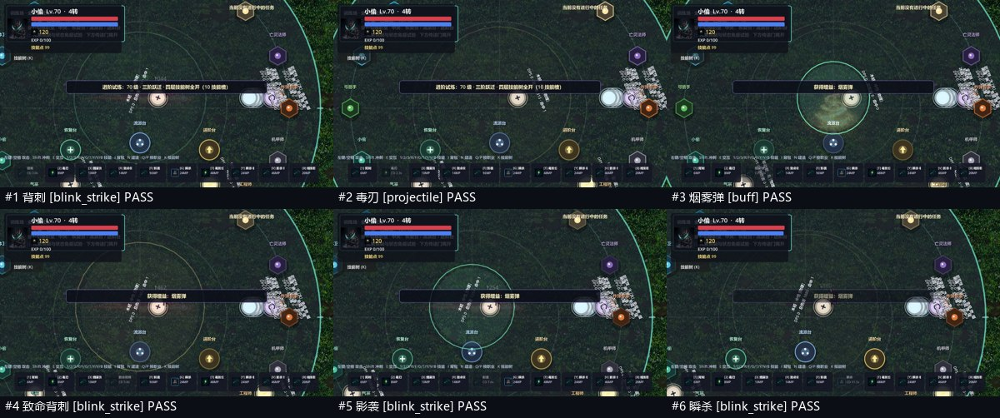

| 槽 | 技能（点击看截图） | 类型 | 结果 | 关键观测 |
|---|---|---|---|---|
| 1 | [背刺](skills/111_thief_thief_a_1.jpg) | `blink_strike` | ✅ | blink_strike; Move 82, Dmg 0->1044; MP 604->598; CD=1.97; VFX=1; Anim=n/a |
| 2 | [毒刃](skills/112_thief_thief_a_2.jpg) | `projectile` | ✅ | projectile; Dmg 0->313, Hits 0->1; MP 604->596; CD=2.33; VFX=1; Anim=n/a |
| 3 | [烟雾弹](skills/113_thief_thief_a_3.jpg) | `buff` | ✅ | buff; BuffCount 0->1; MP 604->594; CD=9.60; VFX=1; Anim=n/a |
| 4 | [致命背刺](skills/114_thief_thief_a_4.jpg) | `blink_strike` | ✅ | blink_strike; Move 82, Dmg 0->1462; MP 604->590; CD=5.55; VFX=1; Anim=n/a |
| 5 | [影袭](skills/115_thief_thief_a_5.jpg) | `blink_strike` | ✅ | blink_strike; Move 82, Dmg 0->1254; MP 604->588; CD=7.57; VFX=1; Anim=n/a |
| 6 | [瞬杀](skills/116_thief_thief_a_6.jpg) | `blink_strike` | ✅ | blink_strike; Move 82, Dmg 0->1880; MP 604->580; CD=11.53; VFX=1; Anim=n/a |
| 7 | [毒影分身](skills/117_thief_thief_fusion.jpg) | `summon` | ✅ | summon; Summons 0->1(peak); MP 604->556; CD=29.65; VFX=1; Anim=n/a |
| 8 | [瞬杀·极](skills/118_thief_thief_a_spec_a.jpg) | `blink_strike` | ✅ | blink_strike; Move 82, Dmg 0->2402; MP 604->580; CD=13.57; VFX=1; Anim=n/a |
| 9 | [影杀·终结](skills/119_thief_thief_a_apex.jpg) | `blink_strike` | ✅ | blink_strike; Move 82, Dmg 0->3238; MP 604->558; CD=25.55; VFX=1; Anim=n/a |
| 10 | [暗影脱离](skills/120_thief_thief_a_spec_b.jpg) | `blink_strike` | ✅ | blink_strike; Move 82, Dmg 0->1670; MP 604->584; CD=11.57; VFX=1; Anim=n/a |

### 弓箭手 · 精确投射：复合弓与瞄准镜把暴击转化为稳定输出。（`archer`）

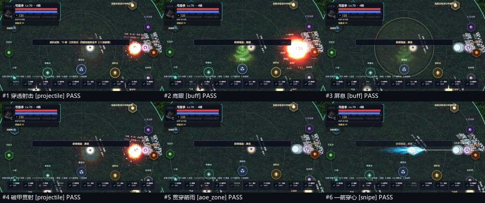

| 槽 | 技能（点击看截图） | 类型 | 结果 | 关键观测 |
|---|---|---|---|---|
| 1 | [穿透射击](skills/121_archer_archer_a_1.jpg) | `projectile` | ✅ | projectile; Dmg 0->858, Hits 0->2; MP 587->581; CD=1.50; VFX=1; Anim=n/a |
| 2 | [鹰眼](skills/122_archer_archer_a_2.jpg) | `buff` | ✅ | buff; BuffCount 0->1; MP 587->577; CD=11.78; VFX=3; Anim=n/a |
| 3 | [屏息](skills/123_archer_archer_a_3.jpg) | `buff` | ✅ | buff; BuffCount 0->1; MP 587->577; CD=9.60; VFX=1; Anim=n/a |
| 4 | [破甲贯射](skills/124_archer_archer_a_4.jpg) | `projectile` | ✅ | projectile; Dmg 0->2010, Hits 0->3; MP 587->575; CD=5.55; VFX=1; Anim=n/a |
| 5 | [贯穿箭雨](skills/125_archer_archer_a_5.jpg) | `aoe_zone` | ✅ | aoe_zone; Dmg 0->2304, Hits 0->3; MP 587->567; CD=9.32; VFX=0; Anim=n/a |
| 6 | [一箭穿心](skills/126_archer_archer_a_6.jpg) | `snipe` | ✅ | snipe; Dmg 0->7887, Hits 0->6; MP 587->561; CD=13.85; VFX=1; Anim=n/a |
| 7 | [万箭穿心](skills/127_archer_archer_fusion.jpg) | `snipe` | ✅ | snipe; Dmg 0->14792, Hits 0->6; MP 587->537; CD=29.83; VFX=1; Anim=n/a |
| 8 | [一箭穿心·极](skills/128_archer_archer_a_spec_a.jpg) | `snipe` | ✅ | snipe; Dmg 0->12328, Hits 0->6; MP 587->553; CD=21.83; VFX=1; Anim=n/a |
| 9 | [射日](skills/129_archer_archer_a_apex.jpg) | `snipe` | ✅ | snipe; Dmg 0->16764, Hits 0->6; MP 587->535; CD=31.83; VFX=1; Anim=n/a |
| 10 | [鹰眼领域](skills/130_archer_archer_a_spec_b.jpg) | `buff` | ✅ | buff; BuffCount 0->2; MP 587->557; CD=25.62; VFX=1; Anim=n/a |

### 义体卫士 · 义体壁垒：液压与能量装甲让自身成为移动前线。（`cyborg`）

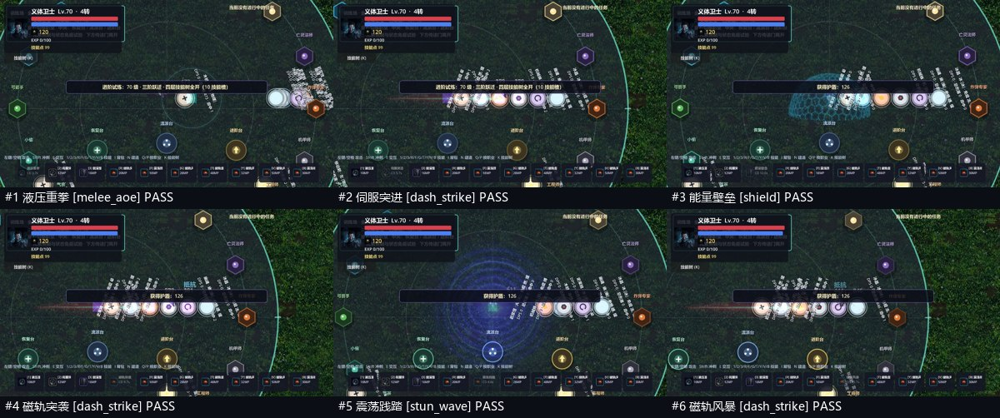

| 槽 | 技能（点击看截图） | 类型 | 结果 | 关键观测 |
|---|---|---|---|---|
| 1 | [液压重拳](skills/131_cyborg_cyborg_a_1.jpg) | `melee_aoe` | ✅ | melee_aoe; Dmg 0->473, Hits 0->1; MP 560->550; CD=3.70; VFX=1; Anim=n/a |
| 2 | [伺服突进](skills/132_cyborg_cyborg_a_2.jpg) | `dash_strike` | ✅ | dash_strike; Move 177, Dmg 0->1291; MP 560->548; CD=5.68; VFX=5; Anim=n/a |
| 3 | [能量壁垒](skills/133_cyborg_cyborg_a_3.jpg) | `shield` | ✅ | shield; Shield 0->126; MP 560->544; CD=12.62; VFX=1; Anim=n/a |
| 4 | [磁轨突袭](skills/134_cyborg_cyborg_a_4.jpg) | `dash_strike` | ✅ | dash_strike; Move 232, Dmg 0->2276; MP 560->540; CD=9.70; VFX=5; Anim=n/a |
| 5 | [震荡践踏](skills/135_cyborg_cyborg_a_5.jpg) | `stun_wave` | ✅ | stun_wave; Dmg 0->1222, Hits 0->2; MP 560->542; CD=8.65; VFX=2; Anim=n/a |
| 6 | [磁轨风暴](skills/136_cyborg_cyborg_a_6.jpg) | `dash_strike` | ✅ | dash_strike; Move 287, Dmg 0->2847; MP 560->532; CD=15.72; VFX=1; Anim=n/a |
| 7 | [磁轨壁垒](skills/137_cyborg_cyborg_fusion.jpg) | `dash_strike` | ✅ | dash_strike; Move 345, Dmg 0->7739; MP 560->512; CD=29.70; VFX=5; Anim=n/a |
| 8 | [磁轨风暴·极](skills/138_cyborg_cyborg_a_spec_a.jpg) | `dash_strike` | ✅ | dash_strike; Move 360, Dmg 0->4477; MP 560->528; CD=19.70; VFX=1; Anim=n/a |
| 9 | [磁轨天罚](skills/139_cyborg_cyborg_a_apex.jpg) | `dash_strike` | ✅ | dash_strike; Move 420, Dmg 0->5781; MP 560->510; CD=29.70; VFX=1; Anim=n/a |
| 10 | [震荡领域](skills/140_cyborg_cyborg_a_spec_b.jpg) | `stun_wave` | ✅ | stun_wave; Dmg 0->3267, Hits 0->3; MP 560->530; CD=17.70; VFX=2; Anim=n/a |

### 黑客 · 网络入侵：病毒、断电与超频改写敌我攻防节奏。（`hacker`）

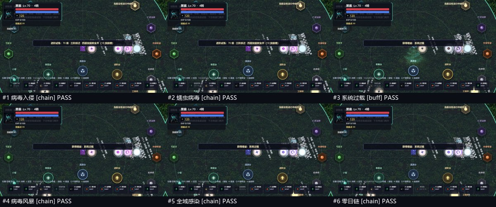

| 槽 | 技能（点击看截图） | 类型 | 结果 | 关键观测 |
|---|---|---|---|---|
| 1 | [病毒入侵](skills/141_hacker_hacker_a_1.jpg) | `chain` | ✅ | chain; Dmg 0->3249, Hits 0->5; MP 791->777; CD=3.70; VFX=6; Anim=n/a |
| 2 | [蠕虫病毒](skills/142_hacker_hacker_a_2.jpg) | `chain` | ✅ | chain; Dmg 0->3752, Hits 0->5; MP 791->773; CD=7.68; VFX=6; Anim=n/a |
| 3 | [系统过载](skills/143_hacker_hacker_a_3.jpg) | `buff` | ✅ | buff; BuffCount 0->1; MP 791->777; CD=11.62; VFX=1; Anim=n/a |
| 4 | [病毒风暴](skills/144_hacker_hacker_a_4.jpg) | `chain` | ✅ | chain; Dmg 0->5539, Hits 0->6; MP 791->769; CD=9.68; VFX=7; Anim=n/a |
| 5 | [全域感染](skills/145_hacker_hacker_a_5.jpg) | `chain` | ✅ | chain; Dmg 0->6775, Hits 0->6; MP 791->765; CD=12.68; VFX=7; Anim=n/a |
| 6 | [零日链](skills/146_hacker_hacker_a_6.jpg) | `chain` | ✅ | chain; Dmg 0->9234, Hits 0->6; MP 791->757; CD=17.70; VFX=7; Anim=n/a |
| 7 | [全网瘫痪](skills/147_hacker_hacker_fusion.jpg) | `chain` | ✅ | chain; Dmg 0->16620, Hits 0->6; MP 791->737; CD=31.70; VFX=7; Anim=n/a |
| 8 | [零日链·极](skills/148_hacker_hacker_a_spec_a.jpg) | `chain` | ✅ | chain; Dmg 0->14158, Hits 0->6; MP 791->751; CD=21.70; VFX=7; Anim=n/a |
| 9 | [零日审判](skills/149_hacker_hacker_a_apex.jpg) | `chain` | ✅ | chain; Dmg 0->18466, Hits 0->6; MP 791->737; CD=29.70; VFX=7; Anim=n/a |
| 10 | [病毒王冠](skills/150_hacker_hacker_a_spec_b.jpg) | `chain` | ✅ | chain; Dmg 0->12927, Hits 0->6; MP 791->755; CD=19.68; VFX=7; Anim=n/a |

### 狙击手 · 潜行狙击：陷阱布场后以超远单发点杀关键目标。（`sniper`）

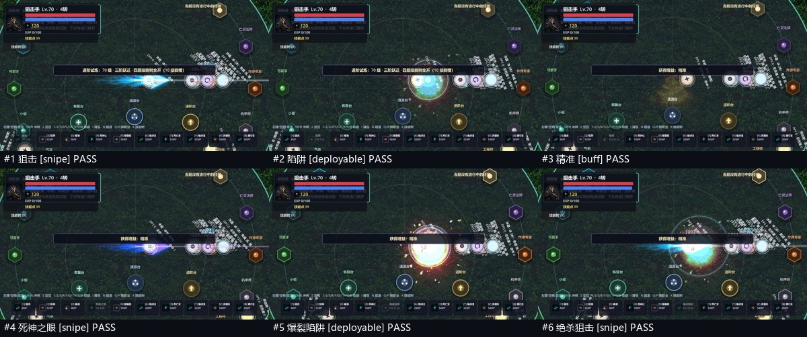

| 槽 | 技能（点击看截图） | 类型 | 结果 | 关键观测 |
|---|---|---|---|---|
| 1 | [狙击](skills/151_sniper_sniper_a_1.jpg) | `snipe` | ✅ | snipe; Dmg 0->8531, Hits 0->6; MP 598->590; CD=3.85; VFX=1; Anim=n/a |
| 2 | [陷阱](skills/152_sniper_sniper_a_2.jpg) | `deployable` | ✅ | deployable; Deployables 0->1(peak); MP 598->586; CD=7.15; VFX=1; Anim=n/a |
| 3 | [精准](skills/153_sniper_sniper_a_3.jpg) | `buff` | ✅ | buff; BuffCount 0->1; MP 598->590; CD=11.58; VFX=1; Anim=n/a |
| 4 | [死神之眼](skills/154_sniper_sniper_a_4.jpg) | `snipe` | ✅ | snipe; Dmg 0->11372, Hits 0->6; MP 598->580; CD=8.83; VFX=1; Anim=n/a |
| 5 | [爆裂陷阱](skills/155_sniper_sniper_a_5.jpg) | `deployable` | ✅ | deployable; Deployables 0->2(peak); MP 598->580; CD=11.20; VFX=2; Anim=n/a |
| 6 | [绝杀狙击](skills/156_sniper_sniper_a_6.jpg) | `snipe` | ✅ | snipe; Dmg 0->14931, Hits 0->6; MP 598->570; CD=15.83; VFX=1; Anim=n/a |
| 7 | [死亡禁区](skills/157_sniper_sniper_fusion.jpg) | `deployable` | ✅ | deployable; Deployables 0->8(peak); MP 598->544; CD=33.40; VFX=8; Anim=n/a |
| 8 | [绝杀狙击·极](skills/158_sniper_sniper_a_spec_a.jpg) | `snipe` | ✅ | snipe; Dmg 0->19192, Hits 0->6; MP 598->566; CD=21.83; VFX=1; Anim=n/a |
| 9 | [天眼绝杀](skills/159_sniper_sniper_a_apex.jpg) | `snipe` | ✅ | snipe; Dmg 0->25596, Hits 0->6; MP 598->544; CD=33.83; VFX=1; Anim=n/a |
| 10 | [潜行狙击](skills/160_sniper_sniper_a_spec_b.jpg) | `buff` | ✅ | buff; BuffCount 0->2; MP 598->570; CD=23.58; VFX=1; Anim=n/a |

---

## 5. 全动作形变实测（40/40 通过）

> 40 状态一图总览：[action_contact_sheet_40.jpg](action_contact_sheet_40.jpg)  
> 单张原图：`actions/`

通过 `SpriteAnim` 公共入口逐一切换 40 个 AnimState，断言内部状态值正确并截图记录形变姿态；另对玩家实体执行普攻/冲刺/受击/死亡/复活真实动作链。

| # | AnimState | 触发方式 | 期望 | 实际 | 结果 |
|---|---|---|---|---|---|
| 1 | `IDLE` | settle | 0 | 0 | ✅ |
| 2 | `RUN` | settle | 1 | 1 | ✅ |
| 3 | `ATTACK` | enter_attack | 2 | 2 | ✅ |
| 4 | `CAST` | enter_cast | 3 | 3 | ✅ |
| 5 | `DASH` | enter_dash | 4 | 4 | ✅ |
| 6 | `BLINK` | enter_blink | 5 | 5 | ✅ |
| 7 | `HURT` | enter_hurt | 6 | 6 | ✅ |
| 8 | `DEAD` | enter_dead | 7 | 7 | ✅ |
| 9 | `STAGGER` | settle | 8 | 8 | ✅ |
| 10 | `RESURRECTING` | settle | 9 | 9 | ✅ |
| 11 | `SWORD_SWING` | enter_sword_swing | 10 | 10 | ✅ |
| 12 | `BOW_DRAW` | enter_bow_draw | 11 | 11 | ✅ |
| 13 | `THROW_BOMB` | enter_throw_bomb | 12 | 12 | ✅ |
| 14 | `CAST_SPELL` | enter_cast_spell | 13 | 13 | ✅ |
| 15 | `SUMMON_RITUAL` | enter_summon_ritual | 14 | 14 | ✅ |
| 16 | `CHARGING` | settle | 15 | 15 | ✅ |
| 17 | `CAST_FOCUS` | settle | 16 | 16 | ✅ |
| 18 | `BLOCK` | settle | 17 | 17 | ✅ |
| 19 | `READY` | settle | 18 | 18 | ✅ |
| 20 | `CROUCH` | settle | 19 | 19 | ✅ |
| 21 | `WALK_CROUCH` | settle | 20 | 20 | ✅ |
| 22 | `PRONE` | settle | 21 | 21 | ✅ |
| 23 | `LURK` | settle | 22 | 22 | ✅ |
| 24 | `JUMP` | enter_jump | 23 | 23 | ✅ |
| 25 | `JUMP_FALLING` | enter_jump | 24 | 24 | ✅ |
| 26 | `JUMP_LAND` | enter_jump | 25 | 25 | ✅ |
| 27 | `SWIM` | settle | 26 | 26 | ✅ |
| 28 | `CLIMB` | settle | 27 | 27 | ✅ |
| 29 | `ROLL` | enter_roll | 28 | 28 | ✅ |
| 30 | `MOUNTED` | settle | 29 | 29 | ✅ |
| 31 | `FORCE_READY` | enter_force_ready | 30 | 30 | ✅ |
| 32 | `DRINK` | settle | 31 | 31 | ✅ |
| 33 | `CARRY` | settle | 32 | 32 | ✅ |
| 34 | `SIT` | settle | 33 | 33 | ✅ |
| 35 | `TRAP_SET` | settle | 34 | 34 | ✅ |
| 36 | `PORTAL` | settle | 35 | 35 | ✅ |
| 37 | `CELEBRATE` | settle | 36 | 36 | ✅ |
| 38 | `FALL` | settle | 37 | 37 | ✅ |
| 39 | `AOE_SWING` | enter_aoe_swing | 38 | 38 | ✅ |
| 40 | `RAPID_STRIKES` | enter_rapid_strikes | 39 | 39 | ✅ |

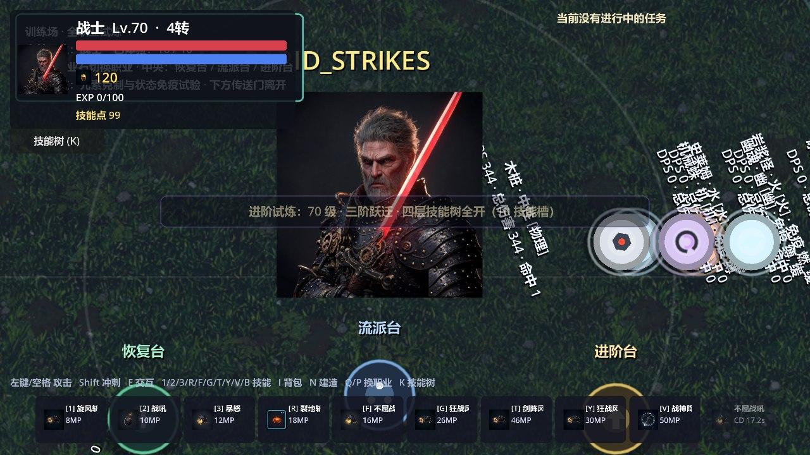

---

## 6. 发现的问题与建议

### 1. 训练场木桩缺少碰撞形状，投射物技能无法命中（建议修复）

scripts/world/training_dummy.gd 由 training_ground.gd 以 DUMMY_SCRIPT.new() 直接实例化，而 training_dummy.gd / enemy_base.gd 均未创建 CollisionShape2D（仅 scenes/enemies/enemy.tscn 自带）。投射物 projectile.gd 是 Area2D(collision_mask=4)，依赖 body_entered 命中，因此训练场内所有 projectile 技能首轮实测均 Dmg 0->0。本次测试在夹具中为木桩补建 CircleShape2D 后投射物链恢复正常，游戏运行逻辑本身正确。建议在 TrainingDummy._ready() 内自建碰撞形状，使训练场真正覆盖投射物技能。

### 2. 统一动作层 ActionController / ActionProfileRegistry 在 Godot 4.7.2 下编译失败（建议修复）

scripts/combat/action_profile_registry.gd:155 的 static func get(id: String) 覆盖了 Object.get(StringName) -> Variant，4.7.2 将警告视为错误，导致该脚本与其调用方 action_controller.gd（第 107 行 ActionProfileRegistry.get）均无法编译。实践中玩家使用 SpriteAnim 形变层，统一动作层处于未接入状态。建议将 get() 改名为 get_profile() 并更新调用方。

### 3. 魔法技能元素归类为单一 fire 元素（非阻断）

SkillExecutor.cast 中未显式指定 damage_element 的魔法技能统一按 fire 结算，火元素木桩对其免疫。训练场提供 7 种元素木桩用于验证克制，但技能数据缺少冰/雷/圣/幽等细分元素字段，元素克制覆盖有限。

---

## 7. 功能断言明细

| 断言 | 结果 | 详情 |
|---|---|---|
| 训练场场景加载 | ✅ | res://scenes/world/training_ground.tscn |
| 训练场出战角色存在 | ✅ |  |
| 职业石数量 = 16 | ✅ | 16 |
| 元素木桩数量 = 8 | ✅ | 8 |
| 木桩进入 training_dummies 组 | ✅ | 8 |
| 存在中性物理木桩（不受元素免疫干扰） | ✅ |  |
| 三功能台所属 Dynamic 节点存在 | ✅ |  |
| 训练场信息面板存在 | ✅ |  |
| 职业 mage 切换/技能/进阶 | ✅ | class=mage skills=10 stage=4 slots=10 |
| 职业 mage 立绘加载 | ✅ |  |
| 职业 runeward 切换/技能/进阶 | ✅ | class=runeward skills=10 stage=4 slots=10 |
| 职业 runeward 立绘加载 | ✅ |  |
| 职业 priest 切换/技能/进阶 | ✅ | class=priest skills=10 stage=4 slots=10 |
| 职业 priest 立绘加载 | ✅ |  |
| 职业 necromancer 切换/技能/进阶 | ✅ | class=necromancer skills=10 stage=4 slots=10 |
| 职业 necromancer 立绘加载 | ✅ |  |
| 职业 bomber 切换/技能/进阶 | ✅ | class=bomber skills=10 stage=4 slots=10 |
| 职业 bomber 立绘加载 | ✅ |  |
| 职业 mech_pilot 切换/技能/进阶 | ✅ | class=mech_pilot skills=10 stage=4 slots=10 |
| 职业 mech_pilot 立绘加载 | ✅ |  |
| 职业 engineer 切换/技能/进阶 | ✅ | class=engineer skills=10 stage=4 slots=10 |
| 职业 engineer 立绘加载 | ✅ |  |
| 职业 bounty_hunter 切换/技能/进阶 | ✅ | class=bounty_hunter skills=10 stage=4 slots=10 |
| 职业 bounty_hunter 立绘加载 | ✅ |  |
| 职业 death_knight 切换/技能/进阶 | ✅ | class=death_knight skills=10 stage=4 slots=10 |
| 职业 death_knight 立绘加载 | ✅ |  |
| 职业 warrior 切换/技能/进阶 | ✅ | class=warrior skills=10 stage=4 slots=10 |
| 职业 warrior 立绘加载 | ✅ |  |
| 职业 qi_adept 切换/技能/进阶 | ✅ | class=qi_adept skills=10 stage=4 slots=10 |
| 职业 qi_adept 立绘加载 | ✅ |  |
| 职业 thief 切换/技能/进阶 | ✅ | class=thief skills=10 stage=4 slots=10 |
| 职业 thief 立绘加载 | ✅ |  |
| 职业 archer 切换/技能/进阶 | ✅ | class=archer skills=10 stage=4 slots=10 |
| 职业 archer 立绘加载 | ✅ |  |
| 职业 cyborg 切换/技能/进阶 | ✅ | class=cyborg skills=10 stage=4 slots=10 |
| 职业 cyborg 立绘加载 | ✅ |  |
| 职业 hacker 切换/技能/进阶 | ✅ | class=hacker skills=10 stage=4 slots=10 |
| 职业 hacker 立绘加载 | ✅ |  |
| 职业 sniper 切换/技能/进阶 | ✅ | class=sniper skills=10 stage=4 slots=10 |
| 职业 sniper 立绘加载 | ✅ |  |
| mage 技能数>=6（完整进阶 10） | ✅ | 10 |
| 技能 mage-mage_a_1 | ✅ | projectile; Dmg 0->606, Hits 0->1; MP 783->775; CD=0.80; VFX=1; Anim=n/a |
| 技能 mage-mage_a_2 | ✅ | aoe_zone; Dmg 0->491, Hits 0->1; MP 783->767; CD=5.05; VFX=0; Anim=n/a |
| 技能 mage-mage_a_3 | ✅ | shield; Shield 0->70; MP 783->765; CD=11.58; VFX=1; Anim=n/a |
| 技能 mage-mage_a_4 | ✅ | aoe_zone; Dmg 0->1826, Hits 0->2; MP 783->757; CD=10.83; VFX=0; Anim=n/a |
| 技能 mage-mage_a_5 | ✅ | aoe_zone; Dmg 0->1404, Hits 0->2; MP 783->761; CD=9.00; VFX=0; Anim=n/a |
| 技能 mage-mage_a_6 | ✅ | aoe_zone; Dmg 0->3144, Hits 0->3; MP 783->749; CD=16.72; VFX=0; Anim=n/a |
| 技能 mage-mage_fusion | ✅ | aoe_zone; Dmg 0->6318, Hits 0->4; MP 783->723; CD=28.98; VFX=0; Anim=n/a |
| 技能 mage-mage_a_spec_a | ✅ | aoe_zone; Dmg 0->3833, Hits 0->3; MP 783->737; CD=24.90; VFX=0; Anim=n/a |
| 技能 mage-mage_a_apex | ✅ | aoe_zone; Dmg 0->6570, Hits 0->4; MP 783->729; CD=30.57; VFX=0; Anim=n/a |
| 技能 mage-mage_a_spec_b | ✅ | dash_strike; Move 232, Dmg 0->2581; MP 783->753; CD=14.68; VFX=1; Anim=n/a |
| runeward 技能数>=6（完整进阶 10） | ✅ | 10 |
| 技能 runeward-runeward_a_1 | ✅ | shield; Shield 0->108; MP 648->632; CD=11.62; VFX=1; Anim=n/a |
| 技能 runeward-runeward_a_2 | ✅ | stun_wave; Dmg 0->361, Hits 0->1; MP 648->636; CD=4.55; VFX=2; Anim=n/a |
| 技能 runeward-runeward_a_3 | ✅ | buff; BuffCount 0->1; MP 648->634; CD=13.58; VFX=1; Anim=n/a |
| 技能 runeward-runeward_a_4 | ✅ | shield; Shield 0->171; MP 648->626; CD=17.60; VFX=1; Anim=n/a |
| 技能 runeward-runeward_a_5 | ✅ | root_zone; Dmg 0->1784, Hits 0->4; MP 648->628; CD=10.68; VFX=1; Anim=n/a |
| 技能 runeward-runeward_a_6 | ✅ | buff; BuffCount 0->1; MP 648->624; CD=19.62; VFX=1; Anim=n/a |
| 技能 runeward-runeward_fusion | ✅ | buff; BuffCount 0->2; MP 648->596; CD=33.62; VFX=1; Anim=n/a |
| 技能 runeward-runeward_a_spec_a | ✅ | heal_zone; HP 1670->1715 (+45); MP 648->612; CD=24.65; VFX=1; Anim=n/a |
| 技能 runeward-runeward_a_apex | ✅ | buff; BuffCount 0->1; MP 648->600; CD=31.60; VFX=1; Anim=n/a |
| 技能 runeward-runeward_a_spec_b | ✅ | stun_wave; Dmg 0->2688, Hits 0->3; MP 648->616; CD=17.70; VFX=2; Anim=n/a |
| priest 技能数>=6（完整进阶 10） | ✅ | 10 |
| 技能 priest-priest_a_1 | ✅ | heal; HP 1544->1589 (+45); MP 701->687; CD=3.60; VFX=1; Anim=n/a |
| 技能 priest-priest_a_2 | ✅ | projectile; Dmg 0->311, Hits 0->1; MP 701->691; CD=2.40; VFX=1; Anim=n/a |
| 技能 priest-priest_a_3 | ✅ | buff; BuffCount 0->1; MP 701->685; CD=13.60; VFX=1; Anim=n/a |
| 技能 priest-priest_a_4 | ✅ | heal_zone; HP 1544->1589 (+45); MP 701->669; CD=12.67; VFX=1; Anim=n/a |
| 技能 priest-priest_a_5 | ✅ | melee_aoe; Dmg 0->489, Hits 0->1; MP 701->679; CD=8.70; VFX=1; Anim=n/a |
| 技能 priest-priest_a_6 | ✅ | heal_zone; HP 1544->1589 (+45); MP 701->663; CD=18.65; VFX=1; Anim=n/a |
| 技能 priest-priest_fusion | ✅ | heal_zone; HP 1544->1589 (+45); MP 701->645; CD=30.67; VFX=1; Anim=n/a |
| 技能 priest-priest_a_spec_a | ✅ | heal; HP 1544->1589 (+45); MP 701->661; CD=17.60; VFX=1; Anim=n/a |
| 技能 priest-priest_a_apex | ✅ | heal_zone; HP 1544->1589 (+45); MP 701->645; CD=32.67; VFX=1; Anim=n/a |
| 技能 priest-priest_a_spec_b | ✅ | snipe; Dmg 0->4646, Hits 0->6; MP 701->665; CD=19.83; VFX=1; Anim=n/a |
| necromancer 技能数>=6（完整进阶 10） | ✅ | 10 |
| 技能 necromancer-necromancer_a_1 | ✅ | projectile; Dmg 0->854, Hits 0->2; MP 769->748; CD=1.32; VFX=-1; Anim=n/a |
| 技能 necromancer-necromancer_a_2 | ✅ | snipe; Dmg 0->1376, Hits 0->4; MP 769->755; CD=7.85; VFX=1; Anim=n/a |
| 技能 necromancer-necromancer_a_3 | ✅ | shield; Shield 0->52; MP 769->753; CD=11.60; VFX=1; Anim=n/a |
| 技能 necromancer-necromancer_a_4 | ✅ | snipe; Dmg 0->3101, Hits 0->6; MP 769->749; CD=8.83; VFX=1; Anim=n/a |
| 技能 necromancer-necromancer_a_5 | ✅ | snipe; Dmg 0->2534, Hits 0->6; MP 769->749; CD=8.83; VFX=1; Anim=n/a |
| 技能 necromancer-necromancer_a_6 | ✅ | snipe; Dmg 0->4224, Hits 0->6; MP 769->739; CD=15.83; VFX=1; Anim=n/a |
| 技能 necromancer-necromancer_fusion | ✅ | summon; Summons 0->2(peak); MP 769->711; CD=35.70; VFX=1; Anim=n/a |
| 技能 necromancer-necromancer_a_spec_a | ✅ | snipe; Dmg 0->5635, Hits 0->6; MP 769->731; CD=21.85; VFX=1; Anim=n/a |
| 技能 necromancer-necromancer_a_apex | ✅ | snipe; Dmg 0->8454, Hits 0->6; MP 769->713; CD=33.85; VFX=1; Anim=n/a |
| 技能 necromancer-necromancer_a_spec_b | ✅ | heal_zone; HP 1473->1518 (+45); MP 769->729; CD=22.65; VFX=1; Anim=n/a |
| bomber 技能数>=6（完整进阶 10） | ✅ | 10 |
| 技能 bomber-bomber_a_1 | ✅ | deployable; Deployables 0->2(peak); MP 623->613; CD=2.23; VFX=2; Anim=n/a |
| 技能 bomber-bomber_a_2 | ✅ | aoe_zone; Dmg 0->978, Hits 0->2; MP 623->605; CD=7.02; VFX=0; Anim=n/a |
| 技能 bomber-bomber_a_3 | ✅ | shield; Shield 0->52; MP 623->607; CD=11.60; VFX=1; Anim=n/a |
| 技能 bomber-bomber_a_4 | ✅ | deployable; Deployables 0->4(peak); MP 623->603; CD=8.48; VFX=4; Anim=n/a |
| 技能 bomber-bomber_a_5 | ✅ | deployable; Deployables 0->4(peak); MP 623->603; CD=9.42; VFX=4; Anim=n/a |
| 技能 bomber-bomber_a_6 | ✅ | deployable; Deployables 0->6(peak); MP 623->593; CD=15.58; VFX=6; Anim=n/a |
| 技能 bomber-bomber_fusion | ✅ | deployable; Deployables 0->6(peak); MP 623->569; CD=33.42; VFX=6; Anim=n/a |
| 技能 bomber-bomber_a_spec_a | ✅ | deployable; Deployables 0->4(peak); MP 623->585; CD=21.27; VFX=4; Anim=n/a |
| 技能 bomber-bomber_a_apex | ✅ | deployable; Deployables 0->8(peak); MP 623->567; CD=33.48; VFX=8; Anim=n/a |
| 技能 bomber-bomber_a_spec_b | ✅ | aoe_zone; Dmg 0->4895, Hits 0->4; MP 623->587; CD=19.13; VFX=0; Anim=n/a |
| mech_pilot 技能数>=6（完整进阶 10） | ✅ | 10 |
| 技能 mech_pilot-mech_pilot_a_1 | ✅ | projectile; Dmg 0->522, Hits 0->1; MP 574->564; CD=2.42; VFX=0; Anim=n/a |
| 技能 mech_pilot-mech_pilot_a_2 | ✅ | shield; Shield 0->252; MP 574->562; CD=11.58; VFX=1; Anim=n/a |
| 技能 mech_pilot-mech_pilot_a_3 | ✅ | buff; BuffCount 0->1; MP 574->560; CD=13.58; VFX=1; Anim=n/a |
| 技能 mech_pilot-mech_pilot_a_4 | ✅ | snipe; Dmg 0->3585, Hits 0->6; MP 574->556; CD=8.83; VFX=1; Anim=n/a |
| 技能 mech_pilot-mech_pilot_a_5 | ✅ | shield; Shield 0->432; MP 574->552; CD=19.58; VFX=1; Anim=n/a |
| 技能 mech_pilot-mech_pilot_a_6 | ✅ | buff; BuffCount 0->1; MP 574->554; CD=19.60; VFX=1; Anim=n/a |
| 技能 mech_pilot-mech_pilot_fusion | ✅ | aoe_zone; Dmg 0->5809, Hits 0->5; MP 574->522; CD=31.12; VFX=0; Anim=n/a |
| 技能 mech_pilot-mech_pilot_a_spec_a | ✅ | snipe; Dmg 0->6066, Hits 0->6; MP 574->540; CD=21.85; VFX=1; Anim=n/a |
| 技能 mech_pilot-mech_pilot_a_apex | ✅ | snipe; Dmg 0->8549, Hits 0->6; MP 574->522; CD=33.87; VFX=1; Anim=n/a |
| 技能 mech_pilot-mech_pilot_a_spec_b | ✅ | buff; BuffCount 0->1; MP 574->538; CD=29.60; VFX=1; Anim=n/a |
| engineer 技能数>=6（完整进阶 10） | ✅ | 10 |
| 技能 engineer-engineer_a_1 | ✅ | deployable; Deployables 0->1(peak); MP 680->664; CD=6.15; VFX=1; Anim=n/a |
| 技能 engineer-engineer_a_2 | ✅ | heal; HP 1567->1612 (+45); MP 680->662; CD=8.62; VFX=1; Anim=n/a |
| 技能 engineer-engineer_a_3 | ✅ | buff; BuffCount 0->1; MP 680->668; CD=11.60; VFX=1; Anim=n/a |
| 技能 engineer-engineer_a_4 | ✅ | deployable; Deployables 0->1(peak); MP 680->656; CD=10.13; VFX=1; Anim=n/a |
| 技能 engineer-engineer_a_5 | ✅ | deployable; Deployables 0->2(peak); MP 680->652; CD=13.25; VFX=2; Anim=n/a |
| 技能 engineer-engineer_a_6 | ✅ | deployable; Deployables 0->1(peak); MP 680->646; CD=17.23; VFX=1; Anim=n/a |
| 技能 engineer-engineer_fusion | ✅ | deployable; Deployables 0->2(peak); MP 680->624; CD=35.45; VFX=2; Anim=n/a |
| 技能 engineer-engineer_a_spec_a | ✅ | deployable; Deployables 0->1(peak); MP 680->638; CD=23.33; VFX=1; Anim=n/a |
| 技能 engineer-engineer_a_apex | ✅ | deployable; Deployables 0->3(peak); MP 680->624; CD=31.45; VFX=3; Anim=n/a |
| 技能 engineer-engineer_a_spec_b | ✅ | summon; Summons 0->1(peak); MP 680->642; CD=21.75; VFX=0; Anim=n/a |
| bounty_hunter 技能数>=6（完整进阶 10） | ✅ | 10 |
| 技能 bounty_hunter-bounty_hunter_a_1 | ✅ | chain; Dmg 0->1496, Hits 0->3; MP 599->589; CD=2.70; VFX=4; Anim=n/a |
| 技能 bounty_hunter-bounty_hunter_a_2 | ✅ | mark; MarkedDummies 0->1; MP 599->591; CD=11.45; VFX=1; Anim=n/a |
| 技能 bounty_hunter-bounty_hunter_a_3 | ✅ | buff; BuffCount 0->1; MP 599->587; CD=9.60; VFX=1; Anim=n/a |
| 技能 bounty_hunter-bounty_hunter_a_4 | ✅ | chain; Dmg 0->2606, Hits 0->4; MP 599->581; CD=7.70; VFX=5; Anim=n/a |
| 技能 bounty_hunter-bounty_hunter_a_5 | ✅ | mark; MarkedDummies 0->1; MP 599->585; CD=15.43; VFX=1; Anim=n/a |
| 技能 bounty_hunter-bounty_hunter_a_6 | ✅ | mark; MarkedDummies 0->1; MP 599->579; CD=19.45; VFX=1; Anim=n/a |
| 技能 bounty_hunter-bounty_hunter_fusion | ✅ | mark; MarkedDummies 0->1; MP 599->559; CD=29.43; VFX=1; Anim=n/a |
| 技能 bounty_hunter-bounty_hunter_a_spec_a | ✅ | mark; MarkedDummies 0->1; MP 599->565; CD=27.45; VFX=1; Anim=n/a |
| 技能 bounty_hunter-bounty_hunter_a_apex | ✅ | snipe; Dmg 0->13930, Hits 0->6; MP 599->547; CD=31.85; VFX=1; Anim=n/a |
| 技能 bounty_hunter-bounty_hunter_a_spec_b | ✅ | projectile; Dmg 0->7256, Hits 0->8; MP 599->569; CD=17.47; VFX=8; Anim=n/a |
| death_knight 技能数>=6（完整进阶 10） | ✅ | 10 |
| 技能 death_knight-death_knight_a_1 | ✅ | dash_strike; Move 123, Dmg 0->752; MP 599->589; CD=4.65; VFX=1; Anim=n/a |
| 技能 death_knight-death_knight_a_2 | ✅ | melee_aoe; Dmg 0->1330, Hits 0->3; MP 599->587; CD=3.83; VFX=1; Anim=n/a |
| 技能 death_knight-death_knight_a_3 | ✅ | shield; Shield 0->73; MP 599->583; CD=13.60; VFX=1; Anim=n/a |
| 技能 death_knight-death_knight_a_4 | ✅ | dash_strike; Move 178, Dmg 0->980; MP 599->583; CD=8.63; VFX=1; Anim=n/a |
| 技能 death_knight-death_knight_a_5 | ✅ | snipe; Dmg 0->2731, Hits 0->5; MP 599->581; CD=7.83; VFX=1; Anim=n/a |
| 技能 death_knight-death_knight_a_6 | ✅ | snipe; Dmg 0->4489, Hits 0->6; MP 599->571; CD=15.85; VFX=1; Anim=n/a |
| 技能 death_knight-death_knight_fusion | ✅ | dash_strike; Move 287, Dmg 0->6228; MP 599->553; CD=27.68; VFX=1; Anim=n/a |
| 技能 death_knight-death_knight_a_spec_a | ✅ | dash_strike; Move 233, Dmg 0->3208; MP 599->567; CD=19.68; VFX=1; Anim=n/a |
| 技能 death_knight-death_knight_a_apex | ✅ | snipe; Dmg 0->7856, Hits 0->6; MP 599->547; CD=31.85; VFX=1; Anim=n/a |
| 技能 death_knight-death_knight_a_spec_b | ✅ | stun_wave; Dmg 0->2965, Hits 0->3; MP 599->569; CD=17.70; VFX=2; Anim=n/a |
| warrior 技能数>=6（完整进阶 10） | ✅ | 10 |
| 技能 warrior-warrior_a_1 | ✅ | melee_aoe; Dmg 0->666, Hits 0->1; MP 551->543; CD=2.70; VFX=1; Anim=n/a |
| 技能 warrior-warrior_a_2 | ✅ | buff; BuffCount 0->1; MP 551->541; CD=9.60; VFX=1; Anim=n/a |
| 技能 warrior-warrior_a_3 | ✅ | buff; BuffCount 0->1; MP 551->539; CD=9.62; VFX=1; Anim=n/a |
| 技能 warrior-warrior_a_4 | ✅ | stun_wave; Dmg 0->851, Hits 0->1; MP 551->533; CD=8.57; VFX=2; Anim=n/a |
| 技能 warrior-warrior_a_5 | ✅ | buff; BuffCount 0->1; MP 551->535; CD=17.60; VFX=1; Anim=n/a |
| 技能 warrior-warrior_a_6 | ✅ | melee_aoe; Dmg 0->3316, Hits 0->3; MP 551->525; CD=13.85; VFX=1; Anim=n/a |
| 技能 warrior-warrior_fusion | ✅ | melee_aoe; Dmg 0->8205, Hits 0->5; MP 551->505; CD=27.85; VFX=1; Anim=n/a |
| 技能 warrior-warrior_a_spec_a | ✅ | melee_aoe; Dmg 0->4355, Hits 0->3; MP 551->521; CD=17.85; VFX=1; Anim=n/a |
| 技能 warrior-warrior_a_apex | ✅ | melee_aoe; Dmg 0->9414, Hits 0->5; MP 551->501; CD=29.85; VFX=1; Anim=n/a |
| 技能 warrior-warrior_a_spec_b | ✅ | buff; BuffCount 0->2; MP 551->521; CD=25.62; VFX=1; Anim=n/a |
| qi_adept 技能数>=6（完整进阶 10） | ✅ | 10 |
| 技能 qi_adept-qi_adept_a_1 | ✅ | melee_aoe; Dmg 0->379, Hits 0->1; MP 714->705; CD=3.20; VFX=1; Anim=n/a |
| 技能 qi_adept-qi_adept_a_2 | ✅ | heal; HP 1571->1616 (+45); MP 714->696; CD=7.60; VFX=1; Anim=n/a |
| 技能 qi_adept-qi_adept_a_3 | ✅ | buff; BuffCount 0->1; MP 714->702; CD=11.60; VFX=1; Anim=n/a |
| 技能 qi_adept-qi_adept_a_4 | ✅ | heal_zone; HP 1571->1616 (+45); MP 714->684; CD=10.67; VFX=1; Anim=n/a |
| 技能 qi_adept-qi_adept_a_5 | ✅ | stun_wave; Dmg 0->487, Hits 0->1; MP 714->696; CD=7.55; VFX=2; Anim=n/a |
| 技能 qi_adept-qi_adept_a_6 | ✅ | heal; HP 1571->1616 (+45); MP 714->680; CD=17.60; VFX=1; Anim=n/a |
| 技能 qi_adept-qi_adept_fusion | ✅ | heal_zone; HP 1571->1616 (+45); MP 714->660; CD=30.67; VFX=1; Anim=n/a |
| 技能 qi_adept-qi_adept_a_spec_a | ✅ | heal_zone; HP 1571->1616 (+45); MP 714->672; CD=22.65; VFX=1; Anim=n/a |
| 技能 qi_adept-qi_adept_a_apex | ✅ | heal_zone; HP 1571->1616 (+45); MP 714->658; CD=30.67; VFX=1; Anim=n/a |
| 技能 qi_adept-qi_adept_a_spec_b | ✅ | melee_aoe; Dmg 0->1028, Hits 0->1; MP 714->688; CD=15.72; VFX=1; Anim=n/a |
| thief 技能数>=6（完整进阶 10） | ✅ | 10 |
| 技能 thief-thief_a_1 | ✅ | blink_strike; Move 82, Dmg 0->1044; MP 604->598; CD=1.97; VFX=1; Anim=n/a |
| 技能 thief-thief_a_2 | ✅ | projectile; Dmg 0->313, Hits 0->1; MP 604->596; CD=2.33; VFX=1; Anim=n/a |
| 技能 thief-thief_a_3 | ✅ | buff; BuffCount 0->1; MP 604->594; CD=9.60; VFX=1; Anim=n/a |
| 技能 thief-thief_a_4 | ✅ | blink_strike; Move 82, Dmg 0->1462; MP 604->590; CD=5.55; VFX=1; Anim=n/a |
| 技能 thief-thief_a_5 | ✅ | blink_strike; Move 82, Dmg 0->1254; MP 604->588; CD=7.57; VFX=1; Anim=n/a |
| 技能 thief-thief_a_6 | ✅ | blink_strike; Move 82, Dmg 0->1880; MP 604->580; CD=11.53; VFX=1; Anim=n/a |
| 技能 thief-thief_fusion | ✅ | summon; Summons 0->1(peak); MP 604->556; CD=29.65; VFX=1; Anim=n/a |
| 技能 thief-thief_a_spec_a | ✅ | blink_strike; Move 82, Dmg 0->2402; MP 604->580; CD=13.57; VFX=1; Anim=n/a |
| 技能 thief-thief_a_apex | ✅ | blink_strike; Move 82, Dmg 0->3238; MP 604->558; CD=25.55; VFX=1; Anim=n/a |
| 技能 thief-thief_a_spec_b | ✅ | blink_strike; Move 82, Dmg 0->1670; MP 604->584; CD=11.57; VFX=1; Anim=n/a |
| archer 技能数>=6（完整进阶 10） | ✅ | 10 |
| 技能 archer-archer_a_1 | ✅ | projectile; Dmg 0->858, Hits 0->2; MP 587->581; CD=1.50; VFX=1; Anim=n/a |
| 技能 archer-archer_a_2 | ✅ | buff; BuffCount 0->1; MP 587->577; CD=11.78; VFX=3; Anim=n/a |
| 技能 archer-archer_a_3 | ✅ | buff; BuffCount 0->1; MP 587->577; CD=9.60; VFX=1; Anim=n/a |
| 技能 archer-archer_a_4 | ✅ | projectile; Dmg 0->2010, Hits 0->3; MP 587->575; CD=5.55; VFX=1; Anim=n/a |
| 技能 archer-archer_a_5 | ✅ | aoe_zone; Dmg 0->2304, Hits 0->3; MP 587->567; CD=9.32; VFX=0; Anim=n/a |
| 技能 archer-archer_a_6 | ✅ | snipe; Dmg 0->7887, Hits 0->6; MP 587->561; CD=13.85; VFX=1; Anim=n/a |
| 技能 archer-archer_fusion | ✅ | snipe; Dmg 0->14792, Hits 0->6; MP 587->537; CD=29.83; VFX=1; Anim=n/a |
| 技能 archer-archer_a_spec_a | ✅ | snipe; Dmg 0->12328, Hits 0->6; MP 587->553; CD=21.83; VFX=1; Anim=n/a |
| 技能 archer-archer_a_apex | ✅ | snipe; Dmg 0->16764, Hits 0->6; MP 587->535; CD=31.83; VFX=1; Anim=n/a |
| 技能 archer-archer_a_spec_b | ✅ | buff; BuffCount 0->2; MP 587->557; CD=25.62; VFX=1; Anim=n/a |
| cyborg 技能数>=6（完整进阶 10） | ✅ | 10 |
| 技能 cyborg-cyborg_a_1 | ✅ | melee_aoe; Dmg 0->473, Hits 0->1; MP 560->550; CD=3.70; VFX=1; Anim=n/a |
| 技能 cyborg-cyborg_a_2 | ✅ | dash_strike; Move 177, Dmg 0->1291; MP 560->548; CD=5.68; VFX=5; Anim=n/a |
| 技能 cyborg-cyborg_a_3 | ✅ | shield; Shield 0->126; MP 560->544; CD=12.62; VFX=1; Anim=n/a |
| 技能 cyborg-cyborg_a_4 | ✅ | dash_strike; Move 232, Dmg 0->2276; MP 560->540; CD=9.70; VFX=5; Anim=n/a |
| 技能 cyborg-cyborg_a_5 | ✅ | stun_wave; Dmg 0->1222, Hits 0->2; MP 560->542; CD=8.65; VFX=2; Anim=n/a |
| 技能 cyborg-cyborg_a_6 | ✅ | dash_strike; Move 287, Dmg 0->2847; MP 560->532; CD=15.72; VFX=1; Anim=n/a |
| 技能 cyborg-cyborg_fusion | ✅ | dash_strike; Move 345, Dmg 0->7739; MP 560->512; CD=29.70; VFX=5; Anim=n/a |
| 技能 cyborg-cyborg_a_spec_a | ✅ | dash_strike; Move 360, Dmg 0->4477; MP 560->528; CD=19.70; VFX=1; Anim=n/a |
| 技能 cyborg-cyborg_a_apex | ✅ | dash_strike; Move 420, Dmg 0->5781; MP 560->510; CD=29.70; VFX=1; Anim=n/a |
| 技能 cyborg-cyborg_a_spec_b | ✅ | stun_wave; Dmg 0->3267, Hits 0->3; MP 560->530; CD=17.70; VFX=2; Anim=n/a |
| hacker 技能数>=6（完整进阶 10） | ✅ | 10 |
| 技能 hacker-hacker_a_1 | ✅ | chain; Dmg 0->3249, Hits 0->5; MP 791->777; CD=3.70; VFX=6; Anim=n/a |
| 技能 hacker-hacker_a_2 | ✅ | chain; Dmg 0->3752, Hits 0->5; MP 791->773; CD=7.68; VFX=6; Anim=n/a |
| 技能 hacker-hacker_a_3 | ✅ | buff; BuffCount 0->1; MP 791->777; CD=11.62; VFX=1; Anim=n/a |
| 技能 hacker-hacker_a_4 | ✅ | chain; Dmg 0->5539, Hits 0->6; MP 791->769; CD=9.68; VFX=7; Anim=n/a |
| 技能 hacker-hacker_a_5 | ✅ | chain; Dmg 0->6775, Hits 0->6; MP 791->765; CD=12.68; VFX=7; Anim=n/a |
| 技能 hacker-hacker_a_6 | ✅ | chain; Dmg 0->9234, Hits 0->6; MP 791->757; CD=17.70; VFX=7; Anim=n/a |
| 技能 hacker-hacker_fusion | ✅ | chain; Dmg 0->16620, Hits 0->6; MP 791->737; CD=31.70; VFX=7; Anim=n/a |
| 技能 hacker-hacker_a_spec_a | ✅ | chain; Dmg 0->14158, Hits 0->6; MP 791->751; CD=21.70; VFX=7; Anim=n/a |
| 技能 hacker-hacker_a_apex | ✅ | chain; Dmg 0->18466, Hits 0->6; MP 791->737; CD=29.70; VFX=7; Anim=n/a |
| 技能 hacker-hacker_a_spec_b | ✅ | chain; Dmg 0->12927, Hits 0->6; MP 791->755; CD=19.68; VFX=7; Anim=n/a |
| sniper 技能数>=6（完整进阶 10） | ✅ | 10 |
| 技能 sniper-sniper_a_1 | ✅ | snipe; Dmg 0->8531, Hits 0->6; MP 598->590; CD=3.85; VFX=1; Anim=n/a |
| 技能 sniper-sniper_a_2 | ✅ | deployable; Deployables 0->1(peak); MP 598->586; CD=7.15; VFX=1; Anim=n/a |
| 技能 sniper-sniper_a_3 | ✅ | buff; BuffCount 0->1; MP 598->590; CD=11.58; VFX=1; Anim=n/a |
| 技能 sniper-sniper_a_4 | ✅ | snipe; Dmg 0->11372, Hits 0->6; MP 598->580; CD=8.83; VFX=1; Anim=n/a |
| 技能 sniper-sniper_a_5 | ✅ | deployable; Deployables 0->2(peak); MP 598->580; CD=11.20; VFX=2; Anim=n/a |
| 技能 sniper-sniper_a_6 | ✅ | snipe; Dmg 0->14931, Hits 0->6; MP 598->570; CD=15.83; VFX=1; Anim=n/a |
| 技能 sniper-sniper_fusion | ✅ | deployable; Deployables 0->8(peak); MP 598->544; CD=33.40; VFX=8; Anim=n/a |
| 技能 sniper-sniper_a_spec_a | ✅ | snipe; Dmg 0->19192, Hits 0->6; MP 598->566; CD=21.83; VFX=1; Anim=n/a |
| 技能 sniper-sniper_a_apex | ✅ | snipe; Dmg 0->25596, Hits 0->6; MP 598->544; CD=33.83; VFX=1; Anim=n/a |
| 技能 sniper-sniper_a_spec_b | ✅ | buff; BuffCount 0->2; MP 598->570; CD=23.58; VFX=1; Anim=n/a |
| 全技能实测完成 | ✅ | tested=160 |
| 动作测试宿主创建 | ✅ |  |
| 动作 01 IDLE | ✅ | state=0 expect=0 via=settle |
| 动作 02 RUN | ✅ | state=1 expect=1 via=settle |
| 动作 03 ATTACK | ✅ | state=2 expect=2 via=enter_attack |
| 动作 04 CAST | ✅ | state=3 expect=3 via=enter_cast |
| 动作 05 DASH | ✅ | state=4 expect=4 via=enter_dash |
| 动作 06 BLINK | ✅ | state=5 expect=5 via=enter_blink |
| 动作 07 HURT | ✅ | state=6 expect=6 via=enter_hurt |
| 动作 08 DEAD | ✅ | state=7 expect=7 via=enter_dead |
| 动作 09 STAGGER | ✅ | state=8 expect=8 via=settle |
| 动作 10 RESURRECTING | ✅ | state=9 expect=9 via=settle |
| 动作 11 SWORD_SWING | ✅ | state=10 expect=10 via=enter_sword_swing |
| 动作 12 BOW_DRAW | ✅ | state=11 expect=11 via=enter_bow_draw |
| 动作 13 THROW_BOMB | ✅ | state=12 expect=12 via=enter_throw_bomb |
| 动作 14 CAST_SPELL | ✅ | state=13 expect=13 via=enter_cast_spell |
| 动作 15 SUMMON_RITUAL | ✅ | state=14 expect=14 via=enter_summon_ritual |
| 动作 16 CHARGING | ✅ | state=15 expect=15 via=settle |
| 动作 17 CAST_FOCUS | ✅ | state=16 expect=16 via=settle |
| 动作 18 BLOCK | ✅ | state=17 expect=17 via=settle |
| 动作 19 READY | ✅ | state=18 expect=18 via=settle |
| 动作 20 CROUCH | ✅ | state=19 expect=19 via=settle |
| 动作 21 WALK_CROUCH | ✅ | state=20 expect=20 via=settle |
| 动作 22 PRONE | ✅ | state=21 expect=21 via=settle |
| 动作 23 LURK | ✅ | state=22 expect=22 via=settle |
| 动作 24 JUMP | ✅ | state=23 expect=23 via=enter_jump |
| 动作 25 JUMP_FALLING | ✅ | state=24 expect=24 via=enter_jump |
| 动作 26 JUMP_LAND | ✅ | state=25 expect=25 via=enter_jump |
| 动作 27 SWIM | ✅ | state=26 expect=26 via=settle |
| 动作 28 CLIMB | ✅ | state=27 expect=27 via=settle |
| 动作 29 ROLL | ✅ | state=28 expect=28 via=enter_roll |
| 动作 30 MOUNTED | ✅ | state=29 expect=29 via=settle |
| 动作 31 FORCE_READY | ✅ | state=30 expect=30 via=enter_force_ready |
| 动作 32 DRINK | ✅ | state=31 expect=31 via=settle |
| 动作 33 CARRY | ✅ | state=32 expect=32 via=settle |
| 动作 34 SIT | ✅ | state=33 expect=33 via=settle |
| 动作 35 TRAP_SET | ✅ | state=34 expect=34 via=settle |
| 动作 36 PORTAL | ✅ | state=35 expect=35 via=settle |
| 动作 37 CELEBRATE | ✅ | state=36 expect=36 via=settle |
| 动作 38 FALL | ✅ | state=37 expect=37 via=settle |
| 动作 39 AOE_SWING | ✅ | state=38 expect=38 via=enter_aoe_swing |
| 动作 40 RAPID_STRIKES | ✅ | state=39 expect=39 via=enter_rapid_strikes |
| 真实动作-普攻触发并命中 | ✅ | dmg 0->344 anim=10 |
| 真实动作-冲刺进入无敌 | ✅ | dash_cd=0.83 |
| 真实动作-受击形变 | ✅ | dealt=1 anim=6 |
| 真实动作-死亡形变 | ✅ | hp=0 dealt=49922 |
| 真实动作-复活接口可执行 | ✅ | hp=1863 state=0 |
| 恢复台回满 HP/MP | ✅ | hp=1863 mp=551 |
| 流派台切换流派 | ✅ | warrior_a -> warrior_b |
| 进阶台达到 70 级 / 10 技能槽 | ✅ | lv=70 slots=10 |
| 元素木桩统计可读取 | ✅ |  |
| 离开训练场传送门存在 | ✅ |  |
| 视频帧采集完成（36 帧） | ✅ | frames=36 |

---

## 8. 交付物索引

| 路径 | 内容 |
|---|---|
| `训练场全角色全技能全动作测试报告.md` | 本报告 |
| `logs/results.json` | 结构化结果（功能/角色/96 技能/40 动作） |
| `logs/audit.log` | 完整 ACTION / OBSERVE / PASS / FAIL 时序日志 |
| `logs/console.log` | Godot 控制台原始输出 |
| `screenshots/*.jpg` | 训练场全景 |
| `classes/*.jpg` | 16 职业训练场截图 |
| `skills/*.jpg` | 160 张技能施放截图 |
| `actions/*.jpg` | 40 张动作形变截图 + 1 张真实动作 |
| `class_sheets/*.jpg` | 16 张职业六技能拼图 |
| `class_portrait_sheet.jpg` | 16 职业立绘总览 |
| `class_training_sheet.jpg` | 16 职业训练场截图总览 |
| `skill_contact_sheet.jpg` | 160 技能总览拼图 |
| `action_contact_sheet_40.jpg` | 40 动作总览拼图 |
| `frames/*.jpg` | 36 帧操作视频帧 |
| `tools/training_ground_audit_runner.gd` / `.tscn` | 本次测试脚本与入口 |
| `tools/build_training_ground_report.py` | 本报告与拼图生成脚本 |
